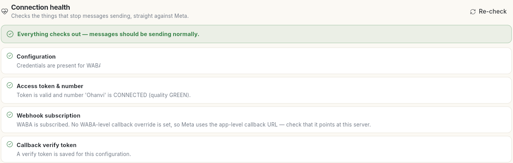
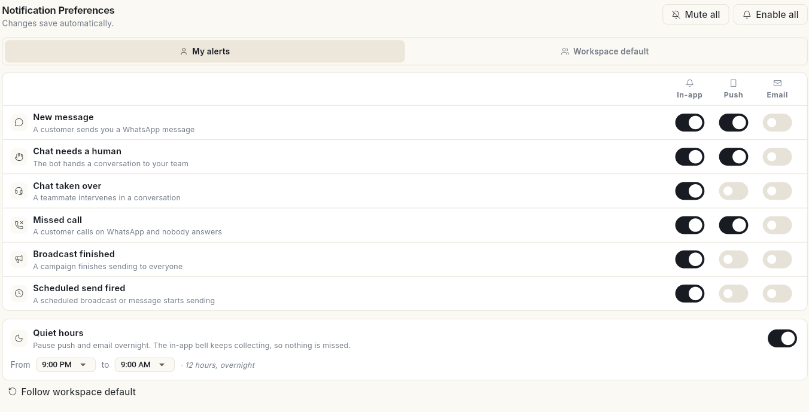
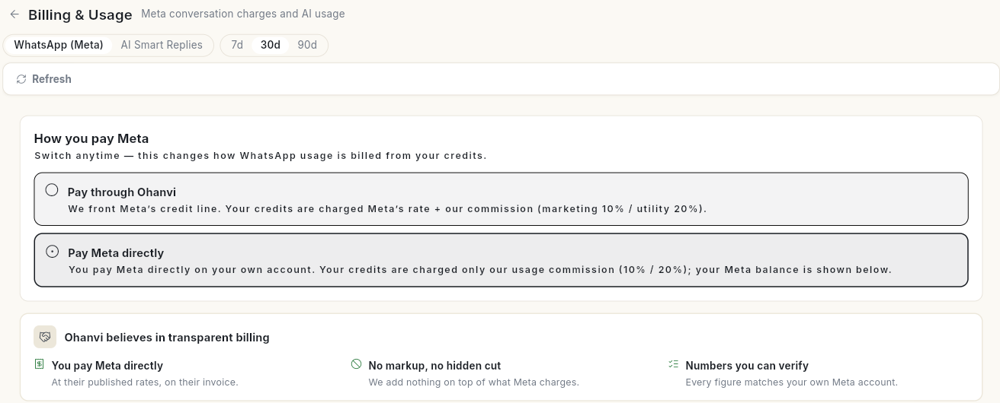

# कनेक्शन की सेहत, अलर्ट और व्हाट्सऐप बिलिंग देखें { #check-connection-health-alerts-and-whatsapp-billing }

तीन व्हाट्सऐप सेटिंग्स अकाउंट को चलता रखती हैं: **Connection Health** जाँचता है कि मैसेज जा सकते हैं, **Notification Preferences** तय करता है कि किन इवेंट पर आपको अलर्ट मिले, और **Billing & Usage** दिखाता है कि आप Meta को भुगतान कैसे करते हैं। अंत में आप जान जाएँगे कि आपका नंबर ठीक है, आपके अलर्ट सेट हैं, और व्हाट्सऐप के इस्तेमाल का बिल कैसे बनता है।

## शुरू करने से पहले { #before-you-start }

- आपका रोल व्हाट्सऐप **Manage** खोल सकता हो। देखें [टीम के सदस्य, रोल और अनुमतियाँ प्रबंधित करें](../settings/roles-and-permissions.md)।

## चरण { #steps }

### कनेक्शन की सेहत जाँचें { #check-connection-health }

1. बाएँ रेल में **WhatsApp** खोलें, **Manage** चुनें, फिर **Connection Health**।
2. ऊपर का नतीजा पढ़ें। **Everything checks out — messages should be sending normally.** का मतलब है कि सब ठीक है।
3. हर जाँच पढ़ें: **Configuration**, **Access token & number** (आपके नंबर की क्वालिटी के साथ), **Webhook subscription** और **Callback verify token**।
4. कुछ ठीक करने के बाद **Re-check** पर क्लिक करें।

### अपने व्हाट्सऐप अलर्ट चुनें { #choose-your-whatsapp-alerts }

1. **Manage** में **Notification Preferences** चुनें। बदलाव अपने आप सेव हो जाते हैं।
2. अपने अलर्ट सेट करने के लिए **My alerts** चुना रहने दें। **Workspace default** में पूरे वर्कस्पेस के डिफ़ॉल्ट होते हैं।
3. हर इवेंट के लिए **In-app**, **Push** और **Email** को चालू या बंद करें:

    | इवेंट | यह कब चलता है |
    | --- | --- |
    | **New message** | कोई ग्राहक आपको व्हाट्सऐप मैसेज भेजता है। |
    | **Chat needs a human** | बॉट किसी बातचीत को आपकी टीम को सौंप देता है। |
    | **Chat taken over** | टीम का कोई सदस्य किसी बातचीत में दखल देता है। |
    | **Missed call** | कोई ग्राहक व्हाट्सऐप पर कॉल करता है और कोई जवाब नहीं देता। |
    | **Broadcast finished** | कोई कैंपेन सभी को भेजना पूरा कर लेता है। |
    | **Scheduled send fired** | कोई शेड्यूल किया गया ब्रॉडकास्ट या मैसेज भेजना शुरू करता है। |

4. वैकल्पिक: **Quiet hours** चालू करें और **From** तथा **to** चुनें, जैसे रात 9:00 बजे से सुबह 9:00 बजे तक। पुश और ईमेल रात भर रुके रहते हैं; ऐप के अंदर की घंटी जमा करती रहती है, इसलिए कुछ छूटता नहीं।
5. सभी स्विच एक साथ बदलने के लिए **Mute all** या **Enable all** इस्तेमाल करें, या डिफ़ॉल्ट पर लौटने के लिए **Follow workspace default**।

Ohanvi के बाकी हिस्सों के नोटिफ़िकेशन के लिए देखें [चुनें कि नोटिफ़िकेशन आप तक कैसे पहुँचें](../settings/notification-preferences.md)।

### देखें कि आप Meta को भुगतान कैसे करते हैं { #see-how-you-pay-meta }

1. **Manage** में **Billing & Usage** चुनें।
2. **WhatsApp (Meta)** या **AI Smart Replies** चुनें, और अवधि चुनें: **7d**, **30d** या **90d**।
3. **How you pay Meta** के नीचे देखें कि कौन-सा विकल्प चुना है:
    - **Pay through Ohanvi**: Ohanvi Meta की क्रेडिट लाइन आगे से भरता है। आपके क्रेडिट से Meta की दर और Ohanvi का कमीशन कटता है।
    - **Pay Meta directly**: आप अपने अकाउंट से सीधे Meta को भुगतान करते हैं। आपके क्रेडिट से सिर्फ़ Ohanvi का इस्तेमाल कमीशन कटता है।

    आप कभी भी बदल सकते हैं। इससे बदलता है कि व्हाट्सऐप के इस्तेमाल का बिल आपके क्रेडिट से कैसे बनता है।

4. **Billable messages** और **By category** तथा **By pricing type** के बँटवारे के लिए नीचे स्क्रोल करें।

अपने Ohanvi क्रेडिट और टॉप-अप के लिए देखें [क्रेडिट और बिलिंग](../credits-and-billing.md)।

## वीडियो वॉकथ्रू { #video-walkthrough }

[VIDEO]

## संबंधित गाइड { #related }

- [अपना व्हाट्सऐप नंबर कनेक्ट करें](connect-whatsapp-number.md)
- [वेबहुक और इंटीग्रेशन](whatsapp-webhooks-and-integrations.md)
- [क्रेडिट और बिलिंग](../credits-and-billing.md)
