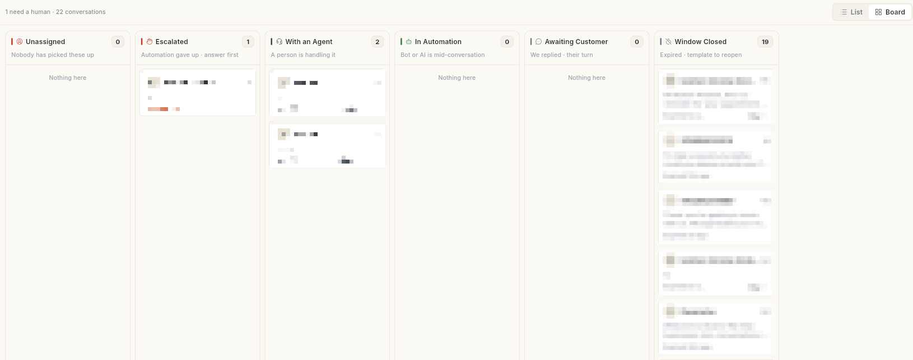

# WhatsApp { #whatsapp }

यहाँ आप अपना बिज़नेस नंबर कनेक्ट करते हैं और शेयर्ड Inbox में ग्राहकों को जवाब देते हैं। मंज़ूर Template मैसेज और Broadcast भी यहीं से भेजते हैं। प्रोडक्ट Catalog, Click-to-WhatsApp ऐड और आपकी तरफ़ से जवाब देने वाला AI एजेंट भी यहीं चलता है।

## यह कहाँ मिलेगा { #where-to-find-it }

लेफ़्ट रेल में **WhatsApp** खोलें। पैनल में एक ही लिस्ट दिखती है। इसे लाइनों से 3 हिस्सों में बाँटा गया है:

| हिस्सा | पैनल के आइटम |
| --- | --- |
| बात करें और भेजें | **Dashboard**, **Inbox**, **Campaign**, **Ads Manager** |
| बनाएँ | **Template**, **Flows** |
| मैनेज करें | **Contact**, **AI Agent**, **Catalog**, **Manage** |

सेटअप वाली स्क्रीन पैनल में नहीं हैं। नीचे बाईं तरफ़ अपने नाम के पहले अक्षर पर क्लिक करें, फिर **Settings** → **WhatsApp** चुनें। **Setup** ग्रुप में **Configuration**, **Business Profile**, **Webhooks**, **Developer API**, **BUSY** और **Migrate to Ohanvi** मिलेंगे।

**Manage** पर क्लिक करने से उसकी अपनी लिस्ट खुलती है। उसमें **Opt-in Management**, **Live Chat Settings**, **Canned Messages**, **Agents**, **Tags**, **Scheduler** और **Delivery Logs** शामिल हैं।

WhatsApp Executive रोल वाले यूज़र को सिर्फ़ **Inbox** दिखता है।

## शुरू करने से पहले { #before-you-start }

- आपके पास WhatsApp बिज़नेस नंबर होना चाहिए, और अपने Meta Business Manager का एडमिन एक्सेस भी। इसे वेब ऐप से कनेक्ट करें — मोबाइल पर Facebook की विंडो नहीं खुलती।
- आपके रोल के पास WhatsApp का एक्सेस होना चाहिए। पैनल के हर आइटम की अपनी अनुमति होती है।
- आपके पास क्रेडिट होने चाहिए। Template मैसेज और AI के जवाब में क्रेडिट लगते हैं। देखें [क्रेडिट और बिलिंग](../credits-and-billing.md)।

## सेटअप { #set-up }

पहली बार इन्हें इसी क्रम में करें।

| गाइड | कब काम आएगी |
| --- | --- |
| [अपना WhatsApp नंबर कनेक्ट करें](connect-whatsapp-number.md) | आप पहली बार WhatsApp सेट कर रहे हैं। |
| [कई WhatsApp नंबर चलाएँ](run-multiple-whatsapp-numbers.md) | आप एक से ज़्यादा नंबर चाहते हैं, हर नंबर का अपना लेबल और बैज। |
| [अपना WhatsApp नंबर Ohanvi पर लाएँ](migrate-to-ohanvi.md) | आपका नंबर अभी किसी दूसरे प्रोवाइडर के पास है। |
| [अपनी WhatsApp बिज़नेस प्रोफ़ाइल सेट करें](whatsapp-business-profile.md) | आप चाहते हैं कि ग्राहक आपका लोगो, जानकारी और पता देखें। |
| [WhatsApp एजेंट जोड़ें](add-whatsapp-agents.md) | आपकी टीम चैट का जवाब देगी। |
| [WhatsApp कॉन्टैक्ट मैनेज करें](manage-whatsapp-contacts.md) | आप कॉन्टैक्ट जोड़ना चाहते हैं, या opt-in और opt-out संभालना चाहते हैं। |

## ग्राहकों से बात करें { #talk-to-customers }

| गाइड | कब काम आएगी |
| --- | --- |
| [WhatsApp Inbox का इस्तेमाल करें](use-whatsapp-inbox.md) | आप चैट का जवाब दे रहे हैं, उन्हें असाइन कर रहे हैं या बंद कर रहे हैं। |
| [WhatsApp AI एजेंट सेट करें](set-up-ai-agent.md) | आप चाहते हैं कि AI आम सवालों के जवाब दे और ज़रूरत पड़ने पर चैट आपकी टीम को दे दे। |
| [WhatsApp चैटबॉट Flow बनाएँ](../create-whatsapp-flow.md) | आप बटन और सवालों वाला चैटबॉट चाहते हैं, जो ग्राहक को स्टेप-दर-स्टेप आगे ले जाए। |

## मैसेज भेजें { #send-messages }

| गाइड | कब काम आएगी |
| --- | --- |
| [WhatsApp मैसेज Template बनाएँ](create-message-template.md) | मैसेज भेजने से पहले उसे Meta से मंज़ूर करवाना है। |
| [WhatsApp Broadcast Campaign भेजें](send-broadcast-campaign.md) | आप कॉन्टैक्ट के एक ग्रुप को अभी या बाद में मैसेज भेजना चाहते हैं। |
| [WhatsApp Campaign रिपोर्ट पढ़ें](read-campaign-report.md) | आप देखना चाहते हैं कि Campaign किसे मिला, किसने पढ़ा और किसे नहीं पहुँचा। |
| [WhatsApp Dashboard पढ़ें](whatsapp-dashboard.md) | आप अपने भेजने वाले नंबर, लिमिट और क्वालिटी रेटिंग देखना चाहते हैं। |

## बेचें और बढ़ें { #sell-and-grow }

| गाइड | कब काम आएगी |
| --- | --- |
| [अपना WhatsApp Catalog सेट करें](set-up-whatsapp-catalog.md) | आप चैट में प्रोडक्ट भेजना चाहते हैं। |
| [Click-to-WhatsApp ऐड चलाएँ](click-to-whatsapp-ads.md) | आप ऐसे Meta ऐड चाहते हैं जिन पर क्लिक करने से आपके साथ चैट खुले। |
| [WhatsApp वेबहुक और इंटीग्रेशन सेट करें](whatsapp-webhooks-and-integrations.md) | आप Meta का वेबहुक, डेवलपर API key या BUSY कनेक्ट कर रहे हैं। |

## जुड़ी गाइड { #related }

- [Flows](../flows/index.md) — चैटबॉट, ऑटोमेशन और स्टोर के मैसेज।
- [एनालिटिक्स](../analytics/index.md) — Broadcast और स्टोर का प्रदर्शन।
- [CRM और कॉन्टैक्ट](../crm/index.md)
- [शेड्यूल](../schedule/index.md) — शेड्यूल किए गए Broadcast बाकी सब चीज़ों के साथ देखें।
