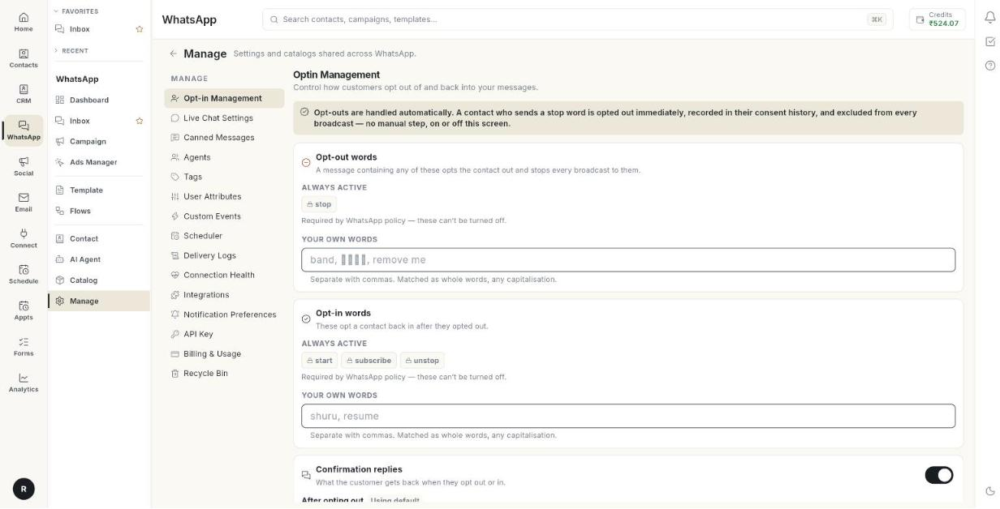

# ऑप्ट-इन और ऑप्ट-आउट शब्द प्रबंधित करें { #manage-opt-in-and-opt-out-words }

ऑप्ट-इन प्रबंधन तय करता है कि कौन-से शब्द आपके संदेश रोकते हैं और कौन-से उन्हें फिर शुरू करते हैं। आख़िर में ग्राहक अपनी भाषा में ऑप्ट-आउट कर सकते हैं, और ऐसा करने पर उन्हें साफ़ जवाब मिलता है। ऑप्ट-आउट हमेशा आपके लिए अपने-आप संभाले जाते हैं। यह पेज सिर्फ़ और शब्द जोड़ने देता है। ऑप्ट-आउट शब्द पहले नंबर के कॉन्फ़िगरेशन में सेट होते थे। अब वे सिर्फ़ यहीं रहते हैं।

## शुरू करने से पहले { #before-you-start }

- आपका व्हाट्सऐप नंबर Ohanvi से कनेक्ट हो। देखें [अपना व्हाट्सऐप नंबर कनेक्ट करें](connect-whatsapp-number.md)।
- आप **WhatsApp** पैनल में **Manage** खोल सकते हों। न दिखे तो अपने एडमिन से पूछें।
- आपको पता हो कि आपके ग्राहक कौन-से शब्द इस्तेमाल करते हैं, जैसे हिंदी में या आपके ब्रांड के अपने वाक्यांश में।

## ऑप्ट-आउट कैसे काम करता है { #how-opt-out-works }

जब कोई ग्राहक स्टॉप शब्द भेजता है, तो Ohanvi ये काम एक साथ करता है, किसी मैन्युअल चरण के बिना:

- संपर्क को ऑप्ट-आउट कर देता है।
- बदलाव को संपर्क की सहमति की हिस्ट्री में दर्ज करता है।
- संपर्क को हर ब्रॉडकास्ट से बाहर रखता है।

व्हाट्सऐप की पॉलिसी यह माँगती है, इसलिए बने-बनाए शब्द हमेशा चालू रहते हैं। वे **ALWAYS ACTIVE** दिखते हैं और बंद नहीं किए जा सकते। आपके अपने शब्द उनमें सिर्फ़ जुड़ते हैं।

## चरण { #steps }

### ऑप्ट-इन प्रबंधन खोलें { #open-opt-in-management }

1. लेफ़्ट रेल में **WhatsApp** खोलें, फिर **Manage** चुनें।
2. **Opt-in Management** चुनें। पेज का टाइटल **Optin Management** होता है।

    

### अपने ऑप्ट-आउट शब्द जोड़ें { #add-your-own-opt-out-words }

1. **Opt-out words** कार्ड खोजें। यह **ALWAYS ACTIVE** के नीचे बने-बनाए शब्द दिखाता है।
2. **YOUR OWN WORDS** के नीचे वाले बॉक्स पर क्लिक करें।
3. अपने शब्द कॉमा से अलग करके लिखें। जैसे: `band, रोको, remove me`
4. **Save changes** पर क्लिक करें। संदेश **Opt-in settings saved.** दिखता है।

शब्दों के नियम:

- शब्दों को कॉमा से अलग करें।
- शब्द सिर्फ़ पूरे शब्द के रूप में मेल खाता है।
- कैपिटल या छोटे अक्षर से फ़र्क नहीं पड़ता।

### अपने ऑप्ट-इन शब्द जोड़ें { #add-your-own-opt-in-words }

1. **Opt-in words** कार्ड खोजें। इसमें लिखा है कि ये शब्द ऑप्ट-आउट कर चुके संपर्क को वापस ऑप्ट-इन करते हैं।
2. **YOUR OWN WORDS** के नीचे वाले बॉक्स पर क्लिक करें।
3. अपने शब्द कॉमा से अलग करके लिखें। जैसे: `shuru, resume`
4. **Save changes** पर क्लिक करें।

### कन्फ़र्मेशन जवाब एडिट करें { #edit-the-confirmation-replies }

1. **Confirmation replies** कार्ड खोजें। उसका स्विच चालू रखें।
2. **After opting out** में वह जवाब लिखें जो ग्राहक को ऑप्ट-आउट करने पर मिलता है।
3. **After opting back in** में वह जवाब लिखें जो ग्राहक को वापस ऑप्ट-इन करने पर मिलता है।
4. मानक शब्दों का इस्तेमाल करने के लिए बॉक्स खाली छोड़ें। तब कार्ड पर **Using default** दिखता है।
5. **Save changes** पर क्लिक करें।

!!! warning "कन्फ़र्मेशन जवाब चालू रखें"
    अगर आप स्विच बंद करते हैं, तो ऑप्ट-आउट फिर भी होता है, पर ग्राहक को कोई जवाब नहीं मिलता। इससे ऐसा लग सकता है कि उसे अनदेखा किया गया। इससे ब्लॉक हो सकते हैं और आपके नंबर की क्वालिटी रेटिंग गिर सकती है।

### आख़िरी सेव की हुई सेटिंग्स दोबारा लोड करें { #reload-your-last-saved-settings }

1. **Reload** पर क्लिक करें। पेज आख़िरी सेव किए हुए शब्द और जवाब दिखाता है।

## समस्या का समाधान { #troubleshooting }

| समस्या | कारण | समाधान |
| --- | --- | --- |
| **No WhatsApp account is connected yet.** | इस वर्कस्पेस से कोई नंबर जुड़ा नहीं है। | एक नंबर कनेक्ट करें। देखें [अपना व्हाट्सऐप नंबर कनेक्ट करें](connect-whatsapp-number.md)। |
| **Could not save opt-in settings.** | सेव का अनुरोध फ़ेल हो गया। | अपना कनेक्शन जाँचें, फिर दोबारा **Save changes** पर क्लिक करें। |
| ग्राहक का ऑप्ट-आउट शब्द काम नहीं करता | शब्द किसी लंबे शब्द का हिस्सा है, या सूची में नहीं है। | ठीक वही शब्द जोड़ें। शब्द पूरे शब्द के रूप में मेल खाते हैं। |
| बने-बनाए शब्द आपकी सूची में नहीं दिख रहा | बने-बनाए शब्द **ALWAYS ACTIVE** के नीचे दिखते हैं, आपके अपने बॉक्स में नहीं। | **YOUR OWN WORDS** में सिर्फ़ अतिरिक्त शब्द जोड़ें। |

## संबंधित गाइड { #related }

- [व्हाट्सऐप संपर्क प्रबंधित करें](manage-whatsapp-contacts.md)
- [व्हाट्सऐप ब्रॉडकास्ट कैंपेन भेजें](send-broadcast-campaign.md)
- [कनेक्शन की सेहत जाँचें](check-connection-health.md)
