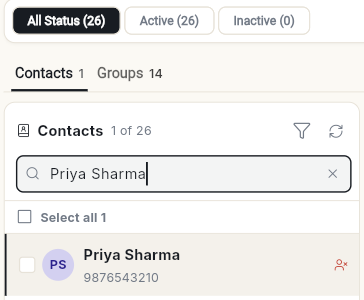
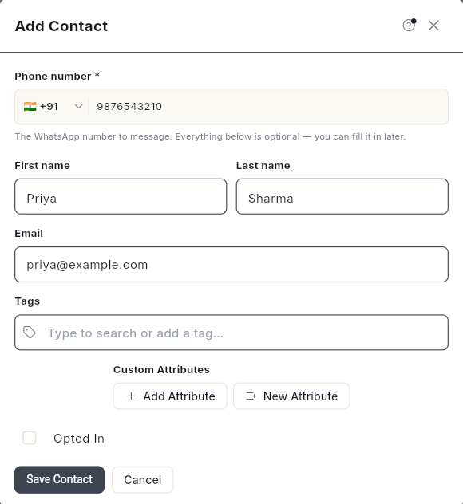
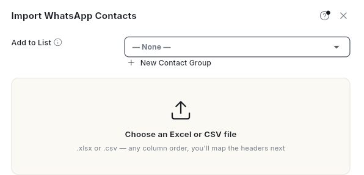
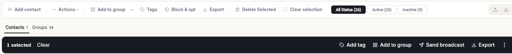
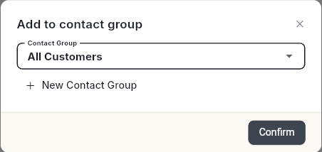
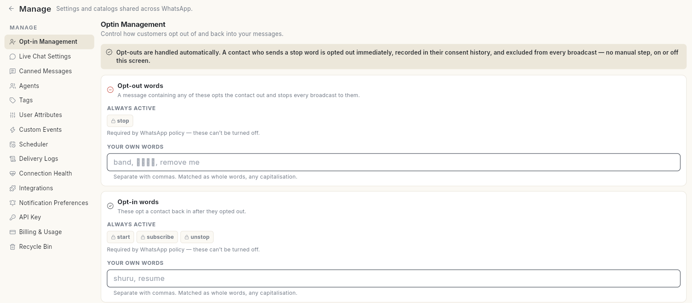

# WhatsApp कॉन्टैक्ट मैनेज करें { #manage-whatsapp-contacts }

अपनी WhatsApp ऑडियंस बनाएँ और उनकी सहमति (consent) अपडेट रखें। इस पेज के आख़िर तक आप कॉन्टैक्ट जोड़ना या इम्पोर्ट करना, उन्हें ग्रुप और टैग करना, ऑप्ट-इन या ऑप्ट-आउट करना सीख जाएँगे। साथ ही वे अतिरिक्त शब्द भी सेट कर पाएँगे जिन्हें भेजकर ग्राहक आपके मैसेज बंद करवा सकते हैं।

## शुरू करने से पहले { #before-you-start }

- **WhatsApp** पैनल में आपको **Contact** दिखना चाहिए। न दिखे तो अपने एडमिन से पूछें। देखें [टीम के मेंबर, रोल और अनुमतियाँ मैनेज करें](../settings/roles-and-permissions.md)।
- इम्पोर्ट करना हो, तो आपके पास फ़ोन नंबर वाले कॉलम की CSV या Excel फ़ाइल होनी चाहिए।
- CRM के कॉन्टैक्ट रिकॉर्ड, डील और एक्टिविटी के लिए देखें [CRM ओवरव्यू](../crm/index.md)।

## स्टेप { #steps }

### अपने कॉन्टैक्ट खोलें { #open-your-contacts }

1. लेफ़्ट रेल में **WhatsApp** खोलें, फिर **Contact** चुनें। **Contacts** स्क्रीन खुलेगी।
2. सबसे ऊपर की रो स्टेटस से फ़िल्टर करती है: **All Status**, **Active** और **Inactive**, हर एक के साथ उसकी गिनती दिखती है। उसके नीचे **Contacts** और **Groups** टैब हैं, जिनमें दिखता है कि आपके पास हर एक में कितने हैं।

    

3. किसी को ढूँढने के लिए **Search name, phone or email…** में टाइप करें। किसी रो पर क्लिक करें, तो दाईं ओर उस कॉन्टैक्ट की जानकारी खुलती है। इसमें ये सेक्शन हैं: **Identity**, **Messaging**, **Custom Attributes**, **Activity** और **Record**।

### कॉन्टैक्ट जोड़ें { #add-a-contact }

1. ऊपर दाईं ओर **Add contact** पर क्लिक करें। **Add Contact** खुलेगा।
2. **Phone number \*** में देश चुनें और नंबर लिखें। बाकी सब ज़रूरी नहीं है।
3. **First name**, **Last name** और **Email** आपके पास हों तो भर दें। आप **Tags** और **Custom Attributes** भी जोड़ सकते हैं।
4. **Opted In** पर टिक तभी लगाएँ जब उस व्यक्ति ने आपके मैसेज पाने के लिए हाँ कहा हो। यह पहले से बंद रहता है।

    

5. **Save Contact** पर क्लिक करें। कॉन्टैक्ट लिस्ट में जुड़ जाएगा। उसे ढूँढने के लिए नाम सर्च करें।

### कॉन्टैक्ट इम्पोर्ट करें { #import-contacts }

1. ऊपर दाईं ओर **Import** (अपलोड) आइकन पर क्लिक करें। **Import WhatsApp Contacts** खुलेगा।

    

2. सबसे ऊपर **Add to List** में कोई कॉन्टैक्ट ग्रुप चुनें। ग्रुप न चुनना हो, तो **— None —** रहने दें। तब कॉन्टैक्ट **Business Contact** ग्रुप में जाएँगे। नया ग्रुप बनाने के लिए **New Contact Group** पर क्लिक करें।
3. टेम्प्लेट चाहिए तो **Download Sample CSV** पर क्लिक करें।
4. **Choose an Excel or CSV file** पर क्लिक करके अपनी फ़ाइल चुनें। फ़ाइल `.xlsx` या `.csv` हो सकती है, और कॉलम किसी भी क्रम में हो सकते हैं।
5. **Header identifiers** में हर फ़ील्ड के लिए अपनी फ़ाइल का कॉलम चुनें, जैसे **Phone Number** और **First Name**।
6. **Options** में **Default Country Code** सेट करें। यह उन नंबरों के लिए है जिनमें कोड नहीं है। फ़ाइल के टैग से पुराने टैग बदलने हों, तो **Replace Tags** चालू करें।
7. **Import** पर क्लिक करें। काम पूरा होने पर **Import complete** दिखेगा।

अगर कोई फ़ोन नंबर पहले से मौजूद है, तो वह उसी कॉन्टैक्ट में जुड़ जाता है। जिस रो में फ़ोन नंबर नहीं है, वह छूट जाती है। पुराने इम्पोर्ट देखने के लिए **Import history** पर क्लिक करें।

इम्पोर्ट करके तुरंत कैंपेन भेजना हो, तो इसकी जगह **Import and broadcast** चुनें।

### कॉन्टैक्ट इम्पोर्ट करें और उन्हें ब्रॉडकास्ट भेजें { #import-contacts-and-broadcast-to-them }

यह तब काम आता है जब आप फ़ाइल के लोगों को तुरंत मैसेज भेजना चाहते हैं। फ़ाइल इम्पोर्ट करने का तरीका वही है, बस कॉन्टैक्ट ग्रुप चुनना ज़रूरी है।

1. ऊपर **Actions** पर क्लिक करें, फिर **Import and Broadcast** चुनें। आप **Import** आइकन पर राइट-क्लिक करके **Import and broadcast** भी चुन सकते हैं। **Import WhatsApp Contacts** खुलेगा।
2. **Add to List** में कोई कॉन्टैक्ट ग्रुप चुनें। नीचे हेल्प टेक्स्ट में लिखा है **The contact group these contacts will be broadcast to.** यहाँ **— None —** का विकल्प नहीं है।
3. ग्रुप अभी बना न हो, तो **New Contact Group** पर क्लिक करें।
4. **Choose an Excel or CSV file** पर क्लिक करके अपनी फ़ाइल चुनें।
5. **Header identifiers** में हर फ़ील्ड का कॉलम चुनें, जैसे ऊपर **Import contacts** में बताया है।
6. **Import** पर क्लिक करें। काम पूरा होने पर **Import complete** दिखेगा।
7. यह मैसेज पढ़ें: **Contacts imported — pick that group in the Audience step to broadcast to them.** इसके बाद **Campaign** बनाने की स्क्रीन खुलेगी।
8. **Audience** स्टेप में वही ग्रुप चुनें जो आपने स्टेप 2 में चुना था। इसके बाद [WhatsApp ब्रॉडकास्ट कैंपेन भेजें](send-broadcast-campaign.md) में बताए तरीके से आगे बढ़ें।

!!! warning "पहले ऑप्ट-इन देख लें"
    मैसेज सिर्फ़ उन्हीं को भेजें जिन्होंने आपके मैसेज पाने की हाँ कही है। नीचे देखें [कॉन्टैक्ट्स को ऑप्ट-इन या ऑप्ट-आउट करें](#opt-contacts-in-or-out)।

### इम्पोर्ट हिस्ट्री देखें { #read-the-import-history }

1. ऊपर **Actions** पर क्लिक करें, फिर **Import History** चुनें। आप **Import** आइकन पर राइट-क्लिक करके **Import history** भी चुन सकते हैं। **Import History** विंडो खुलेगी।
2. लिस्ट पढ़ें। सबसे नया इम्पोर्ट सबसे ऊपर होता है। हर रो में **Date**, **Status**, **Total**, **Imported**, **Failed** और **Details** दिखते हैं।
3. **Failed** देखें। 0 से ज़्यादा संख्या लाल रंग में दिखती है। **Details** बताता है कि वे रो क्यों फ़ेल हुईं। कुछ फ़ेल न हुआ हो, तो यहाँ **—** दिखता है।
4. देख लेने के बाद क्लोज़ आइकन पर क्लिक करें।

यह विंडो सिर्फ़ कॉन्टैक्ट फ़ाइल के इम्पोर्ट दिखाती है। कोई इम्पोर्ट न हुआ हो, तो इसमें **No imports yet** लिखा होता है।

### कॉन्टैक्ट्स को ग्रुप और टैग करें { #group-and-tag-contacts }

1. जिन कॉन्टैक्ट्स को चुनना है, उन पर टिक लगाएँ। एक गहरे रंग की बार आएगी। उसमें चुने हुए कॉन्टैक्ट्स के लिए **Add tag**, **Add to group**, **Send broadcast** और **Export** होते हैं।

    

2. **Add to group** पर क्लिक करें। **Add to contact group** खुलेगा। **Contact Group** में कोई ग्रुप चुनें, या **New Contact Group** पर क्लिक करें। फिर **Confirm** पर क्लिक करें।

    

    किसी कॉन्टैक्ट को ग्रुप से निकालना हो, तो कॉन्टैक्ट पर क्लिक करें। फिर दाईं ओर **Groups** के पास **Remove…** पर क्लिक करें। यह मैसेज आएगा: **Removed 1 contact from "All Customers".** इसमें आपके ग्रुप का नाम होगा।

3. **Tags** पर क्लिक करें, **Type to search or add a tag…** में टाइप करें, फिर **Add Tags** पर क्लिक करें।

ग्रुप बनाने या बदलने के लिए **Contact Groups** पर क्लिक करें, या **Groups** टैब खोलें। ये ग्रुप CRM के साथ साझा रहते हैं। देखें [कॉन्टैक्ट ग्रुप बनाएँ और मैनेज करें](../crm/contact-groups.md)।

### कॉन्टैक्ट्स को ऑप्ट-इन या ऑप्ट-आउट करें { #opt-contacts-in-or-out }

ऑप्ट-आउट हुए कॉन्टैक्ट को आप कोई भी WhatsApp मैसेज नहीं भेज सकते। जब तक वे वापस ऑप्ट-इन न करें, यह रोक रहती है।

एक कॉन्टैक्ट के लिए:

1. कॉन्टैक्ट पर क्लिक करें। उसकी जानकारी दाईं ओर खुलेगी।
2. **Messaging** में **Opted in** को चालू या बंद करें। इसके साथ **Can receive campaigns** या **Campaigns will skip this contact** दिखता है।
3. **Save** पर क्लिक करें।

कई कॉन्टैक्ट्स के लिए:

1. कॉन्टैक्ट्स पर टिक लगाएँ।
2. **Block & opt** पर क्लिक करें। **Opt in/out** खुलेगा।
3. **Opt Out** या **Opt In** पर क्लिक करें।

हर बदलाव कॉन्टैक्ट की **Consent History** में दर्ज होता है। साथ में यह भी लिखा रहता है कि बदलाव कहाँ से हुआ, जैसे STOP/START कीवर्ड, हाथ से किया गया बदलाव या इम्पोर्ट।

### ऑप्ट-आउट और ऑप्ट-इन शब्द सेट करें { #set-opt-out-and-opt-in-words }

जो ग्राहक **stop** भेजता है, वह उसी समय ऑप्ट-आउट हो जाता है और किसी भी ब्रॉडकास्ट में नहीं जाता। वह **start**, **subscribe** या **unstop** भेजे, तो वापस ऑप्ट-इन हो जाता है। ये शब्द हमेशा चालू रहते हैं और इन्हें बंद नहीं किया जा सकता।

1. लेफ़्ट रेल में **WhatsApp** खोलें, फिर **Manage** चुनें।
2. **Opt-in Management** चुनें।

    

3. **Opt-out words** में **Your own words** बॉक्स में अपने शब्द लिखें और हर शब्द के बीच कॉमा लगाएँ। जैसे, आपके ग्राहकों की भाषा के शब्द। ये पूरे शब्द के रूप में मैच होते हैं, और छोटे-बड़े अक्षर से फ़र्क नहीं पड़ता।
4. **Opt-in words** में वे शब्द जोड़ें जिनसे कॉन्टैक्ट वापस ऑप्ट-इन हो जाए।
5. **Confirmation replies** में **After opting out** और **After opting back in** बदलें। स्टैंडर्ड जवाब रखना हो, तो उन्हें खाली छोड़ दें।
6. **Save changes** पर क्लिक करें। **Opt-in settings saved.** मैसेज आएगा।

## वीडियो वॉकथ्रू { #video-walkthrough }

[VIDEO]

## समस्या का समाधान { #troubleshooting }

| समस्या | कारण | समाधान |
| --- | --- | --- |
| **No importable rows found — check the Phone Number column mapping.** | किसी भी कॉलम को **Phone Number** से जोड़ा नहीं गया, या वह कॉलम खाली है। | **Header identifiers** में **Phone Number** के लिए सही कॉलम चुनें। |
| **Could not update opt-in status — try again.** | बदलाव सेव नहीं हुआ। | दोबारा कोशिश करें। बार-बार फ़ेल हो, तो पेज रिफ़्रेश करें। |
| कॉन्टैक्ट पर **Needs attention — invalid number** दिखता है | उसे भेजे गए पिछले 3 ब्रॉडकास्ट सब फ़ेल हुए, और एक भी उस तक नहीं पहुँचा। | देखें कि यह नंबर WhatsApp पर है या नहीं। फिर **Stop sending** या **Keep sending** पर क्लिक करें। |
| कॉन्टैक्ट पर **Needs attention — possibly blocked** दिखता है | पहले उसे मैसेज मिले थे, पर हाल के मैसेज बार-बार फ़ेल हो रहे हैं। WhatsApp कभी नहीं बताता कि ब्लॉक हुआ है। | कॉन्टैक्ट को देखें, फिर **Stop sending** या **Keep sending** पर क्लिक करें। |
| **stop** भेजने वाला ग्राहक अब भी लिस्ट में दिखता है | ऑप्ट-आउट से सिर्फ़ मैसेज बंद होते हैं, कॉन्टैक्ट डिलीट नहीं होता। | यह सामान्य है। उसका स्टेटस **Opted out** दिखता है। |

## जुड़ी गाइड { #related }

- [WhatsApp इनबॉक्स का इस्तेमाल करें](use-whatsapp-inbox.md)
- [कॉन्टैक्ट ग्रुप बनाएँ और मैनेज करें](../crm/contact-groups.md)
- [कॉन्टैक्ट इम्पोर्ट और सिंक करें](../crm/import-and-sync-contacts.md)
- [कॉन्टैक्ट की सहमति ट्रैक करें](../crm/consent-and-compliance.md)
- [कस्टम कॉन्टैक्ट फ़ील्ड जोड़ें](../crm/custom-fields.md)
