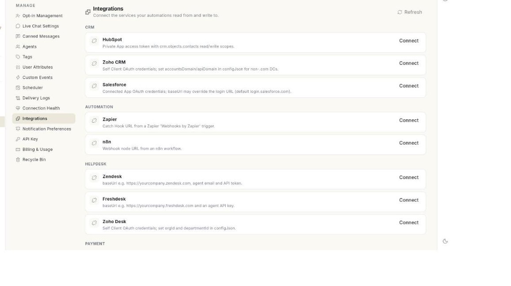

# WhatsApp इंटीग्रेशन मैनेज करें { #manage-whatsapp-integrations }

आपके WhatsApp ऑटोमेशन जिन बाहरी सर्विस का इस्तेमाल करते हैं, उन्हें कनेक्ट करने के लिए **Manage** में **Integrations** खोलें। आख़िर में सर्विस पर **Connected** दिखेगा, आपने उसे टेस्ट कर लिया होगा, और आपको पता होगा कि उसकी जानकारी कैसे बदलनी है या उसे कैसे हटाना है। कनेक्ट करने में करीब 2 मिनट लगते हैं।

## शुरू करने से पहले { #before-you-start }

- आपका रोल WhatsApp **Manage** खोल पाता हो। न खोल पाए तो अपने एडमिन से पूछें। देखें [टीम के मेंबर, रोल और अनुमतियाँ मैनेज करें](../settings/roles-and-permissions.md)।
- सर्विस जो जानकारी माँगती है, वह आपके पास हो, जैसे key या टोकन। हर सर्विस के कार्ड में सेटअप के लिए एक छोटा हिंट दिखता है।
- आपको पता हो कि यह सर्विस कौन-सा ऑटोमेशन इस्तेमाल करेगा। देखें [फ़्लो के लिए ऐप कनेक्ट करें](../flows/connect-apps-for-flows.md)।

## Integrations स्क्रीन पर क्या दिखता है { #what-the-integrations-screen-shows }

स्क्रीन का टाइटल **Integrations** है। उसके नीचे लिखा है **Connect the services your automations read from and write to.** सर्विस कैटेगरी के हिसाब से बँटी होती हैं। हर कैटेगरी का नाम बड़े अक्षरों में एक हेडिंग में लिखा होता है।

| कार्ड पर आपको क्या दिखता है | इसका मतलब |
| --- | --- |
| **Connected** | सर्विस कनेक्ट है और चालू है। |
| **Paused** | सर्विस कनेक्ट है, पर बंद है। |
| लाल स्टेटस लेबल | पिछली कनेक्शन जाँच में OK नहीं आया। **Test** चलाएँ। |
| **Set up under AI Settings.** | यह सर्विस AI सेटिंग्स स्क्रीन पर सेट होती है। कार्ड पर कोई बटन नहीं होता। |

## स्टेप { #steps }

### कोई सर्विस कनेक्ट करें { #connect-a-service }

1. लेफ़्ट रेल में **WhatsApp** खोलें, फिर **Manage** चुनें।
2. **Integrations** चुनें। सर्विस की लिस्ट खुलेगी।

    

3. अपनी सर्विस ढूँढें। उसके नाम के नीचे लिखा सेटअप हिंट पढ़ें।
4. **Connect** पर क्लिक करें। एक विंडो खुलेगी, जिसके टाइटल में सर्विस का नाम होगा।
5. हर फ़ील्ड भरें। key, secret, टोकन या पासवर्ड के फ़ील्ड में आप जो लिखते हैं, वह छिपा रहता है।
6. विंडो में **This integration needs no credentials — connecting is enough.** लिखा हो, तो कुछ भरना नहीं है।
7. **Save** पर क्लिक करें। **Integration saved.** मैसेज आएगा और कार्ड पर **Connected** दिखेगा।

!!! note "फ़ील्ड के नाम"
    विंडो के फ़ील्ड सर्विस से आते हैं। जैसे `apiKey` नाम का फ़ील्ड **Api key** के रूप में दिखता है।

### कनेक्शन टेस्ट करें { #test-a-connection }

1. ऐसा कार्ड ढूँढें जिस पर **Connected** या **Paused** लिखा हो।
2. **Test** पर क्लिक करें।
3. जो मैसेज आए, उसे पढ़ें। यह सर्विस का अपना जवाब होता है, जैसे key क्यों नहीं मानी गई। सर्विस कोई टेक्स्ट न भेजे, तो मैसेज **Connection test finished.** आता है।
4. इसके बाद कार्ड पर लाल स्टेटस लेबल दिखे, तो **Edit** पर क्लिक करें और जानकारी जाँचें।

### सर्विस की जानकारी बदलें { #change-the-details-of-a-service }

1. कनेक्ट की हुई सर्विस ढूँढें।
2. **Edit** पर क्लिक करें। वही विंडो खुलेगी।
3. नई वैल्यू लिखें।
4. **Save** पर क्लिक करें। **Integration saved.** मैसेज आएगा।

पहले सेव की हुई वैल्यू रखनी हो, तो वह फ़ील्ड खाली छोड़ दें। [VERIFY: क्या खाली फ़ील्ड सेव की हुई वैल्यू रखता है]

### सर्विस हटाएँ { #remove-a-service }

1. कनेक्ट की हुई सर्विस ढूँढें।
2. **Remove** पर क्लिक करें। **Remove this integration?** विंडो खुलेगी।
3. चेतावनी पढ़ें। जो **Automations that depend on** इस सर्विस पर टिके हैं, वे **will stop working until it is connected again.**
4. हटाना पक्का करने के लिए **Remove** पर क्लिक करें, या रखने के लिए **Cancel** पर। **Integration removed.** मैसेज आएगा।

!!! warning "ऑटोमेशन उसी समय रुक जाते हैं"
    हटाने से पहले देख लें कि कौन-से फ़्लो इस सर्विस का इस्तेमाल करते हैं। हटाया हुआ इंटीग्रेशन आप **Recycle Bin** से वापस ला सकते हैं। देखें [डिलीट किए आइटम वापस लाएँ](restore-deleted-items.md)।

### लिस्ट दोबारा लोड करें { #reload-the-list }

1. स्क्रीन पर ऊपर दाईं ओर **Refresh** पर क्लिक करें।
2. लिस्ट लोड न हो, तो स्क्रीन पर **Could not load integrations.** दिखता है। **Retry** पर क्लिक करें।

## समस्या का समाधान { #troubleshooting }

| समस्या | कारण | समाधान |
| --- | --- | --- |
| **Could not save the integration.** | कोई ज़रूरी फ़ील्ड खाली या गलत है, या सर्विस तक पहुँच नहीं हो पाई। | हर फ़ील्ड देखें, फिर दोबारा **Save** पर क्लिक करें। |
| **Could not reach the service.** | टेस्ट कनेक्ट नहीं हो पाया। | अपना इंटरनेट कनेक्शन और उस सर्विस का अपना स्टेटस देखें, फिर दोबारा **Test** पर क्लिक करें। |
| कार्ड पर **Connect** बटन नहीं है और **Set up under AI Settings.** लिखा है | यह सर्विस यहाँ नहीं, AI सेटिंग्स स्क्रीन पर सेट होती है। | AI सेटिंग्स खोलें। देखें [WhatsApp AI एजेंट सेट करें](set-up-ai-agent.md)। |
| कार्ड पर लाल स्टेटस लेबल दिख रहा है | पिछली जाँच फ़ेल हो गई, जैसे key कैंसिल हो गई हो। | वजह पढ़ने के लिए **Test** पर क्लिक करें, फिर जानकारी ठीक करने के लिए **Edit** पर क्लिक करें। |
| **Could not remove the integration.** | इंटीग्रेशन हट नहीं पाया। | **Refresh** पर क्लिक करें, फिर दोबारा **Remove** करें। |
| आपकी ज़रूरत की सर्विस लिस्ट में नहीं है | Ohanvi यहाँ वह सर्विस नहीं देता। | इसकी जगह वेबहुक या API इस्तेमाल करें। देखें [वेबहुक और इंटीग्रेशन](whatsapp-webhooks-and-integrations.md)। |

## जुड़ी गाइड { #related }

- [WhatsApp वेबहुक और इंटीग्रेशन सेट करें](whatsapp-webhooks-and-integrations.md)
- [फ़्लो के लिए ऐप कनेक्ट करें](../flows/connect-apps-for-flows.md)
- [कनेक्टर चुनें](../settings/choose-connectors.md)
- [डिलीट किए आइटम वापस लाएँ](restore-deleted-items.md)
