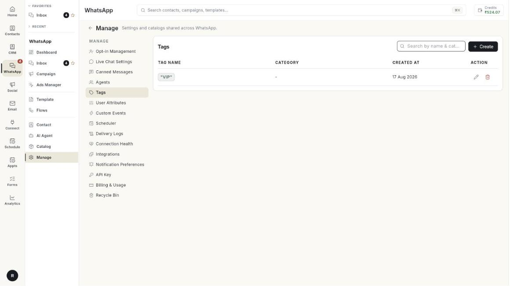

# प्रबंधन { #manage }

Manage में वे सेटिंग्स और सूचियाँ हैं जो व्हाट्सऐप के बाकी हिस्सों को सहारा देती हैं: चैट के नियम, ऑप्ट-इन शब्द, सेव किए जवाब, आपकी टीम, टैग, शेड्यूल, लॉग और बहुत कुछ।

**इसे कहाँ खोजें:** लेफ़्ट रेल में **WhatsApp** खोलें, फिर **Manage** चुनें।

## गाइड { #guides }

| गाइड | कब इस्तेमाल करें |
| --- | --- |
| [ऑप्ट-इन प्रबंधन (Opt-in Management)](../manage-opt-in-and-opt-out-words.md) | आप ऐसे शब्द तय करना चाहते हैं जो लोगों को ऑप्ट-इन या ऑप्ट-आउट करें। |
| [लाइव चैट सेटिंग्स (Live Chat Settings)](../set-up-live-chat-settings.md) | आप ऑटो-रिप्लाई, काम के घंटे और हैंडऑफ़ के नियम चाहते हैं। |
| [तैयार संदेश (Canned Messages)](../create-canned-messages.md) | आप सेव किए हुए जवाब चाहते हैं जिन्हें आपकी टीम / से डाल सके। |
| [एजेंट्स (Agents)](../add-whatsapp-agents.md) | आप टीम के सदस्यों को व्हाट्सऐप में जोड़ना चाहते हैं। |
| [टैग, यूज़र एट्रिब्यूट और कस्टम इवेंट (Tags, User Attributes and Custom Events)](../tags-attributes-and-events.md) | आप संपर्कों को लेबल करना या अतिरिक्त जानकारी सेव करना चाहते हैं। |
| [शेड्यूलर और डिलीवरी लॉग (Scheduler and Delivery Logs)](../scheduler-and-delivery-logs.md) | आप शेड्यूल किए गए मैसेज देखना या डिलीवरी जाँचना चाहते हैं। |
| [कनेक्शन की सेहत (Connection Health)](../check-connection-health.md) | आप जानना चाहते हैं कि आपका नंबर काम कर रहा है या नहीं। |
| [इंटीग्रेशन (Integrations)](../manage-whatsapp-integrations.md) | आप दूसरी सेवाएँ कनेक्ट करना चाहते हैं। |
| [नोटिफ़िकेशन की पसंद (Notification Preferences)](../set-notification-preferences.md) | आप चुनना चाहते हैं कि व्हाट्सऐप के किन इवेंट पर आपको नोटिफ़िकेशन मिले। |
| [API Key और Cloud API एक्सेस (API Key and Cloud API access)](../get-cloud-api-access.md) | आपको अपना नंबर Meta Cloud API से जोड़ने में मदद चाहिए। |
| [बिलिंग और इस्तेमाल (Billing and Usage)](../read-billing-and-usage.md) | आप देखना चाहते हैं कि Meta क्या चार्ज करता है। |
| [सेहत, अलर्ट और बिलिंग (Health, alerts and billing)](../health-notifications-and-billing.md) | आप सेहत, अलर्ट और बिलिंग का एक ही ओवरव्यू चाहते हैं। |
| [मीडिया लाइब्रेरी (Media Library)](../manage-media-library.md) | आप देखना चाहते हैं कि आपका अकाउंट कौन सा मीडिया रखता है, या जगह खाली करना चाहते हैं। |
| [रीसायकल बिन (Recycle Bin)](../restore-deleted-items.md) | आपने कुछ डिलीट कर दिया और उसे वापस चाहते हैं। |

## शुरू करने से पहले { #before-you-start }

- आपका व्हाट्सऐप नंबर Ohanvi से कनेक्ट है। देखें [अपना व्हाट्सऐप नंबर कनेक्ट करें](../connect-whatsapp-number.md)।
- आपके रोल के पास इस स्क्रीन का एक्सेस है। अगर यह नहीं दिखती, तो अपने एडमिन से पूछें।
