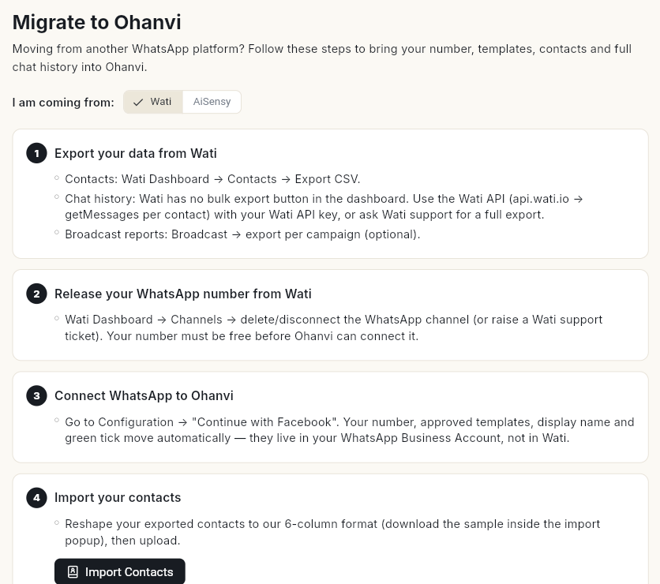

# अपना WhatsApp नंबर Ohanvi पर लाएँ { #move-your-whatsapp-number-to-ohanvi }

किसी दूसरे WhatsApp प्लेटफ़ॉर्म से अपना WhatsApp बिज़नेस नंबर, कॉन्टैक्ट और चैट हिस्ट्री Ohanvi में ले आएँ। काम पूरा होने पर आपका नंबर Ohanvi से मैसेज भेजेगा, आपके कॉन्टैक्ट और पुरानी चैट इम्पोर्ट हो चुकी होंगी, और टेस्ट का जवाब इनबॉक्स में दिखेगा।

## शुरू करने से पहले { #before-you-start }

- आपका रोल **Migrate to Ohanvi** खोल पाता हो। यह एडमिन स्क्रीन है। देखें [टीम के मेंबर, रोल और अनुमतियाँ मैनेज करें](../settings/roles-and-permissions.md)।
- आप अपने पुराने प्रोवाइडर के डैशबोर्ड में लॉगिन कर पाते हों। साथ ही Facebook में Meta Business Manager के एडमिन के तौर पर भी लॉगिन कर पाते हों।
- आपने पुराने प्रोवाइडर से अपने कॉन्टैक्ट और चैट हिस्ट्री एक्सपोर्ट कर ली हो, या कर सकते हों।

## स्टेप { #steps }

### माइग्रेशन गाइड खोलें { #open-the-migration-guide }

1. नीचे बाएँ कोने में अपने नाम के पहले अक्षर पर क्लिक करें, फिर **Settings** पर क्लिक करें।
2. **WhatsApp** चुनें, फिर **Migrate to Ohanvi** चुनें। स्क्रीन पर 6 स्टेप दिखते हैं।
3. **I am coming from:** के बगल में अपना मौजूदा प्लेटफ़ॉर्म चुनें, **Wati** या **AiSensy**। चुनते ही स्टेप उसके हिसाब से बदल जाते हैं।

    

### क्या अपने-आप आ जाता है { #what-moves-on-its-own }

आपका नंबर, मंज़ूर हो चुके टेम्प्लेट, डिस्प्ले नाम और ग्रीन टिक आपके WhatsApp Business Account के हैं। वे पुराने प्रोवाइडर के नहीं हैं। इसलिए नंबर कनेक्ट करते ही ये सब साथ आ जाते हैं। कॉन्टैक्ट और चैट हिस्ट्री पुराने प्रोवाइडर के सर्वर पर रहती हैं, इसलिए इन्हें आपको खुद इम्पोर्ट करना होगा। कैंपेन, एनालिटिक्स और बॉट फ़्लो माइग्रेट नहीं हो सकते। इन्हें Ohanvi में दोबारा बनाएँ।

### नंबर ले आएँ { #move-the-number }

1. पुराने प्लेटफ़ॉर्म से **अपना डेटा एक्सपोर्ट करें**। कॉन्टैक्ट को CSV फ़ाइल में एक्सपोर्ट करें। चैट हिस्ट्री के लिए स्क्रीन पर आपके प्लेटफ़ॉर्म का जो नोट दिया है, उसे पढ़ें। कुछ प्लेटफ़ॉर्म पर इसके लिए सपोर्ट को रिक्वेस्ट भेजनी पड़ती है।
2. पुराने प्लेटफ़ॉर्म से **अपना WhatsApp नंबर रिलीज़ करें**। वहाँ WhatsApp चैनल डिलीट या डिस्कनेक्ट करें, या उनके सपोर्ट से नंबर रिलीज़ करने को कहें।
3. **WhatsApp को Ohanvi से कनेक्ट करें।** **Configuration** में जाएँ और **Continue with Facebook** का इस्तेमाल करें। देखें [अपना WhatsApp नंबर कनेक्ट करें](connect-whatsapp-number.md)।

!!! warning "पहले नंबर रिलीज़ करें"
    Ohanvi नंबर कनेक्ट करे, इससे पहले नंबर खाली होना चाहिए। जब तक पुराना प्लेटफ़ॉर्म नंबर रिलीज़ नहीं करता, कनेक्शन फ़ेल होता रहेगा।

### कॉन्टैक्ट और चैट हिस्ट्री इम्पोर्ट करें { #import-contacts-and-chat-history }

1. अपनी कॉन्टैक्ट फ़ाइल को 6 कॉलम वाले फ़ॉर्मैट में बदलें: **Phone Number**, **First Name**, **Last Name**, **Email**, **Country Code**, **Tags**।
2. **Import your contacts** के नीचे **Import Contacts** पर क्लिक करें। **WhatsApp Contacts** अपलोड खुल जाता है। टेम्प्लेट चाहिए तो वहीं से सैंपल CSV डाउनलोड करें।
3. अपनी फ़ाइल अपलोड करें। सिर्फ़ .xlsx, .xls और .csv फ़ाइलें चलती हैं।
4. अपने चैट एक्सपोर्ट को इन कॉलम में बदलें: **Phone Number**, **Sender Name**, **Direction**, **Message Type**, **Message Text**, **Timestamp**। **Direction** में **incoming** या **outgoing** लिखें।
5. **Import your chat history** के नीचे **Import Chat History** पर क्लिक करें, फिर फ़ाइल अपलोड करें।

जो कॉन्टैक्ट आपकी लिस्ट में नहीं हैं, Ohanvi उन्हें चैट फ़ाइल से बना देता है। वही फ़ाइल दोबारा अपलोड करने में कोई दिक्कत नहीं है। डुप्लिकेट छोड़ दिए जाते हैं।

### जाँचें कि सब ठीक चल रहा है { #check-everything-works }

1. Ohanvi से अपने फ़ोन पर एक टेस्ट मैसेज भेजें।
2. अपने फ़ोन से उसका जवाब दें।
3. लेफ़्ट रेल में **WhatsApp** खोलें, फिर **Inbox** चुनें। देखें कि आपका जवाब वहाँ दिख रहा है।

## वीडियो वॉकथ्रू { #video-walkthrough }

[VIDEO]

## समस्या का समाधान { #troubleshooting }

| समस्या | कारण | समाधान |
| --- | --- | --- |
| Facebook पॉपअप में नंबर कनेक्ट नहीं होता | पुराने प्लेटफ़ॉर्म ने अभी भी नंबर अपने पास रखा है। | स्टेप 2 पूरा करें। नंबर रिलीज़ करें, फिर दोबारा कनेक्ट करें। |
| **Only .xlsx, .xls, .csv files are allowed** | फ़ाइल किसी और फ़ॉर्मैट में है। | उसे CSV या Excel में सेव करें, फिर दोबारा अपलोड करें। |
| माइग्रेट करने के बाद टेम्प्लेट नहीं दिख रहे | टेम्प्लेट उसी WhatsApp Business Account में रहते हैं जो आपने कनेक्ट किया था। | देखें कि आपने वही पुराना WhatsApp Business Account कनेक्ट किया है, कोई नया नहीं। |
| पुराने बॉट फ़्लो और कैंपेन नहीं दिख रहे | इन्हें माइग्रेट नहीं किया जा सकता। | इन्हें Ohanvi में दोबारा बनाएँ। देखें [WhatsApp चैटबॉट फ़्लो बनाएँ](../create-whatsapp-flow.md)। |

## जुड़ी गाइड { #related }

- [अपना WhatsApp नंबर कनेक्ट करें](connect-whatsapp-number.md)
- [WhatsApp कॉन्टैक्ट मैनेज करें](manage-whatsapp-contacts.md)
- [WhatsApp इनबॉक्स का इस्तेमाल करें](use-whatsapp-inbox.md)
- [कॉन्टैक्ट इम्पोर्ट और सिंक करें](../crm/import-and-sync-contacts.md)
