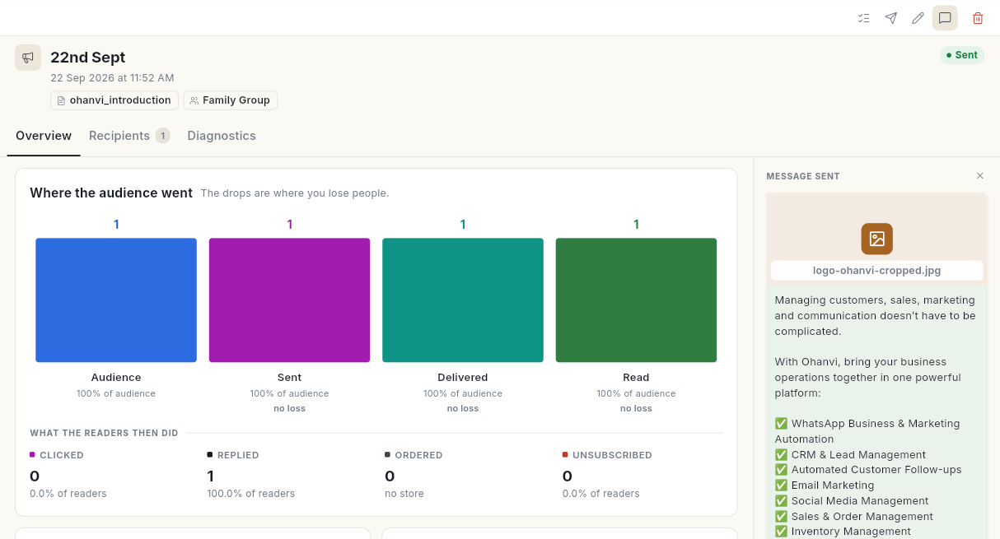
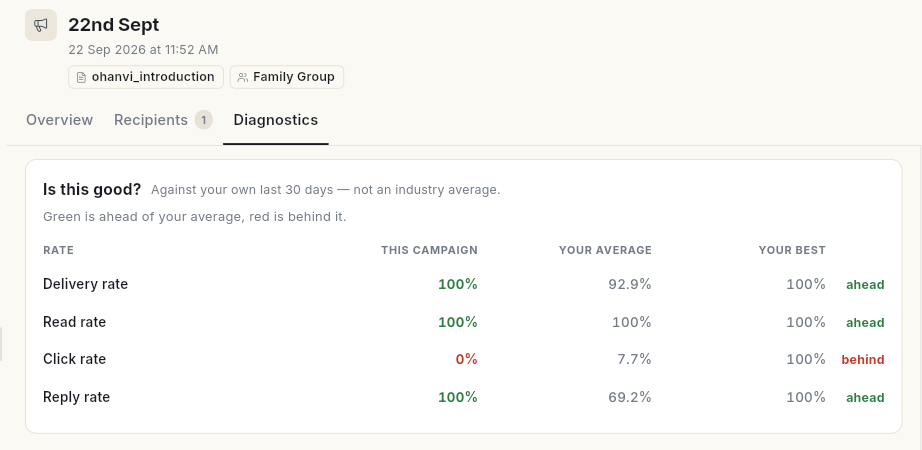
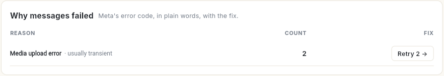
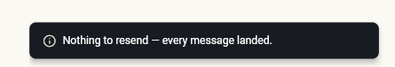
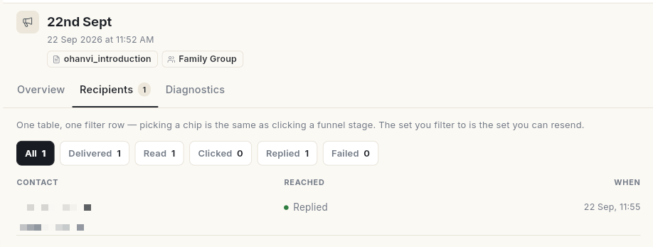
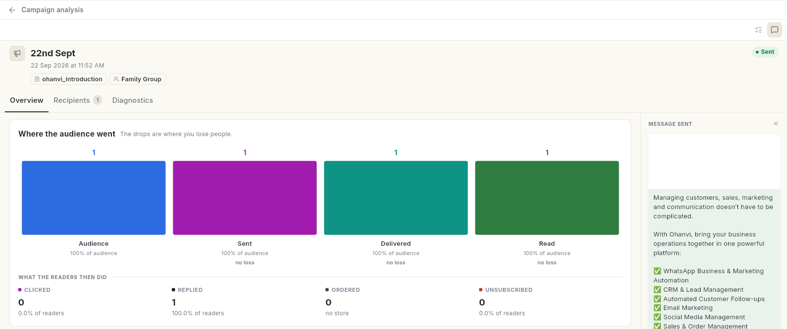

# व्हाट्सऐप कैंपेन रिपोर्ट पढ़ें { #read-a-whatsapp-campaign-report }

भेजा गया कैंपेन खोलें और पढ़ें कि वह कैसा पहुँचा: कितने लोगों को मिला, कितनों ने पढ़ा और कितनों ने उस पर कुछ किया, और कुछ मैसेज फ़ेल क्यों हुए। अंत में आपको पता होगा कि क्या ठीक करना है और आपने फ़ेल हुए मैसेज दोबारा भेज दिए होंगे।

## शुरू करने से पहले { #before-you-start }

- आपने कम से कम 1 कैंपेन भेजा है। देखें [ब्रॉडकास्ट कैंपेन भेजें](send-broadcast-campaign.md)।
- आपको **WhatsApp** पैनल में **Campaign** दिखता है।

## हर डिलीवरी स्टेटस का मतलब { #what-each-delivery-status-means }

आँकड़े तब भरते जाते हैं जब व्हाट्सऐप हर मैसेज की पुष्टि करता है, इसलिए एक मिनट पहले भेजा गया कैंपेन अभी गिना जा रहा होता है।

| स्टेटस | मतलब |
| --- | --- |
| **Queued** | व्हाट्सऐप को सौंपे जाने का इंतज़ार है। |
| **Sent** | व्हाट्सऐप ने मैसेज स्वीकार कर लिया। |
| **Delivered** | मैसेज व्यक्ति के फ़ोन तक पहुँच गया। |
| **Read** | व्यक्ति ने उसे खोला। जिन्होंने रीड रिसीप्ट बंद कर रखी है वे पढ़ने पर भी कभी **Read** नहीं दिखते। |
| **Clicked** | व्यक्ति ने ट्रैक किए गए लिंक बटन को दबाया। इसके लिए टेम्प्लेट पर **Enable Click Tracking** चाहिए। |
| **Replied** | व्यक्ति ने जवाब लिखा। |
| **Failed** | व्हाट्सऐप ने डिलीवर नहीं किया। वजह पंक्ति पर लिखी होती है। फ़ेल हुए मैसेज पर शुल्क नहीं लगता। |

## चरण { #steps }

### सारांश पढ़ें { #read-the-summary }

1. लेफ़्ट रेल में **WhatsApp** खोलें, फिर **Campaign** चुनें।
2. सबसे ऊपर सभी कैंपेन के कुल आँकड़े पढ़ें: **Campaigns**, **Messages sent**, **Delivered**, **Read** और **Failed**।
3. सूची में किसी कैंपेन पर क्लिक करें। उसकी रिपोर्ट दाईं ओर खुलती है, एक **GRADE** और 3 टैब के साथ: **Overview**, **Recipients** और **Diagnostics**। दाईं ओर **Message sent** वह मैसेज दिखाता है जो भेजा गया।

    

### Overview टैब पढ़ें { #read-the-overview-tab }

- **Where the audience went** भेजे जाने से लेकर डिलीवर, पढ़े जाने, क्लिक, जवाब और ऑर्डर तक का हर चरण दिखाता है। गिरावट वहीं है जहाँ आप लोगों को खोते हैं। किसी चरण पर क्लिक करके उन लोगों की सटीक सूची खोलें।
- **What the readers then did** दिखाता है कि कितने पाठकों ने **Clicked**, **Replied**, **Ordered** या **Unsubscribed** किया।
- **vs your last broadcast** इस सेंड की तुलना उससे पहले के ब्रॉडकास्ट से करता है। हरा मतलब पिछले से बेहतर, लाल मतलब पिछड़ गया।
- **What it drove** पढ़े जाने और क्लिक दिखाता है। स्टोर कनेक्ट होने पर यह रेवेन्यू भी दिखाता है।
- **Do this next** सुझाई गई कार्रवाइयाँ बताता है, जैसे उन लोगों से फ़ॉलो-अप करना जिन्होंने पढ़ा पर क्लिक नहीं किया, या उन नंबरों को छोड़ना जो लगातार दो बार फ़ेल हुए।
- **How fast it landed** में **Median time to deliver**, **Median time to read** और **Peak reading hour** दिखते हैं।

### जानें कि कितनी तेज़ी से पहुँचा { #read-how-fast-it-landed }

**How fast it landed** कार्ड लॉन्च के बाद का समय मिनटों में दिखाता है, कैलेंडर के दिनों में नहीं। ब्रॉडकास्ट मिनटों में पूरा हो जाता है, इसलिए दिन-वार चार्ट में एक ही बिंदु दिखता।

1. **Overview** टैब खोलें और **How fast it landed** तक स्क्रॉल करें।
2. **Median time to deliver** पढ़ें। आधे मैसेज इस समय से तेज़ फ़ोन तक पहुँचे।
3. **Median time to read** पढ़ें। आधे पाठकों ने इस समय से तेज़ मैसेज खोला। उसके नीचे **p95** वह समय दिखाता है जिसके अंदर हर 100 में से 95 पाठकों ने पढ़ लिया।
4. **Peak reading hour** पढ़ें। यह सबसे ज़्यादा पढ़े जाने वाला घड़ी का घंटा दिखाता है, जैसे `19:00–20:00`। कैप्शन में **when to send the next one** लिखा होता है।
5. अगर अभी किसी ने मैसेज नहीं पढ़ा है, तो **Peak reading hour** में **—** दिखता है और कैप्शन में **no reads yet** लिखा होता है। बाद में फिर देखें।
6. **Never delivered** पढ़ें। यह भेजे गए मैसेज में से डिलीवर हुए मैसेज घटाने पर बचता है। कैप्शन में **see Diagnostics for why** लिखा होता है।

समय सबसे सही छोटी इकाई में दिखता है, जैसे `45 s`, `12 min 30 s` या `2 h 15 m`।

!!! tip "सुझाव"
    अगला ब्रॉडकास्ट इसी ब्रॉडकास्ट के **Peak reading hour** पर शेड्यूल करें। देखें [शेड्यूल किए गए मैसेज और डिलीवरी लॉग देखें](scheduler-and-delivery-logs.md)।

### पता करें कि मैसेज क्यों फ़ेल हुए { #find-out-why-messages-failed }

1. **Diagnostics** टैब खोलें। **Is this good?** इस कैंपेन के **Delivery rate**, **Read rate**, **Click rate** और **Reply rate** की तुलना आपके अपने पिछले 30 दिनों के **Your average** और **Your best** से करता है। हरा मतलब आपके औसत से **आगे**, लाल मतलब उससे **पीछे**।

    

2. जब मैसेज फ़ेल हुए हों, तो **Why messages failed** पढ़ें। यह फ़ेल होने की वजहों को व्हाट्सऐप के कारण के हिसाब से आसान शब्दों में समूह में रखता है, **Count** और **Fix** बटन के साथ, जैसे **Retry 2**।

    

3. हर लिंक पर क्लिक के लिए **Links & buttons** पढ़ें, और टेम्प्लेट की क्वालिटी रेटिंग के लिए **Template health**।
4. **What this send cost your list** पढ़ें: **Reached first time**, **At risk** (लगातार 2 या ज़्यादा बार फ़ेल), **Unsubscribed** और **Excluded**।

### छूटे लोगों को दोबारा भेजें { #resend-to-the-people-it-missed }

1. कैंपेन पर ऊपर दाईं ओर **Resend** आइकन (कागज़ का हवाई जहाज़) पर क्लिक करें। **Resend?** विंडो बताती है कि यह कितने लोगों को जाएगा। अगर हर मैसेज डिलीवर हो चुका है, तो इसकी जगह संदेश **Nothing to resend — every message landed.** दिखता है।

    

2. **Resend** पर क्लिक करें। **Resend started** दिखता है। डिलीवरी अपडेट तब आते हैं जब व्हाट्सऐप हर एक की पुष्टि करता है।

दोबारा भेजना फ़ेल हुए पाने वालों को जाता है। अगर कुछ फ़ेल नहीं हुआ, तो यह उन लोगों को जाता है जिनका मैसेज डिलीवर नहीं हुआ। दोबारा भेजे हर मैसेज पर शुल्क तब लगता है जब वह डिलीवर होता है।

### देखें किसे मिला { #see-who-received-it }

1. कैंपेन पर **Recipients** टैब खोलें, या ऊपर दाईं ओर **Who received it** आइकन (टिक वाली सूची) पर क्लिक करें। हर पंक्ति में **Contact**, मैसेज कहाँ तक **Reached**, और **When** दिखता है।
2. चिप **All**, **Delivered**, **Read**, **Clicked**, **Replied** या **Failed** से फ़िल्टर करें। हर चिप अपनी गिनती दिखाता है। जिस सेट पर आप फ़िल्टर करते हैं, वही सेट आप दोबारा भेज सकते हैं।

    

3. सिर्फ़ फ़ेल हुए मैसेज दोबारा भेजने के लिए **Resend … failed** पर क्लिक करें।

### रिपोर्ट को उसके अपने पेज पर खोलें { #open-the-report-on-its-own-page }

1. **WhatsApp** → **Dashboard** खोलें और **Broadcasts** टेबल में किसी ब्रॉडकास्ट पर क्लिक करें। **Campaign analysis** अपने पेज पर खुलता है।
2. इसमें वही **Overview**, **Recipients** और **Diagnostics** टैब हैं जो **Campaign** की रिपोर्ट में हैं, और दाईं ओर **Message sent**।
3. वापस जाने के लिए **Campaign analysis** के बगल के बैक एरो पर क्लिक करें।

अपने सभी कैंपेन के कुल आँकड़ों के लिए, ब्रॉडकास्ट से हुए रेवेन्यू समेत, **Analytics** का इस्तेमाल करें। देखें [मार्केटिंग एनालिटिक्स पढ़ें](../analytics/read-marketing-analytics.md)।

## वीडियो वॉकथ्रू { #video-walkthrough }

[VIDEO]

## समस्या का समाधान { #troubleshooting }

| समस्या | कारण | समाधान |
| --- | --- | --- |
| **Read** की संख्या **Delivered** से काफ़ी कम है | कुछ लोगों ने रीड रिसीप्ट बंद कर रखी है, या उन्होंने अभी खोला नहीं है। | **Replied** और **Clicked** से तुलना करें, और बाद में फिर देखें। |
| क्लिक 0% दिखते हैं और **No URL button on template** लिखा है | टेम्प्लेट में लिंक बटन नहीं है, इसलिए कोई क्लिक ट्रैक नहीं हो सकता। | अपने अगले टेम्प्लेट में **Enable Click Tracking** वाला URL बटन जोड़ें। |
| फ़ेल होने की वजह: **This person has chosen not to receive marketing messages from your business, so WhatsApp blocked this one.** | व्यक्ति ने व्हाट्सऐप में मार्केटिंग मैसेज लेना बंद कर दिया है। | उन्हें मार्केटिंग कैंपेन से बाहर रखें। |
| फ़ेल होने की वजह: **WhatsApp did not deliver this one. It limits how many marketing messages a person receives so their inbox stays useful …** | Meta हर व्यक्ति को मिलने वाले मार्केटिंग मैसेज की सीमा तय करता है। | बाद में फिर कोशिश करें, या इस व्यक्ति तक किसी और तरीके से पहुँचें। |
| फ़ेल होने की वजह: **This number cannot receive WhatsApp messages. …** | नंबर व्हाट्सऐप पर नहीं है, गलत लिखा है, या उसने आपको ब्लॉक कर रखा है। | संपर्क पर नंबर जाँचें। |
| **Nothing to resend — every message landed.** | कोई मैसेज फ़ेल नहीं हुआ और न ही बिना डिलीवर रहा। | कुछ करने की ज़रूरत नहीं। |

## संबंधित गाइड { #related }

- [ब्रॉडकास्ट कैंपेन भेजें](send-broadcast-campaign.md)
- [मैसेज टेम्प्लेट बनाएँ](create-message-template.md)
- [मार्केटिंग एनालिटिक्स पढ़ें](../analytics/read-marketing-analytics.md)
