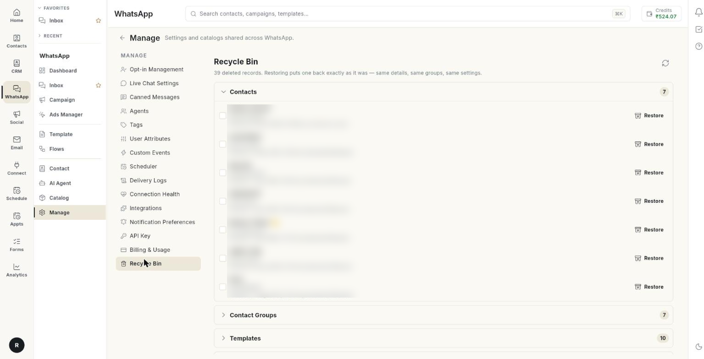

# डिलीट किए गए आइटम वापस लाएँ { #restore-deleted-items }

डिलीट किए WhatsApp आइटम वापस लाने के लिए **Manage** में **Recycle Bin** खोलें। आख़िर में आइटम अपनी स्क्रीन में लौट आता है। उसकी डिटेल, ग्रुप और सेटिंग्स वही रहती हैं जो पहले थीं। वापस लाने में करीब 1 मिनट लगता है।

## शुरू करने से पहले { #before-you-start }

- आपका रोल WhatsApp **Manage** खोल पाता हो। न खुले तो अपने एडमिन से पूछें। देखें [टीम के मेंबर, रोल और अनुमतियाँ मैनेज करें](../settings/roles-and-permissions.md)।
- आपको याद हो कि आपने किस तरह का आइटम डिलीट किया था, जैसे कॉन्टैक्ट या टेम्प्लेट।

## रीसायकल बिन में क्या रहता है { #what-the-recycle-bin-holds }

बिन डिलीट किए आइटम को टाइप के हिसाब से अलग-अलग रखता है। हर टाइप के आगे लिखा होता है कि उसमें कितने आइटम हैं।

| प्रकार | इसमें क्या रहता है |
| --- | --- |
| **Contacts** | आपके डिलीट किए कॉन्टैक्ट। वापस लाया कॉन्टैक्ट उन्हीं ग्रुप में लौट जाता है जिनमें वह पहले था। |
| **Contact Groups** | कॉन्टैक्ट के ग्रुप। |
| **Broadcasts** | ब्रॉडकास्ट कैंपेन। |
| **Templates** | मैसेज टेम्प्लेट। |
| **Chatbot Flows** | चैटबॉट फ़्लो। |
| **Scheduled Messages** | बाद में भेजने के लिए सेट किए मैसेज। |
| **Canned Replies** | सेव किए हुए झटपट जवाब। |
| **Tags** | कॉन्टैक्ट के टैग। |
| **Custom Attributes** | कॉन्टैक्ट के कस्टम फ़ील्ड। |
| **Custom Events** | वे इवेंट जो आपके सिस्टम फ़्लो शुरू करने के लिए भेजते हैं। |
| **Catalog Products** | आपके WhatsApp कैटलॉग के प्रोडक्ट। |
| **Integrations** | कनेक्ट की हुई सर्विस। |

जिस टाइप में कुछ भी डिलीट नहीं हुआ, वह दिखता ही नहीं।

## स्टेप { #steps }

### डिलीट किया हुआ आइटम ढूँढें { #find-a-deleted-item }

1. लेफ़्ट रेल में **WhatsApp** खोलें, फिर **Manage** चुनें।
2. **Recycle Bin** चुनें। ऊपर हेडर में लिखा होता है कि आपके कितने रिकॉर्ड डिलीट हुए हैं। साथ में यह भी लिखा होता है: **Restoring puts one back exactly as it was — same details, same groups, same settings.**

    

3. किसी टाइप की लिस्ट खोलने के लिए उस पर क्लिक करें, जैसे **Contacts**। लिस्ट बंद करने के लिए उस पर दोबारा क्लिक करें।
4. हर पंक्ति देखें। उसमें नाम, छोटा विवरण, और **Deleted** के साथ तारीख व समय दिखता है। अगर पता हो, तो यह भी दिखता है कि किसने डिलीट किया। यह **by** और नाम के रूप में लिखा होता है।
5. अगर लिस्ट लंबी है, तो उसके अंत में **Showing the N most recently deleted of M.** लिखा होता है। पुराने आइटम लिस्ट में नहीं दिखते। [LIMIT]

अगर कुछ भी डिलीट नहीं हुआ है, तो स्क्रीन पर **The recycle bin is empty — nothing has been deleted.** लिखा होता है।

### एक आइटम वापस लाएँ { #restore-one-item }

1. वह टाइप खोलें जिसमें आइटम है।
2. आइटम की पंक्ति के दाएँ सिरे पर **Restore** पर क्लिक करें।
3. जो मैसेज दिखे, उसे पढ़ें। उसमें **Restored.** लिखा होगा, या सर्वर का कोई मैसेज।
4. आइटम लौटा या नहीं, यह जाँचने के लिए उसकी अपनी स्क्रीन खोलें। कॉन्टैक्ट के लिए **Contact** खोलें।

### कई आइटम वापस लाएँ { #restore-several-items }

1. वह टाइप खोलें जिसमें आइटम हैं।
2. हर पंक्ति के शुरू में दिए चेकबॉक्स पर टिक लगाएँ।
3. लिस्ट के ऊपर दी गिनती देखें, जैसे **3 selected**।
4. **Restore selected** पर क्लिक करें। काम चलते समय बटन पर स्पिनर घूमता दिखता है।
5. जो मैसेज दिखे, उसे पढ़ें। लिस्ट दोबारा लोड हो जाती है और वापस लाए गए आइटम बिन से हट जाते हैं।

आप एक बार में एक ही टाइप के आइटम चुन सकते हैं। लिस्ट दोबारा लोड होने पर टिक हट जाते हैं।

!!! note "कॉन्टैक्ट या फ़्लो वापस लाना"
    **Contact** वापस लाने पर उसके ग्रुप के लिंक भी लौट आते हैं। **Chatbot Flow** वापस लाने पर वे हिस्से भी लौट आते हैं जो उसके साथ डिलीट हुए थे।

### रीसायकल बिन दोबारा लोड करें { #reload-the-recycle-bin }

1. ऊपर दाईं ओर **Refresh** आइकन पर क्लिक करें।
2. अगर बिन लोड नहीं होता, तो स्क्रीन पर **Could not load deleted records.** दिखता है। **Refresh** पर फिर से क्लिक करें।

## समस्या का समाधान { #troubleshooting }

| समस्या | कारण | समाधान |
| --- | --- | --- |
| **Could not restore the selected records.** | सर्वर ने रीस्टोर करने से मना कर दिया, जैसे आइटम अब इस्तेमाल के लायक नहीं रहा। | मैसेज पढ़ें। वजह ठीक करें, फिर दोबारा कोशिश करें। |
| **Restore failed.** | रिक्वेस्ट सर्वर तक नहीं पहुँची। | अपना इंटरनेट कनेक्शन देखें, **Refresh** पर क्लिक करें, फिर दोबारा कोशिश करें। |
| जो आइटम आपको चाहिए वह लिस्ट में नहीं है | वह दिखाए गए ताज़ा आइटम से पुराना है, या उसे WhatsApp मॉड्यूल से कभी डिलीट ही नहीं किया गया था। | सही टाइप के अंदर ढूँढें। **Showing … most recently deleted** वाली लाइन भी देखें। |
| कॉन्टैक्ट वापस आ गया, पर उस ग्रुप में नहीं है जिसमें आप उम्मीद कर रहे थे | कॉन्टैक्ट उन्हीं ग्रुप में लौटता है जिनमें वह डिलीट होते समय था। | उसे दोबारा ग्रुप में जोड़ें। देखें [WhatsApp कॉन्टैक्ट मैनेज करें](manage-whatsapp-contacts.md)। |

## जुड़ी गाइड { #related }

- [WhatsApp कॉन्टैक्ट मैनेज करें](manage-whatsapp-contacts.md)
- [WhatsApp मैसेज टेम्प्लेट बनाएँ](create-message-template.md)
- [WhatsApp इंटीग्रेशन मैनेज करें](manage-whatsapp-integrations.md)
- [अपनी WhatsApp बिज़नेस प्रोफ़ाइल सेट करें](whatsapp-business-profile.md)
