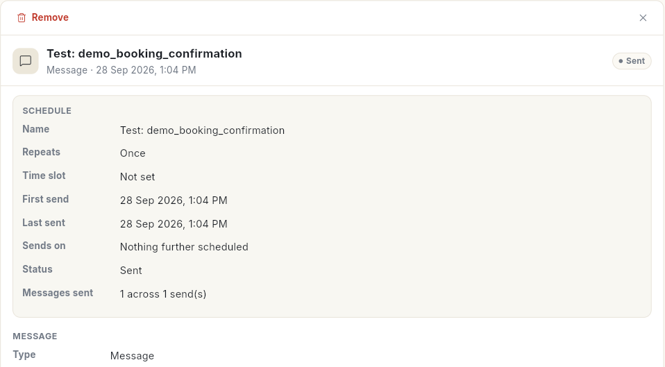
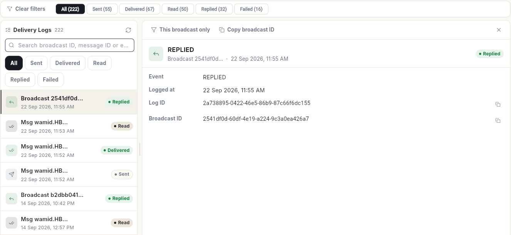

# शेड्यूल किए मैसेज और डिलीवरी लॉग जाँचें { #check-scheduled-messages-and-delivery-logs }

**Scheduler** में वे सभी व्हाट्सऐप मैसेज होते हैं जो बाद में जाने के लिए तय हैं, और **Delivery Logs** में दर्ज होता है कि भेजे गए हर मैसेज के साथ क्या हुआ। अंत में आप शेड्यूल किया हुआ मैसेज खोज सकते हैं, उसका ब्योरा पढ़ सकते हैं, और किसी भी मैसेज को भेजे जाने से लेकर जवाब आने या फ़ेल होने तक देख सकते हैं।

## शुरू करने से पहले { #before-you-start }

- आपका रोल व्हाट्सऐप **Manage** खोल सकता हो। देखें [टीम के सदस्य, रोल और अनुमतियाँ प्रबंधित करें](../settings/roles-and-permissions.md)।

## चरण { #steps }

### शेड्यूलर पढ़ें { #read-the-scheduler }

1. लेफ़्ट रेल में **WhatsApp** खोलें, **Manage** चुनें, फिर **Scheduler**।
2. ऊपर **All**, **Scheduled**, **Paused**, **Sent**, **Failed** या **Stopped** से फ़िल्टर करें। हर एक की गिनती दिखती है।
3. **Search title, type or number…** से खोजें, फिर किसी आइटम पर क्लिक करें। उसका ब्योरा दाईं ओर खुलता है।

**Schedule** कार्ड में **Name**, यह कैसे **Repeats**, **Time slot**, **First send**, **Last sent**, **Sends on**, उसका **Status** और **Messages sent** दिखते हैं। उसे डिलीट करने के लिए ऊपर **Remove** पर क्लिक करें।

नया मैसेज शेड्यूल करने के लिए सूची के ऊपर **Schedule** पर क्लिक करें, या ऊपर दाईं ओर **Schedule Message** पर। टेस्ट मैसेज भी यहाँ दिखते हैं, जिनका नाम **Test:** और टेम्प्लेट का नाम होता है।

सूची के ऊपर के कार्ड **Upcoming**, **Sent**, **Failed** और **Stopped** की गिनती बताते हैं। **Upcoming** उन आइटम को गिनता है जो **Scheduled** फ़िल्टर दिखाता है।

Ohanvi में जो कुछ भी शेड्यूल है, उसके कैलेंडर के लिए देखें [जो कुछ भी शेड्यूल है, सब देखें](../schedule/view-schedule.md)। बार-बार चलने वाले भेजने के लिए देखें [बार-बार चलने वाले शेड्यूल प्रबंधित करें](../schedule/manage-recurring-schedules.md)।

### मैसेज शेड्यूल करें { #schedule-a-message }

1. **Scheduler** में **Schedule Message** पर क्लिक करें। **Schedule Message** विंडो खुलती है।
2. वैकल्पिक: **Title (optional)** लिखें।
3. **Contact Group** के नीचे एक या ज़्यादा ग्रुप चुनें। 2 चुनने पर लेबल **Contact Groups (2 selected)** हो जाता है। हर बार भेजते समय सदस्य नए सिरे से लिए जाते हैं।
4. **Template** के नीचे कोई approved टेम्प्लेट चुनें।
5. **Variables** के नीचे हर प्लेसहोल्डर भरें, या कोई एट्रिब्यूट डालें ताकि हर संपर्क को उसका अपना मान मिले। जिन संपर्कों का मान खाली है उनके लिए फ़ॉलबैक जोड़ें।
6. **Repeat** के नीचे **Once**, **Daily**, **Weekly**, **Monthly**, **Yearly**, **Special Days** या **Holidays** चुनें।
7. **Time slot** के नीचे 4-4 घंटे की 6 विंडो में से एक चुनें, **12:00 AM – 4:00 AM** से **8:00 PM – 12:00 AM** तक। मैसेज विंडो की शुरुआत में जाता है।
8. **Send date** तय करें। बार-बार चलने वाले शेड्यूल के लिए यह **First send date** लिखा होता है। **Special Days** और **Holidays** के लिए इसके बजाय कैलेंडर पर तारीखें चुनें।
9. वैकल्पिक: **End date (optional)** तय करें। इसके बिना शेड्यूल रोके जाने तक चलता रहता है।
10. वैकल्पिक: **Also add to Google Calendar** पर टिक करें। पहले **Scheduler** पेज पर **Connect Google** पर क्लिक करें।
11. **Message Preview** जाँचें, फिर **Schedule Message** पर क्लिक करें। संदेश **Message scheduled.** दिखता है।

अगर कुछ छूटा है, तो फ़ॉर्म बताता है कि क्या, जैसे **Select at least one contact group.** या **Fill every template variable.**

### शेड्यूल बदलें, रोकें या बंद करें { #change-pause-or-stop-a-schedule }

सूची में किसी आइटम पर क्लिक करें। उसके बटन ब्योरे के ऊपर दिखते हैं। वही कार्रवाइयाँ मेन्यू के रूप में देखने के लिए आइटम पर राइट-क्लिक करें।

1. उसे खिसकाने के लिए **Reschedule** पर क्लिक करें। **Repeat**, **Time slot**, अगली तारीख या आखिरी तारीख बदलें, फिर **Save** पर क्लिक करें। संदेश **Schedule updated.** दिखता है।
2. फ़ेल हुए आइटम के लिए यही बटन **Retry** लिखा होता है। भेजने को वापस कतार में डालने के लिए विंडो में **Retry** पर क्लिक करें।
3. जो शेड्यूल अभी गया नहीं है उसे रोकने के लिए **Pause** पर क्लिक करें। संदेश **Schedule paused — nothing sends until you resume it.** दिखता है।
4. रोके हुए शेड्यूल को जारी रखने के लिए **Resume** पर क्लिक करें। संदेश **Schedule resumed.** दिखता है।
5. जो भेजना अभी गया नहीं है उसे खत्म करने के लिए **Stop** पर क्लिक करें, फिर **Stop it**। आइटम सूची में **Stopped** के रूप में रहता है।
6. बंद किए आइटम को फिर शुरू करने के लिए **Restart** पर क्लिक करें। संदेश **Schedule restarted.** दिखता है।
7. पूरा हो चुका आइटम हटाने के लिए **Remove** पर क्लिक करें, फिर **Remove it**। संदेश **Removed from the scheduler.** दिखता है।
8. अगर कोई आइटम फ़ेल हुआ है, तो वजह कॉपी करने के लिए **Copy error** पर क्लिक करें।

!!! warning "हटाना अंतिम है"
    **Remove** बंद किए या भेजे जा चुके आइटम को सूची से हमेशा के लिए हटा देता है। इसके बाद बंद किया आइटम फिर शुरू नहीं किया जा सकता। जो मैसेज भेजे जा चुके हैं उन पर असर नहीं पड़ता।

सिर्फ़ 6 टाइम स्लॉट इस्तेमाल हो सकते हैं। जो स्लॉट आज निकल चुका है, वह मना है: **The … slot has already passed on that date — pick a later slot or date.**

### डिलीवरी लॉग पढ़ें { #read-the-delivery-logs }

1. **Manage** में **Delivery Logs** चुनें।
2. ऊपर **All**, **Sent**, **Delivered**, **Read**, **Replied** या **Failed** से फ़िल्टर करें। हर एक की गिनती दिखती है। फिर से शुरू करने के लिए **Clear filters** पर क्लिक करें।
3. ब्रॉडकास्ट ID, मैसेज ID या एरर से खोजें, फिर किसी एंट्री पर क्लिक करें। उसका ब्योरा दाईं ओर खुलता है।

हर एंट्री में **Event**, कब **Logged at**, **Log ID** और **Broadcast ID** दिखते हैं। फ़ेल हुए मैसेज में उसका **Error code** और **Error message** भी दिखता है। सिर्फ़ उसी ब्रॉडकास्ट को देखने के लिए **This broadcast only** पर क्लिक करें, या उसे शेयर करने के लिए **Copy broadcast ID** पर।

!!! note "फ़ेल हुए मैसेज"
    **Delivery Logs** सिर्फ़ यह दिखाता है कि क्या हुआ। फ़ेल हुआ मैसेज दोबारा भेजने का इसमें कोई बटन नहीं है। इस पेज का **Retry** बटन सिर्फ़ सूची को फिर लोड करता है। दोबारा भेजने के लिए कैंपेन रिपोर्ट इस्तेमाल करें। देखें [व्हाट्सऐप कैंपेन रिपोर्ट पढ़ें](read-campaign-report.md)।

फ़ेल हुई एंट्री तक आप डैशबोर्ड से भी पहुँच सकते हैं: **Review failures** → **Open Delivery Logs**। देखें [व्हाट्सऐप डैशबोर्ड पढ़ें](whatsapp-dashboard.md)।

## वीडियो वॉकथ्रू { #video-walkthrough }

[VIDEO]

## संबंधित गाइड { #related }

- [ब्रॉडकास्ट कैंपेन भेजें](send-broadcast-campaign.md)
- [व्हाट्सऐप कैंपेन रिपोर्ट पढ़ें](read-campaign-report.md)
- [व्हाट्सऐप डैशबोर्ड पढ़ें](whatsapp-dashboard.md)
