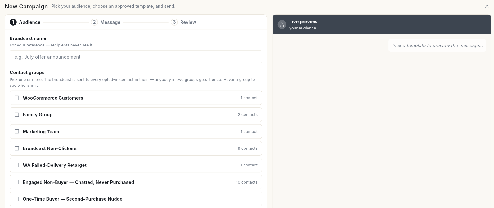
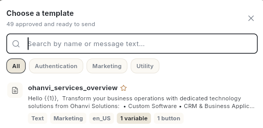
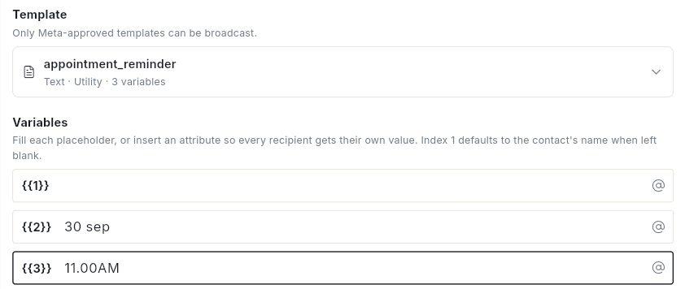
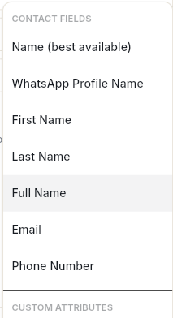
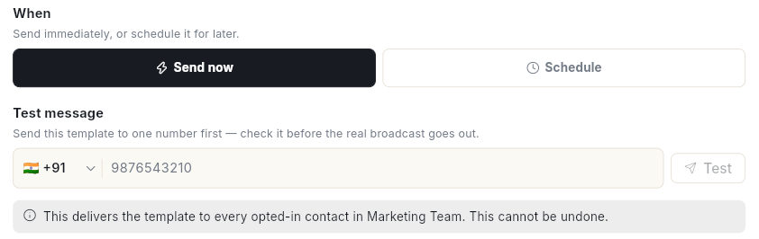
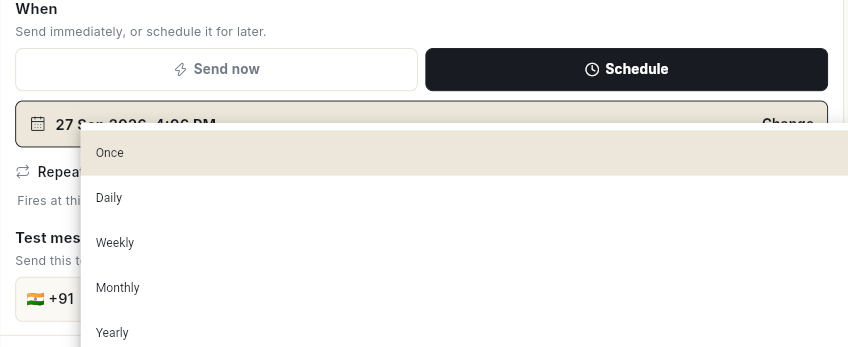

# WhatsApp ब्रॉडकास्ट कैंपेन भेजें { #send-a-whatsapp-broadcast-campaign }

Approved टेम्प्लेट को एक या ज़्यादा कॉन्टैक्ट ग्रुप को भेजें, या अपनी अपलोड की हुई लिस्ट को भेजें। आखिर में आपका कैंपेन जा रहा होगा या शेड्यूल हो चुका होगा, और आप उसे अपने फ़ोन पर टेस्ट कर चुके होंगे। WhatsApp जैसे-जैसे हर मैसेज की पुष्टि करता है, डिलीवरी के आँकड़े **Campaigns** पेज पर भरते जाते हैं।

## शुरू करने से पहले { #before-you-start }

- आपके पास कम से कम 1 टेम्प्लेट हो, जिसका स्टेटस **Approved** हो। देखें [WhatsApp मैसेज टेम्प्लेट बनाएँ](create-message-template.md)।
- आपके पास ऐसा कॉन्टैक्ट ग्रुप हो जिसके कॉन्टैक्ट ने ऑप्ट-इन किया हो, या फ़ोन नंबरों की CSV हो। देखें [WhatsApp कॉन्टैक्ट मैनेज करें](manage-whatsapp-contacts.md)।
- आपके पास क्रेडिट हों। हर WhatsApp मैसेज का चार्ज आपके क्रेडिट से कटता है। देखें [क्रेडिट और बिलिंग](../credits-and-billing.md)।
- **WhatsApp** पैनल में आपको **Campaign** दिखे। न दिखे, तो अपने एडमिन से पूछें। देखें [रोल और परमिशन](../settings/roles-and-permissions.md)।

## कई नंबर होने पर कैंपेन पर क्या असर पड़ता है { #how-several-numbers-affect-a-campaign }

- कैंपेन उसी नंबर से जाता है जो आप **Send from** में चुनते हैं। शुरू में यहाँ आपका **Default** नंबर होता है।
- टेम्प्लेट WhatsApp Business Account के होते हैं। इसलिए उस अकाउंट का हर नंबर वही Approved टेम्प्लेट इस्तेमाल कर सकता है।
- ग्राहक जवाब दे, तो चैट कैंपेन वाले नंबर पर ही रहती है। आपकी टीम अपने-आप उसी नंबर से जवाब देती है।
- हर नंबर की अपनी मैसेजिंग लिमिट होती है। जिस नंबर की लिमिट कम है, उस पर एक नोट दिखता है। बड़ी ऑडियंस को कई दिनों में बाँटकर भेजा जाता है, या उसके लिए दूसरा नंबर इस्तेमाल करना चाहिए।

## क्रेडिट कैसे कटते हैं { #how-credits-are-charged }

- WhatsApp जब पक्का करता है कि मैसेज भेजा गया या डिलीवर हुआ, तब उसका चार्ज लगता है। रेट टेम्प्लेट की कैटेगरी और पाने वाले के देश पर निर्भर करता है।
- जो मैसेज फ़ेल हो जाता है, उसका चार्ज नहीं लगता।
- कैंपेन या टेस्ट जाने से पहले Ohanvi आपका बैलेंस देखता है:
    - बैलेंस खाली हो, तो **Your credits are empty** खुलता है और मैसेज जाना रुक जाता है। **Recharge credits** पर क्लिक करें, क्रेडिट जोड़ें, फिर दोबारा भेजें।
    - बैलेंस कम पड़ सकता हो, तो **Your credits are running low** खुलता है। अगर आपको पता है कि बैलेंस इस कैंपेन के लिए काफ़ी है, तो **Send anyway** पर क्लिक करें। नहीं तो **Recharge credits** पर क्लिक करें।
- अगर बीच में बैलेंस खत्म हो जाए, तो उसके बाद के मैसेज फ़ेल हो जाते हैं।

क्रेडिट खत्म होने पर और क्या-क्या रुक जाता है, यह जानने के लिए [क्रेडिट कम हों या खत्म हो जाएँ](../billing/low-or-empty-credits.md) देखें।

## स्टेप { #steps }

### स्टेप 1: ऑडियंस चुनें { #step-1-pick-the-audience }

1. लेफ़्ट रेल में **WhatsApp** खोलें, फिर **Campaign** चुनें। **Campaigns** पेज खुलेगा।
2. **New Campaign** पर क्लिक करें। **New Campaign** पेज **Audience** स्टेप पर खुलता है। उसके बगल में **Live preview** दिखता है।

    
3. **Broadcast name** लिखें, जैसे `Diwali offer 2026`। इसे सिर्फ़ आपकी टीम देखती है।
4. **Send from** में वह नंबर चुनें जिससे कैंपेन जाएगा। शुरू में यहाँ आपका **Default** नंबर होता है। हर विकल्प में बैज, लेबल, फ़ोन नंबर और उसकी मैसेजिंग लिमिट दिखती है। देखें [कई WhatsApp नंबर चलाएँ](run-multiple-whatsapp-numbers.md)।
5. **Contact groups** में 1 या ज़्यादा ग्रुप पर टिक करें। इन ग्रुप में जिसने भी ऑप्ट-इन किया है, उसे मैसेज एक बार मिलता है, भले ही वह 2 ग्रुप में हो। किसी ग्रुप पर माउस ले जाएँ, तो दिखता है कि उसमें कौन-कौन है।
6. **Continue** पर क्लिक करें। **Message** स्टेप खुलेगा।

!!! tip "हाथ से चुने कॉन्टैक्ट को भेजें"
    **Contact** पेज पर कॉन्टैक्ट चुनें और **Send broadcast** पर क्लिक करें। कंपोज़र उन्हीं कॉन्टैक्ट को ऑडियंस बनाकर खुलता है। कॉन्टैक्ट ग्रुप की ज़रूरत नहीं पड़ती।

### स्टेप 2: टेम्प्लेट चुनें और वेरिएबल भरें { #step-2-choose-the-template-and-fill-the-variables }

1. **Template** चुनें। **Choose a template** खुलता है, जिसमें सिर्फ़ Meta के Approved टेम्प्लेट होते हैं। **All**, **Authentication**, **Marketing** या **Utility** से फ़िल्टर करें, या नाम या मैसेज के टेक्स्ट से खोजें।

    

2. अगर टेम्प्लेट के हेडर में इमेज, वीडियो या डॉक्यूमेंट है, तो हेडर की फ़ाइल देखें। टेम्प्लेट जिस सैंपल के साथ Approved हुआ था, वही इस्तेमाल करना हो तो उसे वैसा ही रहने दें। या नई फ़ाइल चुनें।
3. **Variables** में **{{1}}**, **{{2}}** जैसे बॉक्स भरें। **{{1}}** खाली छोड़ेंगे, तो उसमें कॉन्टैक्ट का नाम लग जाता है। टाइप करते समय **Live preview** बदलता रहता है।

    

4. हर व्यक्ति को उसकी अपनी वैल्यू देनी हो, तो वेरिएबल के आखिर में **@** आइकन पर क्लिक करें। फिर **CONTACT FIELDS** या **CUSTOM ATTRIBUTES** में से कोई फ़ील्ड चुनें, जैसे **First Name**।

    

5. **Fallback — sent when a contact has no value for this attribute** भरें, जैसे `there`। इससे किसी को ऐसा मैसेज नहीं जाता जिसमें कोई जगह खाली रह गई हो।

### वैकल्पिक: CSV लिस्ट या हर व्यक्ति की अलग वैल्यू के साथ भेजें { #optional-send-to-a-csv-list-or-per-person-values }

सिर्फ़ फ़ाइल में दिए नंबरों पर भेजना हो, या हर व्यक्ति को उसकी अपनी वेरिएबल वैल्यू देनी हो, तो **Recipients CSV (optional)** इस्तेमाल करें।

1. **Download recipients CSV** पर क्लिक करें। फ़ाइल में आपकी चुनी हुई ऑडियंस और सही कॉलम हेडिंग पहले से होती हैं।
2. फ़ाइल खोलें, पंक्तियाँ जोड़ें या हटाएँ, और हर व्यक्ति की वैल्यू भरें। फ़ोन नंबर कंट्री कोड के साथ ही रखें, जैसे `919876543210`।
3. **Upload CSV** पर क्लिक करें और फ़ाइल चुनें।
4. **How we read your file** देखें। यह बताता है कि कौन सा कॉलम किस वेरिएबल में जा रहा है। अगर हेडिंग मेल न खाएँ, तो कॉलम क्रम से पढ़े जाते हैं। इसलिए उन्हें ध्यान से जाँच लें।
5. फ़ाइल में ऐसे नंबर हों जो अभी कॉन्टैक्ट नहीं हैं, तो **New numbers in your file** विंडो खुलती है। **Yes — save them to a contact group** या **No — just send it** चुनें। दोनों में से कुछ भी चुनें, फ़ाइल के हर व्यक्ति को मैसेज मिलता है।

**Continue** पर क्लिक करें। **Review** स्टेप खुलेगा।

### स्टेप 3: कैंपेन टेस्ट करें { #step-3-test-the-campaign }

1. **Test message** में देश चुनें और अपना WhatsApp नंबर लिखें। यह **Review** स्टेप पर **When** के नीचे होता है।

    

2. **Test** पर क्लिक करें। WhatsApp जब मैसेज ले लेता है, तो **Test message sent.** दिखता है।
3. अपने फ़ोन पर मैसेज देखें: हेडर, वैल्यू और हर बटन।

टेस्ट मैसेज का चार्ज भी बाकी मैसेज की तरह ही लगता है।

### स्टेप 4: अभी भेजें या शेड्यूल करें { #step-4-send-now-or-schedule }

1. **Review & send** में पूरा सारांश देखें: नाम, टेम्प्लेट, कैटेगरी और ऑडियंस।

    

2. **When** में **Send now** चुनें, या **Schedule** पर क्लिक करें। तारीख़ और समय दिखेंगे। अपनी पसंद का समय चुनने के लिए **Change** पर क्लिक करें। समय आपके अपने टाइम ज़ोन के हिसाब से होता है।
3. चाहें तो **Repeat** को **Daily**, **Weekly**, **Monthly** या **Yearly** पर सेट करें, ताकि कैंपेन बार-बार जाए। **Once** सिर्फ़ 1 बार भेजता है।

    

4. **Send now** या **Schedule** पर क्लिक करें।

!!! warning "भेजा हुआ ब्रॉडकास्ट वापस नहीं लिया जा सकता"
    **Send now** दबाते ही टेम्प्लेट आपकी ऑडियंस के हर ऑप्ट-इन कॉन्टैक्ट तक पहुँच जाता है। इसे वापस नहीं लिया जा सकता। जिन कॉन्टैक्ट ने ऑप्ट-आउट किया है, उन्हें अपने-आप छोड़ दिया जाता है।

इनमें से एक मैसेज आएगा:

- **Broadcast launched — sending to …** — कैंपेन अभी जा रहा है।
- **Broadcast scheduled — it will send at the set time.** — कैंपेन **Scheduled** टैब में अपने समय का इंतज़ार करता है।
- **Recurring broadcast scheduled — first send at the set time. Manage the series from Manage > Scheduler.** — बार-बार चलने वाली सीरीज़ सेट हो गई है।

### शेड्यूल और बार-बार चलने वाले कैंपेन मैनेज करें { #manage-scheduled-and-recurring-campaigns }

1. **Campaigns** पर **Scheduled** टैब खोलें और कैंपेन पर क्लिक करें।
2. **Scheduled send** या **Repeating schedule** में **Next send** और **Repeats** देखें।
3. अगला मैसेज आगे-पीछे करने के लिए **Change time** पर क्लिक करें। सीरीज़ को **Pause** या **Resume** करें, या खत्म करने के लिए **Stop** पर क्लिक करें।
4. बार-बार चलने वाले कैंपेन में **End date** पर क्लिक करके **Stop repeating after** सेट करें।

जो भी मैसेज बार-बार जाने वाले हैं, उन सबको एक जगह देखना हो, तो **Open in Scheduler** पर क्लिक करें। या देखें [बार-बार चलने वाले शेड्यूल मैनेज करें](../schedule/manage-recurring-schedules.md)।

### कैंपेन लॉन्च करें, एडिट करें, कैंसिल करें या दोबारा भेजें { #launch-edit-cancel-or-resend-a-campaign }

हर कैंपेन की पंक्ति में **More actions** मेन्यू होता है।

- **Launch now**: ड्राफ़्ट कैंपेन भेज देता है। **Launch "…"?** विंडो में **Audience**, **Template** और **Recipients** दिखते हैं। **Launch** पर क्लिक करें।
- **Edit**: **Edit Campaign** खोलता है। सिर्फ़ वही कैंपेन एडिट हो सकता है जो अभी गया नहीं है।
- **Cancel**: शेड्यूल हुआ या चल रहा कैंपेन रोक देता है।
- **Resend**: उन लोगों को दोबारा भेजता है जिनका मैसेज फ़ेल हुआ, या डिलीवर ही नहीं हुआ। **Resend?** विंडो में **Resend** पर क्लिक करें।
- **Delete**: कैंपेन को लिस्ट से हटा देता है। इसे वापस नहीं लाया जा सकता।

### कैंपेन के स्टेटस { #campaign-statuses }

लिस्ट **Completed** टैब पर खुलती है। दूसरे स्टेटस देखने के लिए टैब बदलें।

| टैब | क्या दिखाता है |
| --- | --- |
| **Completed** | वे कैंपेन जो पूरे भेजे जा चुके हैं। |
| **Scheduled** | वे कैंपेन जो अपने भेजने के समय का इंतज़ार कर रहे हैं, और वे जो अभी जा रहे हैं। |
| **Draft** | वे कैंपेन जो आपने शुरू किए, पर लॉन्च नहीं किए। |
| **Cancelled** | वे कैंपेन जो आपने कैंसिल कर दिए। |
| **All** | सभी कैंपेन। |

**Automatic** लिखा कैंपेन किसी घटना के होने पर अपने-आप भेजा जाता है, जैसे ऑर्डर मिलना। यह एक बार में 1 ग्राहक को जाता है। आपका डेवलपर इसे Developer API से जोड़ता है। देखें [WhatsApp वेबहुक और इंटीग्रेशन](whatsapp-webhooks-and-integrations.md)।

## वीडियो वॉकथ्रू { #video-walkthrough }

[VIDEO]

## समस्या का समाधान { #troubleshooting }

| समस्या | कारण | समाधान |
| --- | --- | --- |
| **No approved templates yet** | Meta ने अभी तक कोई टेम्प्लेट Approved नहीं किया है। | टेम्प्लेट बनाएँ और **Approved** होने का इंतज़ार करें। देखें [WhatsApp मैसेज टेम्प्लेट बनाएँ](create-message-template.md)। |
| **Fill every placeholder in the template, so nobody receives a message with a blank in it.** | किसी वेरिएबल में न वैल्यू है, न फ़ॉलबैक। | हर **Value for {{n}}** भरें, और हर एट्रिब्यूट का फ़ॉलबैक भी। |
| **Your credits are empty** | आपका बैलेंस ₹0 है। | **Recharge credits** पर क्लिक करें, क्रेडिट जोड़ें, फिर दोबारा भेजें। |
| **The campaign could not be launched. This usually means nobody in the contact group has opted in, or the template is not approved yet. Nothing was sent.** | किसी कॉन्टैक्ट ने ऑप्ट-इन नहीं किया है, या टेम्प्लेट Approved नहीं है। | ग्रुप का ऑप्ट-इन स्टेटस और टेम्प्लेट का स्टेटस देखें, फिर **Launch now** पर क्लिक करें। |
| **Template '…' is not synced to Meta yet. Submit it from the Templates screen first.** | टेम्प्लेट ड्राफ़्ट के रूप में सेव हुआ था। | **Template** खोलें, उसे सबमिट करें, और **Approved** होने का इंतज़ार करें। |
| **Only a campaign that has not been sent yet can be edited** | कैंपेन पहले ही जा चुका है। | नया कैंपेन बनाएँ। पुराने कैंपेन से आप टेस्ट मैसेज अब भी भेज सकते हैं। |

## जुड़ी गाइड { #related }

- [कई WhatsApp नंबर चलाएँ](run-multiple-whatsapp-numbers.md)
- [कैंपेन रिपोर्ट पढ़ें](read-campaign-report.md)
- [WhatsApp मैसेज टेम्प्लेट बनाएँ](create-message-template.md)
- [मार्केटिंग एनालिटिक्स पढ़ें](../analytics/read-marketing-analytics.md)
- [बार-बार चलने वाले शेड्यूल मैनेज करें](../schedule/manage-recurring-schedules.md)
- [क्रेडिट कम या खत्म होने पर](../billing/low-or-empty-credits.md)
