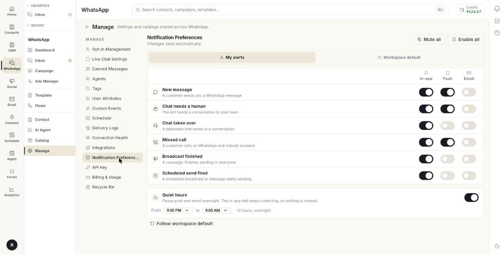

# नोटिफ़िकेशन की पसंद सेट करें { #set-notification-preferences }

Notification Preferences से आप तय करते हैं कि नया मैसेज आने या किसी चैट को इंसान की ज़रूरत पड़ने जैसे WhatsApp इवेंट की खबर आपको कैसे मिले। इस गाइड के अंत तक हर इवेंट आप तक आपकी पसंद के तरीके से पहुँचेगा, और क्वाइट आवर्स से रात में आपको परेशानी नहीं होगी। आप जो भी बदलेंगे, वह अपने-आप सेव हो जाएगा।

## शुरू करने से पहले { #before-you-start }

- **WhatsApp** पैनल में आपको **Manage** खोलना आता हो। न खुले, तो अपने एडमिन से पूछें।
- टीम का डिफ़ॉल्ट सेट करने के लिए आपके रोल के पास उसे बदलने की अनुमति हो।

## इवेंट और खबर पाने के तीन तरीके { #the-events-and-the-three-ways-to-be-told }

| इवेंट | यह कब होता है |
| --- | --- |
| **New message** | कोई ग्राहक आपको WhatsApp मैसेज भेजता है। |
| **Chat needs a human** | बॉट कोई बातचीत आपकी टीम को सौंप देता है। |
| **Chat taken over** | टीम का कोई साथी किसी बातचीत में बीच में आ जाता है। |
| **Missed call** | कोई ग्राहक WhatsApp पर कॉल करता है और कोई नहीं उठाता। |
| **Broadcast finished** | कोई Campaign सभी को मैसेज भेजना पूरा कर लेता है। |
| **Scheduled send fired** | शेड्यूल किया हुआ Broadcast या मैसेज भेजना शुरू होता है। |

| खबर पाने का तरीका | यह क्या है |
| --- | --- |
| **In-app** | Ohanvi के अंदर नोटिफ़िकेशन बेल। |
| **Push** | आपके फ़ोन पर पुश नोटिफ़िकेशन। |
| **Email** | आपके अकाउंट के ईमेल पते पर ईमेल। |

## स्टेप्स { #steps }

### Notification Preferences खोलें { #open-notification-preferences }

1. लेफ़्ट रेल में **WhatsApp** खोलें, फिर **Manage** चुनें।
2. **Notification Preferences** चुनें।

    

3. अपने अलर्ट सेट करने के लिए **My alerts** को चुना हुआ रहने दें।

### चुनें कि हर इवेंट की खबर कैसे मिले { #choose-how-you-hear-about-each-event }

1. इवेंट ढूँढें, जैसे **New message**।
2. **In-app** चालू या बंद करें।
3. **Push** चालू या बंद करें।
4. **Email** चालू या बंद करें।

पेज पर **Changes save automatically** लिखा है, यानी कोई सेव बटन नहीं है। कोई बदलाव सेव न हो पाए, तो **Couldn't save that change — please try again.** दिखता है। तब उस स्विच को दोबारा बदलें।

### सारे अलर्ट एक साथ चालू या बंद करें { #turn-every-alert-on-or-off-at-once }

1. सारे अलर्ट बंद करने के लिए **Mute all** पर क्लिक करें।
2. सारे अलर्ट चालू करने के लिए **Enable all** पर क्लिक करें।

### क्वाइट आवर्स सेट करें { #set-quiet-hours }

1. **Quiet hours** ढूँढें। यह रात में पुश और ईमेल रोक देता है।
2. स्विच चालू करें।
3. **From** के बाद का समय चुनें, जैसे रात 9:00 बजे।
4. **to** के बाद का समय चुनें, जैसे सुबह 9:00 बजे।

क्वाइट आवर्स में भी इन-ऐप बेल में अलर्ट जमा होते रहते हैं। इसलिए आपका कुछ नहीं छूटता।

### अपनी पसंद की जगह टीम का डिफ़ॉल्ट इस्तेमाल करें { #use-the-team-default-instead-of-your-own-choices }

1. **Follow workspace default** पर क्लिक करें।
2. **Follow the workspace default?** विंडो में मैसेज पढ़ें। आपकी अपनी पसंद हट जाएँगी।
3. **Follow default** पर क्लिक करें।

इसके बाद आपको वही मिलेगा जो आपका एडमिन सेट करता है। बाद में एडमिन कुछ बदले, तो वह भी आप पर लागू होगा। अपनी पसंद रखनी हो, तो **Cancel** पर क्लिक करें।

### पूरी टीम के लिए डिफ़ॉल्ट सेट करें { #set-the-default-for-the-whole-team }

1. ऊपर **Workspace default** पर क्लिक करें।
2. इवेंट, तीनों स्विच और **Quiet hours** ठीक वैसे ही सेट करें, जैसे ऊपर बताया है।

अब पेज पर **What a teammate gets before they change anything themselves.** लिखा दिखता है।

## समस्या का समाधान { #troubleshooting }

| समस्या | कारण | समाधान |
| --- | --- | --- |
| **Couldn't save that change — please try again.** | बदलाव सर्वर तक नहीं पहुँचा। | इंटरनेट कनेक्शन देखें और उस स्विच को दोबारा बदलें। |
| आपको पुश अलर्ट नहीं मिलते | **Push** बंद है, या **Quiet hours** चालू है। | **Push** चालू करें, और **Quiet hours** देखें। |
| आपको ईमेल नहीं मिलते | उस इवेंट के लिए **Email** बंद है। | उसके लिए **Email** चालू करें। |
| आपकी पसंद अपने-आप बदलती रहती हैं | आपने **Follow workspace default** चुना हुआ है। | डिफ़ॉल्ट से बाहर आने के लिए स्विच खुद बदलें। |
| आपको **Workspace default** नहीं दिखता | आपका रोल टीम का डिफ़ॉल्ट नहीं बदल सकता। | अपने एडमिन से पूछें। |

## संबंधित गाइड { #related }

- [कनेक्शन की सेहत, अलर्ट और WhatsApp बिलिंग देखें](health-notifications-and-billing.md)
- [चुनें कि नोटिफ़िकेशन आप तक कैसे पहुँचें](../settings/notification-preferences.md)
- [WhatsApp Inbox का इस्तेमाल करें](use-whatsapp-inbox.md)
