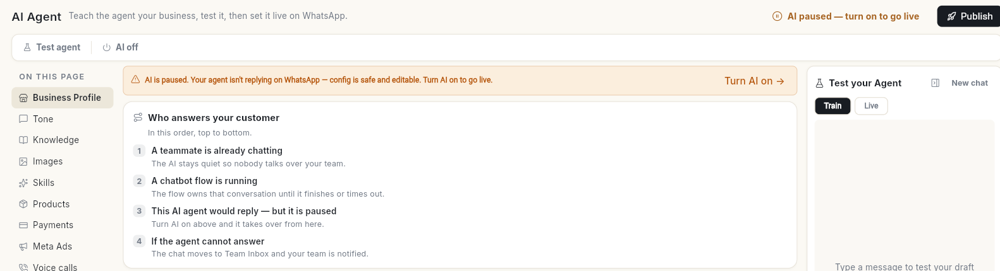
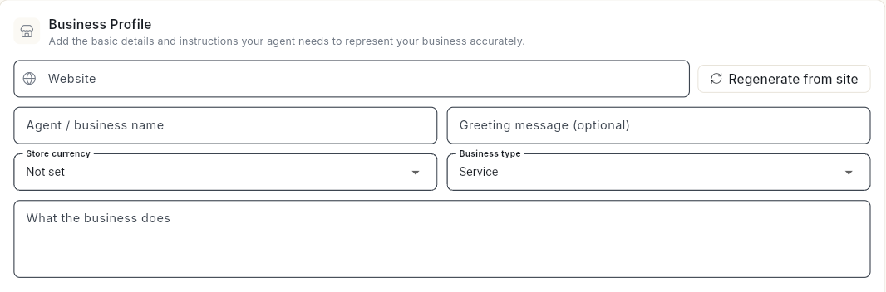
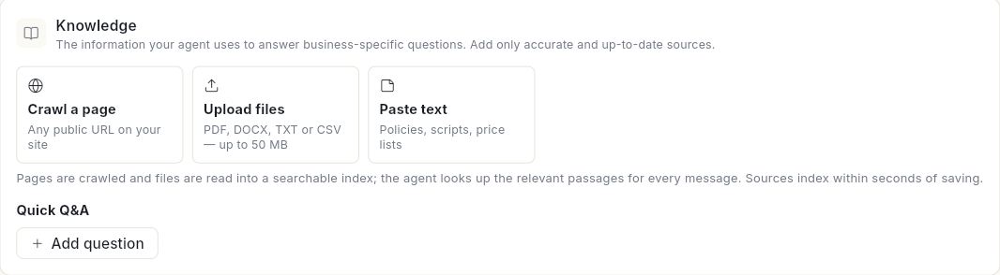
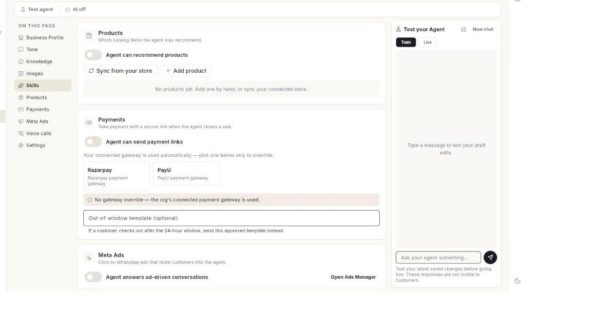
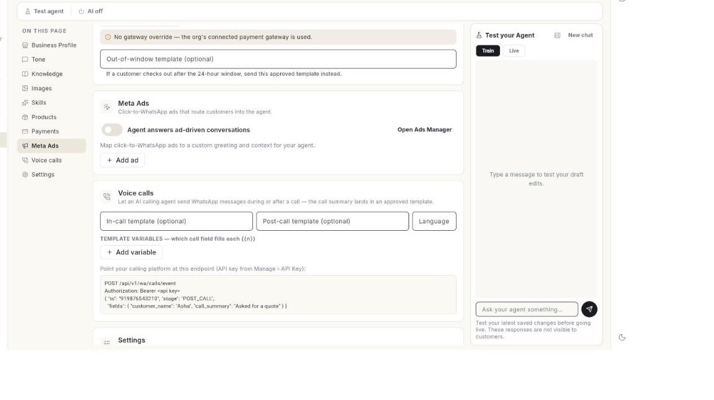
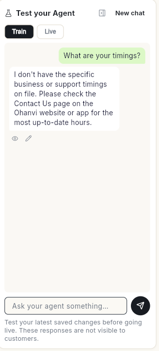
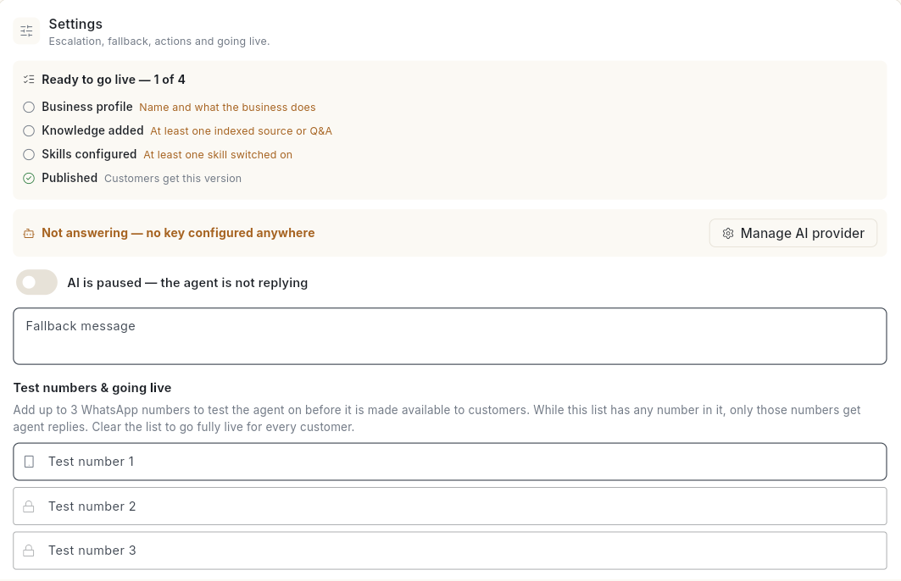

# WhatsApp AI एजेंट सेट करें { #set-up-the-whatsapp-ai-agent }

ऐसा AI एजेंट सेट करें जो आपकी अपनी बिज़नेस जानकारी के आधार पर WhatsApp पर ग्राहकों को जवाब दे। इस गाइड के अंत तक एजेंट आपके बिज़नेस को जानता होगा। जहाँ वह मदद नहीं कर पाएगा, वहाँ चैट आपकी टीम को सौंप देगा। और वह टेस्ट नंबरों के लिए, या हर ग्राहक के लिए, लाइव होगा।

## शुरू करने से पहले { #before-you-start }

- आपका WhatsApp नंबर कनेक्ट हो। देखें [अपना WhatsApp नंबर कनेक्ट करें](connect-whatsapp-number.md)।
- **WhatsApp** पैनल में आपको **AI Agent** दिखता हो। इसके लिए वही एक्सेस चाहिए जो **Flows** के लिए चाहिए। न दिखे, तो अपने एडमिन से पूछें। देखें [टीम मेंबर, रोल और अनुमतियाँ मैनेज करें](../settings/roles-and-permissions.md)।
- आपके पास क्रेडिट हों। ग्राहक तक पहुँचे हर AI जवाब के पैसे आपके क्रेडिट से कटते हैं। देखें [क्रेडिट और बिलिंग](../credits-and-billing.md)।

!!! note "AI यहाँ मैनेज होता है, Configuration में नहीं"
    AI रिप्लाई एजेंट और ऑटो-रिप्लाई अब नंबर की Configuration में सेट नहीं होते। AI के जवाब AI Assistant हब और इसी पेज से मैनेज करें।

## स्टेप्स { #steps }

### पहले जानें कि जवाब कौन देता है { #know-who-answers-first }

लेफ़्ट रेल में **WhatsApp** खोलें, फिर **AI Agent** चुनें। **Who answers your customer** कार्ड में ऊपर से नीचे यह क्रम दिखता है:

1. **A teammate is already chatting** — AI चुप रहता है, ताकि वह आपकी टीम के बीच में न बोले।
2. **A chatbot flow is running** — Flow खत्म होने या टाइम आउट होने तक बातचीत उसी के पास रहती है।
3. **Otherwise this AI agent replies** — वह जवाब इसी पेज पर आपकी की हुई सारी सेटिंग्स के हिसाब से देता है।
4. **If the agent cannot answer** — चैट Inbox में चली जाती है और आपकी टीम को नोटिफ़िकेशन मिलता है।

AI बंद हो, तो लाइन 3 में **This AI agent would reply — but it is paused** लिखा होता है। साथ ही ऊपर एक बार में **Turn AI on** का विकल्प मिलता है।



### अपने बिज़नेस के बारे में बताएँ { #describe-your-business }

1. बाईं ओर की लिस्ट में **Business Profile** चुनें।
2. **Website** में अपनी साइट का पता लिखें, फिर **Regenerate from site** पर क्लिक करें। Ohanvi आपकी वेबसाइट से आपकी जानकारी का ड्राफ़्ट बना देता है।
3. **Agent / business name**, **Greeting message (optional)**, **Store currency**, **Business type** और **What the business does** देख लें। बिज़नेस टाइप में **Other** चुना हो, तो उसके बारे में लिखें।

    

4. **Persona & guardrails** के नीचे ज़रूरत के हिसाब से **Allowed topics**, **Forbidden topics**, **Off-topic response** और **Escalation triggers** भरें।
5. **Tone** चुनें। एक टोन चुनें और **Response length** भी चुनें: **Short**, **Medium** या **Long**।
6. **Save changes** पर क्लिक करें। **AI agent saved.** मैसेज आएगा।

### पर्सोना, एक्स्ट्रा नोट और कस्टम टोन जोड़ें { #add-a-persona-extra-notes-and-a-custom-tone }

1. बाईं ओर की लिस्ट में **Business Profile** चुनें।
2. **Persona & guardrails** के नीचे **Persona statement** लिखें, जैसे `You are Meera, our support assistant.`
3. एजेंट को जो काम हमेशा करना है या कभी नहीं करना है, और जो बाकी बॉक्स में फ़िट नहीं होता, उसे **Additional notes** में लिखें।
4. **Tone** चुनें। एक टोन चुनें और **Response length** भी चुनें।
5. **Advanced tone settings** पर क्लिक करके उसे खोलें।
6. **Custom tone instructions** लिखें, जैसे `Always answer in Hinglish. Address customers as "ji".`
7. **Save changes** पर क्लिक करें।

### नॉलेज जोड़ें { #add-knowledge }

1. **Knowledge** चुनें।
2. कोई स्रोत जोड़ें:
    - **Crawl a page** — आपकी साइट का कोई भी पब्लिक URL।
    - **Upload files** — PDF, DOCX, TXT या CSV, हर फ़ाइल अधिकतम 50 MB की।
    - **Paste text** — पॉलिसी, स्क्रिप्ट या प्राइस लिस्ट।

    

3. **Quick Q&A** के नीचे **Add question** पर क्लिक करें और एक सवाल और उसका **Answer** लिखें।
4. **Save changes** पर क्लिक करें। सेव करने के कुछ ही सेकंड में स्रोत इंडेक्स हो जाते हैं।

किसी स्रोत पर **Not indexed yet — use Re-index all** दिखे, तो **Re-index all** पर क्लिक करें।

### नाम के साथ पेज, फ़ाइल या टेक्स्ट जोड़ें { #add-a-page-a-file-or-text-by-name }

1. **Knowledge** चुनें।
2. पेज जोड़ने के लिए **Crawl a page** पर क्लिक करें। **Crawl a page** विंडो में **Name** और **Page URL** लिखें, फिर **Add** पर क्लिक करें।
3. टेक्स्ट जोड़ने के लिए **Paste text** पर क्लिक करें। **Paste text** विंडो में **Name** और **Text** लिखें, फिर **Add** पर क्लिक करें।
4. फ़ाइल जोड़ने के लिए **Upload files** पर क्लिक करें और PDF, DOCX, TXT, CSV या MD फ़ाइल चुनें। मैसेज **[file name] added — save to index it.** आएगा।
5. नए स्रोत इंडेक्स करने के लिए **Save changes** पर क्लिक करें।
6. कोई स्रोत हटाना हो, तो ट्रैश आइकन (**Remove**) पर क्लिक करें, फिर **Save changes** पर क्लिक करें।

अपलोड की गई फ़ाइल का लिंक 7 दिन चलता है। उसके बाद फ़ाइल को दोबारा इंडेक्स करने के लिए उसे फिर से अपलोड करें। देखें [AI एजेंट के जवाब देखें और सुधारें](review-and-correct-ai-agent-answers.md)।

### वे इमेज जोड़ें जो एजेंट भेज सकता है { #add-images-the-agent-may-send }

1. बाईं ओर की लिस्ट में **Images** चुनें।
2. **Image URL** में फ़ोटो का वेब पता लिखें, जैसे प्रोडक्ट की फ़ोटो, मेन्यू या ब्रोशर। पहले फ़ाइल अपलोड करनी हो, तो [मीडिया लाइब्रेरी](manage-media-library.md) इस्तेमाल करें।
3. **Add** पर क्लिक करें। इमेज लिस्ट में आ जाएगी।
4. एजेंट कोई इमेज न भेजे, इसके लिए उसके बगल के ट्रैश आइकन (**Remove**) पर क्लिक करें।
5. **Save changes** पर क्लिक करें।

प्रोडक्ट जोड़ने के बाद प्रोडक्ट की इमेज यहाँ अपने-आप दिखने लगती हैं।

### स्किल चुनें { #choose-skills }

1. **Skills** चुनें। हर स्किल एक काम है जो एजेंट कर सकता है।
2. कोई स्किल खोलें और उसे सेट करने के लिए **Configure** पर क्लिक करें:

    | स्किल | यह क्या करता है |
    | --- | --- |
    | **FAQ / Support** | आपकी नॉलेज से आम सवालों के जवाब देता है। |
    | **Human Handoff** | ग्राहक किसी इंसान से बात करना चाहे, परेशान हो, या कोई ऐसी बात उठाए जो एजेंट के दायरे से बाहर है, तो चैट आपकी टीम को सौंप देता है। |
    | **Lead Qualification** | संभावित ग्राहक से आपके तय किए सवाल पूछता है और Lead को आपके CRM में भेज सकता है। |
    | **Order Status** | कनेक्ट किए गए एक्शन से ऑर्डर ढूँढता है और उसका स्टेटस बताता है। |

3. अपना खुद का काम जोड़ना हो, तो **Custom skills** के नीचे **Add custom skill** पर क्लिक करें।

इसी लिस्ट में **Products**, **Payments**, **Meta Ads** और **Voice calls** भी हैं। इनसे एजेंट प्रोडक्ट सुझा सकता है, पेमेंट लिंक भेज सकता है, विज्ञापन से आई चैट का जवाब दे सकता है और कॉलिंग एजेंट के साथ काम कर सकता है।

### बताएँ कि स्किल कब चले और क्या जानकारी ले { #say-when-a-skill-is-used-and-what-it-collects }

हर स्किल में ये 2 बॉक्स एक जैसे होते हैं।

1. **Skills** चुनें, कोई स्किल खोलें और **Configure** पर क्लिक करें।
2. **When it is used** में लिखें कि स्किल किस मौके पर चले, जैसे `The customer asks about delivery times or shipping charges`।
3. **Information to collect** के नीचे **Add question** पर क्लिक करें।
4. वह **Question** लिखें जो एजेंट पूछेगा, जैसे `Which city are you in?`
5. **Save as attribute** लिखें, जैसे `City`। हर जवाब Contact पर इसी एट्रिब्यूट के नाम से सेव होता है।
6. स्किल को चालू करने के लिए उस पर लगे बॉक्स में टिक करें।
7. **Save changes** पर क्लिक करें।

### Lead Qualification सेट करें { #set-up-lead-qualification }

1. **Lead Qualification** खोलें और **Configure** पर क्लिक करें।
2. **First qualifying question** लिखें।
3. **Question 2** और **Question 3** लिखें।
4. **Questions to collect** के नीचे वह हर जानकारी लिखें जो एजेंट Lead को आपकी टीम को सौंपने से पहले इकट्ठा करता है, फिर **Add** पर क्लिक करें। [VERIFY: example text for this box]
5. चाहें तो **Template the agent can send (optional)** लिखें। किसी अप्रूव्ड Template का नाम डालें।
6. चाहें तो **Use when contacts arrive from this ad** लिखें। सभी विज्ञापनों के लिए इसे **Any / no ad** ही रहने दें।
7. चाहें तो **Push qualified leads to your CRM (optional)** में टिक करें।
8. **Save changes** पर क्लिक करें।

### कस्टम स्किल जोड़ें { #add-a-custom-skill }

1. **Custom skills** के नीचे **Add custom skill** पर क्लिक करें। नया स्किल कार्ड खुलेगा।
2. **Icon** लिखें, जैसे एक इमोजी।
3. **Skill name** लिखें, जैसे `Book a demo`।
4. **Step-by-step instructions** लिखें। स्टेप्स को नंबर दें, जैसे `1. Ask which product…`
5. ऊपर बताए तरीके से **When it is used** और **Information to collect** भरें।
6. स्किल को चालू करने के लिए कार्ड पर लगे बॉक्स में टिक करें।
7. स्किल हटाने के लिए **Delete skill** पर क्लिक करें।
8. **Save changes** पर क्लिक करें।

### एजेंट को प्रोडक्ट सुझाने दें { #let-the-agent-recommend-products }

1. **Products** चुनें।
2. **Agent can recommend products** चालू करें।
3. अपने स्टोर से प्रोडक्ट लाने के लिए **Sync from your store** पर क्लिक करें। इंटीग्रेशन वाली स्क्रीन खुलेगी।
4. हाथ से जोड़ना हो, तो **Add product** पर क्लिक करें। **Add product** विंडो खुलेगी।
5. **Name**, **Price** (जैसे `₹4,999`) और **Description** लिखें।
6. चाहें तो **Image URL (optional)** लिखें।
7. **Add** पर क्लिक करें।
8. कोई प्रोडक्ट हटाना हो, तो ट्रैश आइकन (**Remove**) पर क्लिक करें।
9. **Save changes** पर क्लिक करें।

कोई प्रोडक्ट न हो, तो लिस्ट में **No products yet. Add one by hand, or sync your connected store.** लिखा आता है। पहले कैटलॉग बनाना हो, तो देखें [अपना WhatsApp कैटलॉग सेट करें](set-up-whatsapp-catalog.md)।

### एजेंट को पेमेंट लिंक भेजने दें { #let-the-agent-send-payment-links }

1. **Payments** चुनें।

    

2. **Agent can send payment links** चालू करें।
3. चाहें तो **Razorpay** या **PayU** पर क्लिक करके वही गेटवे चुनें। चुनाव हटाने के लिए उस पर दोबारा क्लिक करें।
4. चाहें तो **Out-of-window template (optional)** लिखें, जैसे `order_payment_reminder`। ग्राहक 24 घंटे की विंडो बंद होने के बाद चेकआउट करे, तो एजेंट यही अप्रूव्ड Template भेजता है।
5. **Save changes** पर क्लिक करें।

कोई चुनाव न किया हो, तो पेज पर **No gateway override — the org's connected payment gateway is used.** दिखता है।

### विज्ञापन की चैट एजेंट को भेजें { #send-ad-chats-to-the-agent }

1. **Meta Ads** चुनें।

    

2. **Agent answers ad-driven conversations** चालू करें। अपने विज्ञापन देखने के लिए **Open Ads Manager** पर क्लिक करें। देखें [विज्ञापन बनाएँ](ads-manager/create-an-ad.md)।
3. **Add ad** पर क्लिक करें। **Add ad** विंडो खुलेगी।
4. **Ad name / id** लिखें।
5. उस विज्ञापन से आने वाले लोगों के लिए **Custom greeting** लिखें।
6. **Context for the agent** लिखें, ताकि एजेंट जान सके कि विज्ञापन में क्या वादा किया गया था।
7. **Add** पर क्लिक करें।
8. कोई विज्ञापन हटाना हो, तो ट्रैश आइकन (**Remove**) पर क्लिक करें।
9. **Save changes** पर क्लिक करें।

### वॉइस कॉल कनेक्ट करें { #connect-voice-calls }

यह तब काम आता है जब कोई AI कॉलिंग एजेंट कॉल के दौरान या कॉल के बाद WhatsApp मैसेज भेजे।

1. **Voice calls** चुनें।
2. **In-call template (optional)** और **Post-call template (optional)** लिखें। अप्रूव्ड Template के नाम डालें।
3. **Language** लिखें, जैसे `en_US`।
4. **Template variables** के नीचे **Add variable** पर क्लिक करें।
5. **{{n}}** में वेरिएबल का नंबर लिखें, जैसे `1`।
6. **Call field** में कॉल की वह जानकारी लिखें जिससे यह वेरिएबल भरेगा, जैसे `customer_name`, `call_summary` या `agent_name`।
7. **Manage** → **API Key** खोलें और अपनी API key कॉपी करें।
8. अपने कॉलिंग प्लेटफ़ॉर्म को पेज पर दिखे एंडपॉइंट से जोड़ें, और key को बियरर टोकन की तरह दें।
9. **Save changes** पर क्लिक करें।

पेज पर यह उदाहरण दिखता है:

```
POST /api/v1/wa/calls/event
Authorization: Bearer <api key>
{ "to": "919876543210", "stage": "POST_CALL",
  "fields": { "customer_name": "Asha", "call_summary": "Asked for a quote" } }
```

अपने WhatsApp नंबर पर कॉलिंग के बारे में देखें [WhatsApp कॉलिंग](whatsapp-calling.md)।

### API एक्शन जोड़ें { #add-an-api-action }

एक्शन से एजेंट लाइव जानकारी देख सकता है या कोई काम पूरा कर सकता है, जैसे ऑर्डर का स्टेटस बताना या नई Lead बनाना।

1. **Settings** चुनें। **Actions** तक स्क्रॉल करें।
2. **Add custom API action** पर क्लिक करें। विंडो खुलेगी।
3. चाहें तो **Paste cURL (optional)** में cURL कमांड पेस्ट करें, फिर **Fill from cURL** पर क्लिक करें। इससे मेथड, URL, हेडर, बॉडी और बियरर टोकन अपने-आप भर जाते हैं।
4. **Action name** लिखें, जैसे `Check order status`।
5. **When should the agent call it?** में लिखें कि एजेंट इसे किस मौके पर चलाए, जैसे `The customer asks where their order is and gives an order number`।
6. **Intent group** लिखें, जैसे `orders`, `appointments` या `crm`।
7. **Sensitivity** चुनें: **Low — runs without asking** या **High — confirm first**।
8. **Method** चुनें: **GET**, **POST**, **PUT**, **PATCH** या **DELETE**।
9. **URL** लिखें, जैसे `https://api.example.com/orders/{{order_id}}`।
10. **Headers** और **Query params** लिखें, हर लाइन में एक, `Key: value` के रूप में।
11. **POST**, **PUT** या **PATCH** के लिए **Body** लिखें, जैसे `{"order_id": "{{order_id}}"}`।
12. **Authentication** चुनें: **None**, **Bearer token**, **Basic auth** या **API key (header)**। जो बॉक्स दिखें, उन्हें भरें।
13. **Variables** के नीचे **Add variable** पर क्लिक करें। **Name** लिखें, जैसे `order_id`, और **What it is** भी लिखें।
14. **Examples (one per line, 1–5)** लिखें, जैसे `Customer: "where is order 1001?" → order_id=1001`।
15. चाहें तो **Test call — sample values (name=value per line)** में सैंपल वैल्यू लिखें, फिर **Test call** पर क्लिक करें। नतीजे में HTTP स्टेटस और बॉडी दिखती है, या एरर।
16. **Add** पर क्लिक करें। किसी एक्शन को एडिट करते समय बटन पर **Save** लिखा होता है।

एक्शन के लिए नाम और URL ज़रूरी हैं। **High** सेंसिटिविटी वाले एक्शन पर शील्ड आइकन लगा होता है। एक्शन बदलने या डिलीट करने के लिए उसके बगल के पेंसिल (**Edit**) और ट्रैश (**Remove**) आइकन इस्तेमाल करें। अपने एक्शन रखने के लिए पेज पर **Save changes** पर क्लिक करें।

!!! tip "सुझाव: सेव करने से पहले टेस्ट करें"
    **Test call** आपके URL पर असली रिक्वेस्ट भेजता है। ऐसी सैंपल वैल्यू लें जिन्हें भेजना सुरक्षित हो।

### इंसान को हैंडऑफ़ सेट करें { #set-the-handoff-to-a-human }

1. **Settings** चुनें।
2. **Hand off to a human** के नीचे वे **Trigger phrases** लिखें जिनसे हैंडऑफ़ शुरू होता है, जैसे **talk to a human**।
3. वह **Handoff message** लिखें जो ग्राहक को मिलेगा।
4. चाहें तो **Handoff webhook (optional)** के नीचे **Webhook URL** डालें। इससे आपके हेल्पडेस्क या CRM को हर हैंडऑफ़ की खबर मिलती रहेगी।
5. **Fallback message** लिखें। यह तब जाता है जब एजेंट के पास जवाब न हो।

हैंडऑफ़ की गई चैट Inbox में चली जाती है और आपकी टीम को नोटिफ़िकेशन मिलता है। देखें [WhatsApp Inbox का इस्तेमाल करें](use-whatsapp-inbox.md)।

### हैंडऑफ़ वेबहुक को सुरक्षित करें { #secure-the-handoff-webhook }

1. **Settings** चुनें। **Hand off to a human** के नीचे **Webhook URL** ढूँढें।
2. **Authorization header (optional)** लिखें, जैसे `Bearer …`।
3. **Extra headers (JSON, optional)** लिखें, जैसे `{"X-Source":"whatsapp"}`।
4. **Save changes** पर क्लिक करें।

Ohanvi हर हैंडऑफ़ को JSON में भेजता है। इसमें ये फ़ील्ड होते हैं: `event`, `orgId`, `phone`, `contactName`, `reason`, `lastMessage` और `at`।

### एजेंट को टेस्ट करें { #test-the-agent }

1. **Test agent** पर क्लिक करें। **Test your Agent** पैनल खुलेगा।
2. अपने ताज़ा सेव किए बदलाव टेस्ट करने के लिए **Train** को चुना हुआ रहने दें। **Ask your agent something…** में सवाल लिखें और जवाब पढ़ें। टेस्ट के जवाब ग्राहकों को नहीं दिखते। फिर से शुरू करने के लिए **New chat** पर क्लिक करें।

    

3. कोई जवाब गलत लगे, तो जवाब के नीचे पेंसिल आइकन (**Correct this answer**) पर क्लिक करें, **What the agent should say** लिखें, फिर **Save & teach** पर क्लिक करें।

### लाइव करें { #go-live }

1. **Settings** → **Test numbers & going live** के नीचे अधिकतम 3 WhatsApp नंबर जोड़ें, ताकि एजेंट को पहले उन पर आज़मा सकें। लिस्ट में जब तक कोई नंबर है, एजेंट के जवाब सिर्फ़ उन्हीं नंबरों को मिलते हैं।
2. **Ready to go live** देखें। यह बताता है कि कितनी चीज़ें पूरी हैं, जैसे **1 of 4**, और **Business profile**, **Knowledge added**, **Skills configured** और **Published** की लिस्ट दिखाता है। उसके नीचे **Not answering — no key configured anywhere** दिखे, तो **Manage AI provider** पर क्लिक करें और पहले एक key जोड़ें।

    

3. **Publish & go live** पर क्लिक करें। मैसेज **Published — customers now get this version.** आएगा।
4. **Turn AI on** से एजेंट को चालू करें। स्टेटस में **AI is live** दिखेगा।
5. हर ग्राहक के लिए तैयार हों, तो टेस्ट नंबर हटा दें।

एजेंट को रोकने के लिए **Pause AI** पर क्लिक करें। आपके सेव किए बदलाव ग्राहकों तक तभी पहुँचते हैं जब आप पब्लिश करते हैं।

## वीडियो वॉकथ्रू { #video-walkthrough }

[VIDEO]

## समस्या का समाधान { #troubleshooting }

| समस्या | कारण | समाधान |
| --- | --- | --- |
| **Tell us your business type — "Other" needs a description.** | **Business type** **Other** है, पर उसके बारे में कुछ लिखा नहीं है। | अपने बिज़नेस टाइप के बारे में लिखें, फिर सेव करें। |
| **Enter your website first.** | **Website** खाली है। | अपनी साइट का पता लिखें, फिर **Regenerate from site** पर क्लिक करें। |
| **Could not draft anything from that site.** | साइट पढ़ी नहीं जा सकी। | **What the business does** हाथ से भरें। |
| **Files must be 50 MB or smaller.** | फ़ाइल बहुत बड़ी है। | फ़ाइल के टुकड़े करें या उसे कंप्रेस करें। |
| ग्राहकों को पुराने जवाब मिल रहे हैं | आपके बदलाव सेव हैं, पर पब्लिश नहीं हुए। | **Publish & go live** पर क्लिक करें। |
| एजेंट ने जवाब देना बंद कर दिया | आपके क्रेडिट ख़त्म हो गए हैं, या जवाब सिर्फ़ टेस्ट नंबरों को मिल रहे हैं। | रीचार्ज करें, और टेस्ट नंबर हटा दें। देखें [जब क्रेडिट कम हों या ख़त्म हो जाएँ](../billing/low-or-empty-credits.md)। |

## संबंधित गाइड { #related }

- [AI एजेंट के जवाब देखें और सुधारें](review-and-correct-ai-agent-answers.md)
- [WhatsApp Inbox का इस्तेमाल करें](use-whatsapp-inbox.md)
- [WhatsApp चैटबॉट Flow बनाएँ](../create-whatsapp-flow.md)
- [अपनी खुद की या मैनेज्ड सेवाएँ चुनें](../settings/choose-connectors.md)
- [अपने अकाउंट में पैसे जोड़ें](../add-funds.md)
