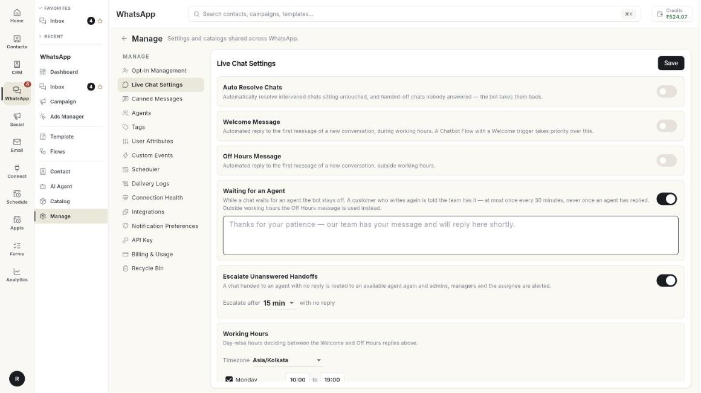

# लाइव चैट सेटिंग्स सेट करें { #set-up-live-chat-settings }

Live Chat Settings से आप अपने टीम Inbox के ऑटोमैटिक जवाब और टाइमर तय करते हैं। इस गाइड के अंत तक ग्राहकों को वेलकम या ऑफ़-आवर्स जवाब मिलेगा। इंतज़ार कर रहे ग्राहकों को पता चलेगा कि उनकी चैट आपकी टीम के पास है। और जिस चैट का कोई जवाब नहीं देता, वह किसी दूसरे एजेंट के पास चली जाएगी। इसमें करीब 5 मिनट लगते हैं।

## शुरू करने से पहले { #before-you-start }

- आपका WhatsApp नंबर Ohanvi से कनेक्ट हो। देखें [अपना WhatsApp नंबर कनेक्ट करें](connect-whatsapp-number.md)।
- **WhatsApp** पैनल में आपको **Manage** खोलना आता हो। न खुले, तो अपने एडमिन से पूछें।
- आपके पास चैट का जवाब देने वाले एजेंट हों। देखें [WhatsApp एजेंट जोड़ें](add-whatsapp-agents.md)।

## हर सेटिंग क्या करती है { #what-each-setting-does }

| सेटिंग | यह क्या करती है |
| --- | --- |
| **Auto Resolve Chats** | उन चैट को बंद कर देती है जिन्हें आपने खुद संभाला, पर बाद में किसी ने छुआ नहीं। साथ ही उन हैंडऑफ़ चैट को भी बंद करती है जिनका किसी ने जवाब नहीं दिया। इसके बाद बॉट ग्राहक को फिर से संभाल लेता है। |
| **Welcome Message** | नई बातचीत के पहले मैसेज का ऑटोमैटिक जवाब। यह काम के घंटों में जाता है। |
| **Off Hours Message** | नई बातचीत के पहले मैसेज का ऑटोमैटिक जवाब। यह काम के घंटों के बाहर जाता है। |
| **Waiting for an Agent** | दोबारा मैसेज करने वाले ग्राहक को बताती है कि उसकी चैट आपकी टीम के पास है। |
| **Escalate Unanswered Handoffs** | बिना जवाब वाली हैंडऑफ़ चैट किसी दूसरे उपलब्ध एजेंट को दे देती है, और आपकी टीम को अलर्ट भेजती है। |
| **Working Hours** | वे दिन और समय जिनसे तय होता है कि वेलकम जाए या ऑफ़-आवर्स जवाब। हर नंबर के अपने घंटे भी **Configuration** में सेट हो सकते हैं। देखें [कई WhatsApp नंबर चलाएँ](run-multiple-whatsapp-numbers.md)। |

!!! note "चैटबॉट Flow पहले चलते हैं"
    Welcome ट्रिगर वाला चैटबॉट Flow **Welcome Message** से पहले चलता है। देखें [WhatsApp चैटबॉट Flow बनाएँ](../create-whatsapp-flow.md)।

## स्टेप्स { #steps }

### Live Chat Settings खोलें { #open-live-chat-settings }

1. लेफ़्ट रेल में **WhatsApp** खोलें, फिर **Manage** चुनें।
2. **Live Chat Settings** चुनें। पेज पर ऊपर बताई सारी सेटिंग्स और एक **Save** बटन दिखता है।

    

कोई नंबर कनेक्ट न हो, तो पेज पर **No WhatsApp account connected** दिखता है। पहले कोई नंबर कनेक्ट करें।

### खाली पड़ी चैट अपने-आप रिज़ॉल्व करें { #resolve-idle-chats-automatically }

1. **Auto Resolve Chats** चालू करें।
2. **Resolve after** लिस्ट खोलें।
3. चैट कितनी देर खाली रहने पर बंद हो, यह चुनें: **1 h**, **2 h**, **4 h**, **8 h**, **12 h**, **24 h**, **48 h** या **72 h**।
4. **Save** पर क्लिक करें।

### वेलकम मैसेज भेजें { #send-a-welcome-message }

1. **Welcome Message** चालू करें। एक टेक्स्ट बॉक्स खुलेगा।
2. जवाब लिखें। बॉक्स में एक उदाहरण दिखता है: `Hey, welcome! How can we help you?`
3. **Save** पर क्लिक करें।

यह जवाब सिर्फ़ आपके काम के घंटों में जाता है।

### ऑफ़-आवर्स मैसेज भेजें { #send-an-off-hours-message }

1. **Off Hours Message** चालू करें। एक टेक्स्ट बॉक्स खुलेगा।
2. जवाब लिखें। बॉक्स में एक उदाहरण दिखता है: `Hey there, our support is currently offline. We'll get back to you soon.`
3. **Save** पर क्लिक करें।

### इंतज़ार कर रहे ग्राहकों को बताएँ कि उनकी चैट टीम के पास है { #tell-waiting-customers-that-the-team-has-their-chat }

1. **Waiting for an Agent** चालू करें। एक टेक्स्ट बॉक्स खुलेगा।
2. जवाब लिखें। बॉक्स में एक उदाहरण दिखता है: `Thanks for your patience — our team has your message and will reply here shortly.`
3. **Save** पर क्लिक करें।

सीमाएँ:

- यह जवाब 30 मिनट में सिर्फ़ एक बार जाता है।
- किसी एजेंट के जवाब देने के बाद यह कभी नहीं जाता।
- काम के घंटों के बाहर इसकी जगह **Off Hours Message** जाता है।

### जिन चैट का कोई जवाब नहीं देता, उन्हें आगे भेजें { #escalate-chats-nobody-answers }

1. **Escalate Unanswered Handoffs** चालू करें। **Escalate after** लिस्ट खुलेगी।
2. **5 min**, **10 min**, **15 min**, **30 min** या **60 min** चुनें। डिफ़ॉल्ट **15 min** है।
3. **Save** पर क्लिक करें।

इसके बाद जिस हैंडऑफ़ चैट का जवाब नहीं आता, वह किसी दूसरे उपलब्ध एजेंट के पास चली जाती है। एडमिन, मैनेजर और जिसे चैट असाइन थी, उन सबको अलर्ट मिलता है।

### अपने काम के घंटे सेट करें { #set-your-working-hours }

1. **Working Hours** तक स्क्रॉल करें।
2. **Timezone** लिस्ट खोलें और अपना टाइमज़ोन चुनें, जैसे **Asia/Kolkata**।
3. हर दिन के लिए, दिन के नाम के आगे वाले बॉक्स में टिक करें। टिक का मतलब है कि उस दिन आप खुले हैं।
4. खुलने का समय सेट करने के लिए पहले वाले समय पर क्लिक करें। टाइम पिकर खुलेगा। समय चुनें।
5. बंद होने का समय सेट करने के लिए **to** के बाद वाले दूसरे समय पर क्लिक करें।
6. किसी दिन को बंद रखना हो, तो उसका टिक हटा दें। तब उस लाइन में **Closed** लिखा दिखता है।

7. **Save** पर क्लिक करें। मैसेज **Live chat settings saved.** दिखेगा।

!!! tip "आखिर में एक बार सेव करें"
    एक **Save** से पेज की सारी सेटिंग्स सेव हो जाती हैं। **Could not save settings.** दिखे, तो **Save** पर दोबारा क्लिक करें।

## समस्या का समाधान { #troubleshooting }

| समस्या | कारण | समाधान |
| --- | --- | --- |
| **No WhatsApp account connected** | इस वर्कस्पेस से कोई नंबर जुड़ा नहीं है। | कोई नंबर कनेक्ट करें। देखें [अपना WhatsApp नंबर कनेक्ट करें](connect-whatsapp-number.md)। |
| **Could not save settings.** | सेव की रिक्वेस्ट फ़ेल हो गई। | इंटरनेट कनेक्शन देखें, फिर **Save** पर दोबारा क्लिक करें। |
| वेलकम मैसेज नहीं जाता | चैट काम के घंटों के बाहर शुरू हुई, या Welcome ट्रिगर वाले चैटबॉट Flow ने पहले जवाब दे दिया। | **Working Hours** देखें, और अपने Flow भी देखें। |
| ग्राहकों को दिन में ऑफ़-आवर्स मैसेज मिलता है | **Timezone** या उस दिन के घंटे गलत हैं। | उन्हें **Working Hours** में ठीक करें और **Save** पर क्लिक करें। |
| चैट आगे नहीं जा रही | **Escalate Unanswered Handoffs** बंद है, या **Escalate after** का समय अभी पूरा नहीं हुआ। | इसे चालू करें और समय चुनें। |

## संबंधित गाइड { #related }

- [WhatsApp Inbox का इस्तेमाल करें](use-whatsapp-inbox.md)
- [WhatsApp एजेंट जोड़ें](add-whatsapp-agents.md)
- [कनेक्शन की सेहत देखें](check-connection-health.md)
- [WhatsApp चैटबॉट Flow बनाएँ](../create-whatsapp-flow.md)
