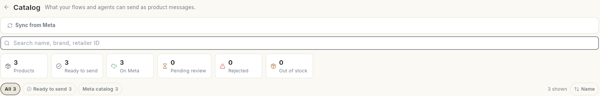
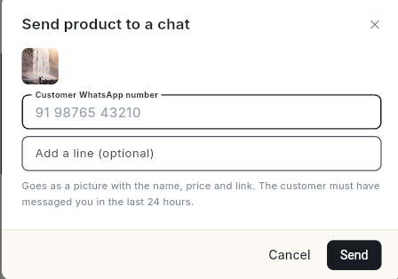

# अपना WhatsApp कैटलॉग सेट करें { #set-up-your-whatsapp-catalog }

अपने WhatsApp **Catalog** में वे प्रोडक्ट डालें जो आप बेचते हैं। फिर एजेंट, फ़्लो और टेम्प्लेट उन्हें प्रोडक्ट मैसेज की तरह भेज सकेंगे। इस गाइड के बाद आपके प्रोडक्ट Meta या आपके स्टोर से सिंक हो चुके होंगे। आपको पता होगा कि कौन-से प्रोडक्ट **Ready to send** हैं। और आप किसी ग्राहक को एक प्रोडक्ट भेज चुके होंगे।

## शुरू करने से पहले { #before-you-start }

- आपका WhatsApp नंबर Ohanvi से कनेक्ट होना चाहिए। देखें [अपना WhatsApp नंबर कनेक्ट करें](connect-whatsapp-number.md)।
- Meta Commerce Manager में आपका एक कैटलॉग होना चाहिए, जो आपके WhatsApp Business Account से जुड़ा हो। WhatsApp सिर्फ़ उसी Meta कैटलॉग के प्रोडक्ट भेज सकता है।
- **WhatsApp** पैनल में **Catalog** दिखना चाहिए। न दिखे तो अपने एडमिन से कहें। देखें [रोल और अनुमतियाँ](../settings/roles-and-permissions.md)।

## प्रोडक्ट कहाँ से आते हैं { #where-products-come-from }

हर प्रोडक्ट कार्ड पर उसका **Source** दिखता है:

| Source | प्रोडक्ट कैसे आता है |
| --- | --- |
| **Meta catalog** | **Sync from Meta** दबाने पर आपके Commerce Manager कैटलॉग से आता है। |
| **Shopify** / **WooCommerce** | लेफ़्ट रेल में **Connect** के नीचे आपने जो स्टोर कनेक्ट किया है, वहाँ से सिंक होता है। |
| **Added by hand** | आपने **Add product** से खुद लिखकर डाला है। |

!!! note "स्टोर के प्रोडक्ट Meta में भी होने चाहिए"
    Shopify या WooCommerce से सिंक हुआ प्रोडक्ट तभी भेजा जा सकता है, जब वह आपके नंबर से जुड़े Meta कैटलॉग में भी हो। Commerce Manager में अपने स्टोर का कैटलॉग कनेक्ट करें। फिर **Sync from Meta** पर क्लिक करें।

## स्टेप्स { #steps }

### Meta से अपना कैटलॉग सिंक करें { #sync-your-catalog-from-meta }

1. लेफ़्ट रेल में **WhatsApp** खोलें और **Catalog** चुनें। **Catalog** पेज खुलेगा। ऊपर गिनती दिखती है: **Products**, **Ready to send**, **On Meta**, **Pending review**, **Rejected** और **Out of stock**।

    
2. **Sync from Meta** पर क्लिक करें। जब तक काम चलता है, बटन पर **Syncing…** दिखता है।
3. काम पूरा होने पर **Synced N product(s) from "…"** दिखता है और ग्रिड में प्रोडक्ट आ जाते हैं।

जब भी आप प्रोडक्ट बदलें, या Meta कोई रिव्यू पूरा कर दे, तब **Sync from Meta** फिर से चलाएँ।

### हाथ से प्रोडक्ट जोड़ें { #add-a-product-by-hand }

1. **Add product** पर क्लिक करें (कैटलॉग खाली हो तो **Add manually** पर)।
2. **Product name** भरें।
3. **Meta catalog ID** भरें। यह Commerce Manager में मिलती है। फिर **Retailer ID** भरें। यह उस कैटलॉग में प्रोडक्ट की कंटेंट ID होती है।
4. **Price** भरें। चाहें तो **Sale price (optional)** भी भरें। फिर **Currency** और **Availability** चुनें।
5. चाहें तो ये भी जोड़ें: **Brand (optional)**, **Image URL (optional)**, **Product page link (optional)** और **Description (optional)**।
6. **Save** पर क्लिक करें।

**Retailer ID** आपके Meta कैटलॉग के प्रोडक्ट से मिलनी चाहिए। नहीं मिली तो WhatsApp वह प्रोडक्ट नहीं भेज पाएगा।

### देखें कि कौन-से प्रोडक्ट भेजे जा सकते हैं { #check-which-products-can-be-sent }

ग्रिड के ऊपर फ़िल्टर चिप हैं, जैसे **All**, **Ready to send** और **Meta catalog**। हर चिप के साथ उसके प्रोडक्ट की गिनती दिखती है।

| फ़िल्टर | मतलब |
| --- | --- |
| **Ready to send** | प्रोडक्ट Meta पर है, अप्रूव है, दिखता है और भेजा जा सकता है। |
| **Not on Meta** | प्रोडक्ट आपके स्टोर से सिंक हुआ है, पर Meta कैटलॉग में नहीं है। इसलिए WhatsApp उसे नहीं भेज सकता। |
| **Rejected** | Meta ने प्रोडक्ट रिजेक्ट कर दिया है। जब तक आप Commerce Manager में उसे ठीक नहीं करते, ग्राहक उसे नहीं देख पाते। |
| **Pending review** | Meta अभी उसे रिव्यू कर रहा है। |
| **Out of stock** | फ़्लो फिर भी उसे भेजते हैं। यह न चाहें तो उसे स्टोर या Commerce Manager में छिपा दें। |
| **Hidden** | ग्राहकों से छिपा हुआ है। |
| **On sale** | उस पर सेल की कीमत है। |

ग्रिड के ऊपर एक चेतावनी पट्टी आती है। वह बताती है कि क्या ठीक करना है, जैसे **Show rejected** या **Show them**। जो प्रोडक्ट भेजा नहीं जा सकता, उस पर **Cannot send: not on Meta, hidden or rejected** दिखता है।

रिजेक्ट हुआ प्रोडक्ट ठीक करने के लिए उसे खोलें और **Rejected by Meta** में वजह पढ़ें। फिर **Commerce Manager** में उसे ठीक करें और दोबारा रिव्यू माँगें। अगली बार **Sync from Meta** करने पर Meta का फ़ैसला आपके पास आ जाता है।

### चैट में प्रोडक्ट भेजें { #send-a-product-in-a-chat }

1. जिस प्रोडक्ट पर **Ready to send** लिखा है, उसके कार्ड पर पेपर-प्लेन आइकन यानी **Send to a chat** पर क्लिक करें। **Send product to a chat** विंडो खुलेगी। प्रोडक्ट एक तस्वीर की तरह जाता है, जिसके साथ उसका नाम, कीमत और लिंक होता है। ग्राहक ने पिछले 24 घंटों में आपको मैसेज किया होना चाहिए।

    

2. देश कोड के साथ **Customer WhatsApp number** लिखें।
3. चाहें तो **Add a line (optional)** में एक लाइन लिखें, जैसे `This one is back in stock!`।
4. **Send** पर क्लिक करें। **Product sent.** दिखेगा।

प्रोडक्ट तस्वीर की तरह जाता है, जिसके साथ नाम, कीमत और लिंक होता है। ग्राहक ने पिछले 24 घंटों में आपको मैसेज किया होना चाहिए।

अगर आपका स्टोर कनेक्ट है, तो **Inbox** में एजेंट **Store** पैन के **Products & stock** से भी प्रोडक्ट भेज सकते हैं।

### फ़्लो में प्रोडक्ट इस्तेमाल करें { #use-products-in-a-flow }

प्रोडक्ट पर **Use in a flow** पर क्लिक करें। फ़्लो अपने Single Product और Multi Product स्टेप्स से प्रोडक्ट भेजते हैं। देखें [WhatsApp चैटबॉट फ़्लो बनाएँ](../create-whatsapp-flow.md)।

### प्रोडक्ट एडिट या डिलीट करें { #edit-or-delete-a-product }

- **Edit** पर क्लिक करें, **Edit product** खुल जाएगा। सिंक हुए प्रोडक्ट का नाम, इमेज, कीमत और स्टॉक अगले सिंक में दोबारा बदल सकते हैं। इसलिए ये चीज़ें वहीं बदलें जहाँ से प्रोडक्ट आया है।
- **Delete product** पर क्लिक करें, फिर **Delete** पर। जो फ़्लो उसकी retailer ID इस्तेमाल करते हैं, वे चलते रहते हैं। सिंक हुआ प्रोडक्ट अगले सिंक पर वापस आ जाता है। उसे हमेशा के लिए हटाना हो तो वहीं से हटाएँ जहाँ से वह आया है।

## वीडियो वॉकथ्रू { #video-walkthrough }

[VIDEO]

## समस्या का समाधान { #troubleshooting }

| समस्या | कारण | समाधान |
| --- | --- | --- |
| **No catalog is connected to your WhatsApp Business Account yet. Link one in Meta Commerce Manager, then sync again.** | आपके नंबर से कोई Meta कैटलॉग नहीं जुड़ा है। | Commerce Manager में अपने WhatsApp Business Account से एक कैटलॉग जोड़ें। फिर **Sync from Meta** पर क्लिक करें। |
| **Your Meta access token cannot read the catalog — it needs the catalog_management permission. Reconnect via WhatsApp Settings.** | आपके WhatsApp कनेक्शन को कैटलॉग की अनुमति नहीं मिली है। | अपना WhatsApp अकाउंट कैटलॉग एक्सेस के साथ दोबारा कनेक्ट करें। देखें [अपना WhatsApp नंबर कनेक्ट करें](connect-whatsapp-number.md)। |
| **WhatsApp is not connected yet — finish the Cloud API setup first.** | नंबर कनेक्ट नहीं हुआ है। | पहले अपना नंबर कनेक्ट करने का काम पूरा करें। |
| प्रोडक्ट पर **Not on Meta** दिखता है | प्रोडक्ट आपके स्टोर से आया है, पर Meta कैटलॉग में नहीं है। | Commerce Manager में स्टोर का कैटलॉग कनेक्ट करें, फिर **Sync from Meta** करें। |
| **Catalog ID is required** / **Retailer ID is required** | कोई ज़रूरी फ़ील्ड खाली है। | दोनों Commerce Manager से कॉपी करके डालें। |

## संबंधित गाइड { #related }

- [WhatsApp चैटबॉट फ़्लो बनाएँ](../create-whatsapp-flow.md)
- [WhatsApp मैसेज टेम्प्लेट बनाएँ](create-message-template.md)
- [कनेक्टर चुनें](../settings/choose-connectors.md)
