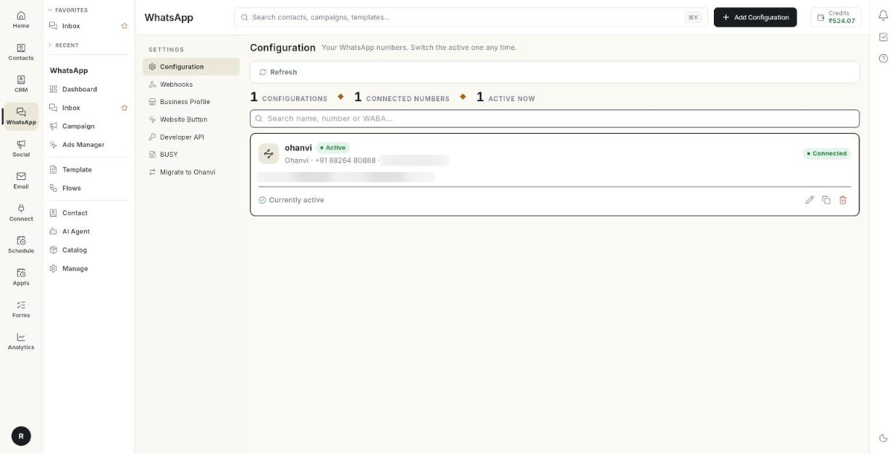

# व्हाट्सऐप सेट करें { #set-up-whatsapp }

ये स्क्रीन व्हाट्सऐप पैनल में नहीं हैं। नीचे बाएँ में अपने नाम के पहले अक्षरों पर क्लिक करें, फिर Settings → WhatsApp। ये आपका नंबर कनेक्ट और कॉन्फ़िगर करती हैं।

**यह कहाँ मिलेगा:** नीचे बाएँ में अपने नाम के पहले अक्षरों पर क्लिक करें, **Settings** चुनें, फिर **WhatsApp**।

## गाइड { #guides }

| गाइड | कब इस्तेमाल करें |
| --- | --- |
| [अपना नंबर कनेक्ट करें](../connect-whatsapp-number.md) | आप पहली बार व्हाट्सऐप सेट कर रहे हैं। |
| [कई व्हाट्सऐप नंबर चलाएँ](../run-multiple-whatsapp-numbers.md) | आपको एक से ज़्यादा नंबर चाहिए, हर एक का अपना लेबल और बैज के साथ। |
| [नंबर एडिट करें](../whatsapp-configuration-settings.md) | आप कनेक्ट किए हुए नंबर का लेबल, बैज, ID या टोकन बदलना चाहते हैं। |
| [बिज़नेस प्रोफ़ाइल](../whatsapp-business-profile.md) | आप अपनी तस्वीर, विवरण या समय बदलना चाहते हैं। |
| [अपना नंबर Ohanvi पर लाएँ](../migrate-to-ohanvi.md) | आप किसी दूसरे व्हाट्सऐप प्रोवाइडर से आ रहे हैं। |
| [अपनी वेबसाइट पर चैट बटन जोड़ें](../add-website-chat-button.md) | आप अपनी साइट पर व्हाट्सऐप बटन चाहते हैं। |
| [वेबहुक, डेवलपर API और BUSY](../whatsapp-webhooks-and-integrations.md) | आप अपने सॉफ़्टवेयर से संदेश भेजते हैं। |

## शुरू करने से पहले { #before-you-start }

- आपके रोल के पास इस स्क्रीन का एक्सेस हो। अगर यह नहीं दिखती, तो अपने एडमिन से पूछें।
