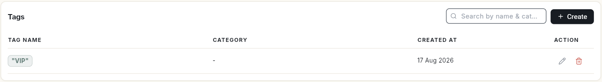
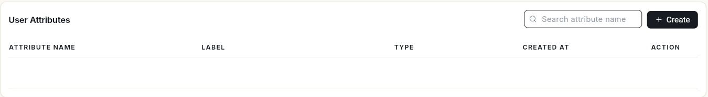
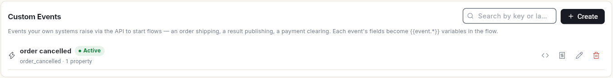

# टैग, यूज़र एट्रिब्यूट और कस्टम इवेंट मैनेज करें { #manage-tags-user-attributes-and-custom-events }

टैग से आप कॉन्टैक्ट्स को ग्रुप में रखते हैं। यूज़र एट्रिब्यूट हर कॉन्टैक्ट की अतिरिक्त जानकारी रखते हैं। कस्टम इवेंट से आपके अपने सिस्टम कोई फ़्लो शुरू कर सकते हैं। इस गाइड के बाद आपको पता होगा कि हर लिस्ट कहाँ है और उसमें नया कैसे जोड़ना है।

## शुरू करने से पहले { #before-you-start }

- आपका रोल WhatsApp **Manage** खोल सकता हो। ये एडमिन स्क्रीन हैं। देखें [टीम के मेंबर, रोल और अनुमतियाँ मैनेज करें](../settings/roles-and-permissions.md)।

## स्टेप्स { #steps }

### लिस्ट खोलें { #open-the-lists }

1. लेफ़्ट रेल में **WhatsApp** खोलें और **Manage** चुनें।
2. बाईं ओर की **Manage** लिस्ट में **Tags**, **User Attributes** या **Custom Events** चुनें।

### टैग { #tags }

**Tags** में हर टैग उसके **Tag Name**, **Category**, **Created At** और **Action** के साथ दिखता है।

1. **Create** पर क्लिक करें। **Create Tag** खुलेगा।
2. **Tag Name** लिखें। **Category (optional)** से टैग को ग्रुप में रखना आसान होता है।
3. **Save** पर क्लिक करें।

टैग का नाम बदलने के लिए पेंसिल आइकन दबाएँ। उसे डिलीट करने के लिए बिन आइकन दबाएँ। कॉन्टैक्ट्स पर टैग लगाने के लिए देखें [WhatsApp कॉन्टैक्ट मैनेज करें](manage-whatsapp-contacts.md)।

### यूज़र एट्रिब्यूट { #user-attributes }

**User Attributes** हर कॉन्टैक्ट पर रखे जाने वाले अतिरिक्त फ़ील्ड हैं। लिस्ट में **Attribute Name**, उसका **Label**, **Type** और **Created At** दिखते हैं।

1. एट्रिब्यूट जोड़ने के लिए **Create** पर क्लिक करें।
2. कोई एट्रिब्यूट ढूँढना हो तो **Search attribute name** में उसका नाम लिखें।

हर कॉन्टैक्ट पर एट्रिब्यूट **Custom Attributes** के नीचे दिखते हैं। आप **@** आइकन से इन्हें ब्रॉडकास्ट में भी डाल सकते हैं। देखें [ब्रॉडकास्ट कैंपेन भेजें](send-broadcast-campaign.md)।

### कस्टम इवेंट { #custom-events }

**Custom Events** वे इवेंट हैं जो आपके अपने सिस्टम API से भेजते हैं, ताकि कोई फ़्लो शुरू हो। जैसे ऑर्डर शिप होना, रिज़ल्ट आ जाना या पेमेंट क्लियर होना। हर इवेंट के फ़ील्ड फ़्लो में `{{event.*}}` वेरिएबल बन जाते हैं।

हर इवेंट पर उसका नाम, **Active** स्टेटस, उसकी key (जैसे `order_cancelled`) और प्रॉपर्टी की गिनती दिखती है। इवेंट जोड़ने के लिए **Create** पर क्लिक करें। कोई इवेंट ढूँढना हो तो उसकी key या लेबल लिखकर खोजें।

## वीडियो वॉकथ्रू { #video-walkthrough }

[VIDEO]

## संबंधित गाइड { #related }

- [WhatsApp कॉन्टैक्ट मैनेज करें](manage-whatsapp-contacts.md)
- [ब्रॉडकास्ट कैंपेन भेजें](send-broadcast-campaign.md)
- [अपनी WhatsApp बिज़नेस प्रोफ़ाइल सेट करें](whatsapp-business-profile.md)
