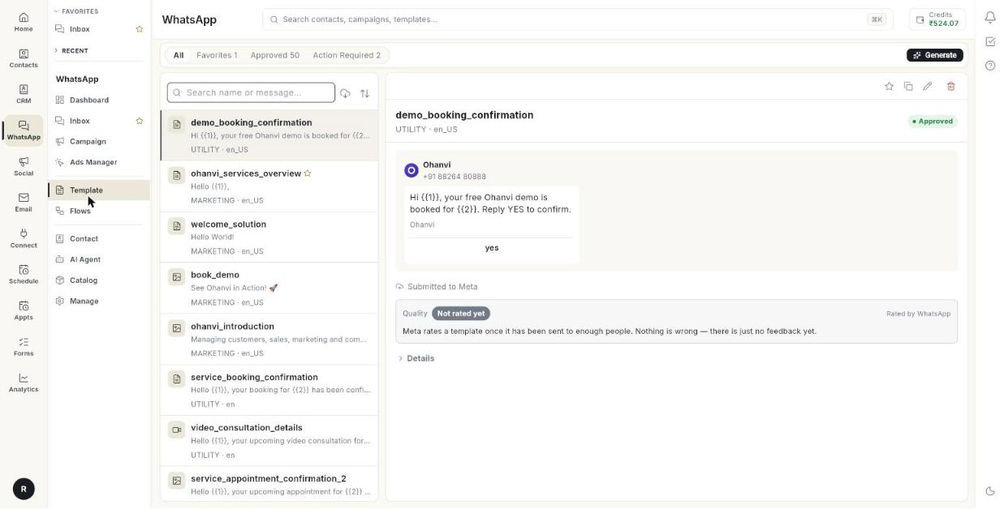

# टेम्प्लेट { #template }

WhatsApp पर बिज़नेस सिर्फ़ ऐसे टेम्प्लेट से चैट शुरू कर सकता है जिसे Meta ने अप्रूव किया हो। यहाँ आप ये टेम्प्लेट बनाते हैं, सबमिट करते हैं और संभालते हैं।

**इसे कहाँ खोलें:** लेफ़्ट रेल में **WhatsApp** खोलें, फिर **Template** चुनें।

## गाइड { #guides }

| गाइड | कब इस्तेमाल करें |
| --- | --- |
| [मैसेज टेम्प्लेट बनाएँ](../create-message-template.md) | आप नया टेम्प्लेट लिखकर Meta को भेजना चाहते हैं। |
| [टेम्प्लेट लाइब्रेरी का इस्तेमाल करें](../use-template-library.md) | आप बने-बनाए टेम्प्लेट से शुरू करना चाहते हैं। |

## शुरू करने से पहले { #before-you-start }

- आपका WhatsApp नंबर Ohanvi से कनेक्ट होना चाहिए। देखें [अपना WhatsApp नंबर कनेक्ट करें](../connect-whatsapp-number.md)।
- आपके रोल को इस स्क्रीन का एक्सेस होना चाहिए। स्क्रीन न दिखे तो अपने एडमिन से पूछें।
