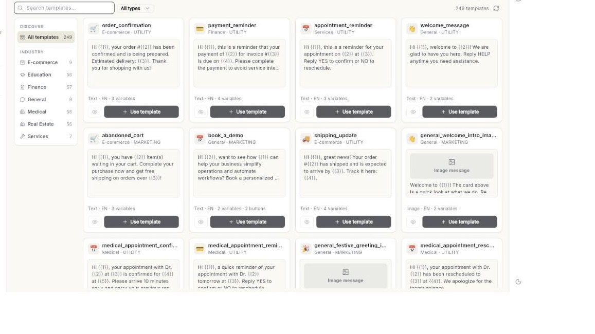

# टेम्प्लेट लाइब्रेरी का इस्तेमाल करें { #use-the-template-library }

लाइब्रेरी से बना-बनाया व्हाट्सऐप टेम्प्लेट चुनें, या मैसेज का वर्णन दें और AI से लिखवाएँ। आखिर में टेम्प्लेट आपके अकाउंट में सेव हो जाता है और Meta को भेज दिया जाता है। इसमें करीब 5 मिनट लगते हैं। Meta आमतौर पर कुछ मिनटों में फ़ैसला कर देता है।

## शुरू करने से पहले { #before-you-start }

- आपका व्हाट्सऐप नंबर Ohanvi से कनेक्ट है। देखें [अपना व्हाट्सऐप नंबर कनेक्ट करें](connect-whatsapp-number.md)।
- आपको **WhatsApp** पैनल में **Template** दिखता है। न दिखे तो अपने एडमिन से अपने रोल को टेम्प्लेट एक्सेस देने को कहें। देखें [रोल और अनुमतियाँ](../settings/roles-and-permissions.md)।
- आपका रोल टेम्प्लेट बना सकता है। इसके बिना आप ब्राउज़ और प्रीव्यू कर सकते हैं, लेकिन टेम्प्लेट इस्तेमाल नहीं कर सकते या AI से लिखवा नहीं सकते।
- आपको पता है कि आपका मैसेज किस श्रेणी का है। देखें [व्हाट्सऐप मैसेज टेम्प्लेट बनाएँ](create-message-template.md)।

## लाइब्रेरी में क्या है { #what-the-library-holds }

**Template Library** में इंडस्ट्री के हिसाब से समूहों में बने-बनाए टेम्प्लेट हैं। हर कार्ड इंडस्ट्री, मैसेज का प्रकार (**Image message**, **Video message**, **Document message** या टेक्स्ट), और दो बटन दिखाता है: **Preview** और **Use template**।

आप जो टेम्प्लेट इस्तेमाल करते हैं, वह आपके अकाउंट में कॉपी हो जाता है। भेजने से पहले आप उसे बदल सकते हैं। लाइब्रेरी का अपना टेम्प्लेट नहीं बदलता।

## चरण { #steps }

### लाइब्रेरी खोलें { #open-the-library }

1. लेफ़्ट रेल में **WhatsApp** खोलें, फिर **Template** चुनें। **Templates** पेज खुलता है।
2. **Browse Library** पर क्लिक करें। **Template Library** पेज खुलता है।

    

3. अपने टेम्प्लेट पर लौटने के लिए पेज के ऊपर बाईं ओर का बैक तीर इस्तेमाल करें।

!!! tip "सुझाव: अंदर आने के और तरीके"
    **New template** के बगल के तीर पर क्लिक करें और **Start from the library…** चुनें। आप **Generate** पर भी क्लिक कर सकते हैं। दोनों वही **Template Library** पेज खोलते हैं।

!!! note "ध्यान दें: कोई Explore टैब नहीं"
    **Templates** पेज पर **Explore** टैब नहीं दिखता। इसके बजाय **Browse Library** इस्तेमाल करें। [VERIFY: an Explore tab is not shown on the Templates page]

### टेम्प्लेट खोजें { #find-a-template }

1. चौड़ी स्क्रीन पर बाईं ओर का **DISCOVER** पैनल देखें। सब कुछ देखने के लिए **All templates** पर क्लिक करें।
2. **INDUSTRY** के नीचे किसी इंडस्ट्री पर क्लिक करें। हर इंडस्ट्री दिखाती है कि उसमें कितने टेम्प्लेट हैं।
3. संकरी स्क्रीन पर इंडस्ट्री की जगह सूची के ऊपर की पट्टी में फ़िल्टर के रूप में दिखती हैं।
4. नाम, इस्तेमाल या इंडस्ट्री से खोजने के लिए **Search templates…** में लिखें।
5. भाषा की सूची से भाषा चुनें। सूची में सबसे पहले **All languages** दिखता है। यह तभी दिखती है जब लाइब्रेरी में 1 से ज़्यादा भाषाएँ हों।
6. मैसेज का प्रकार चुनें: **All types**, **Text**, **Image**, **Video** या **Document**।
7. सूची के बगल की गिनती पढ़ें, जैसे "12 templates"।
8. सूची दोबारा लोड करने के लिए **Refresh** पर क्लिक करें।

### टेम्प्लेट का प्रीव्यू देखें { #preview-a-template }

1. कार्ड पर **Preview** पर क्लिक करें। फ़ोन जैसा प्रीव्यू खुलता है।
2. हेडर, बॉडी, फ़ुटर और बटन जाँचें।
3. सूची पर लौटने के लिए बंद करने वाले आइकन पर क्लिक करें।

### लाइब्रेरी का टेम्प्लेट इस्तेमाल करें { #use-a-library-template }

1. कार्ड पर **Use template** पर क्लिक करें। **Customize Template** फ़ॉर्म खुलता है, जिसमें फ़ील्ड पहले से भरी होती हैं।
2. अलग नाम चाहिए तो **Template name** बदलें। सिर्फ़ छोटे अक्षर, अंक और अंडरस्कोर इस्तेमाल करें।
3. **Template Category** और **Template Language** जाँचें।
4. ज़रूरत के हिसाब से हेडर, बॉडी, फ़ुटर और बटन एडिट करें। फ़ॉर्म नए टेम्प्लेट वाले फ़ॉर्म की तरह काम करता है। देखें [व्हाट्सऐप मैसेज टेम्प्लेट बनाएँ](create-message-template.md)।
5. हर वेरिएबल का **Example** जाँचें। असली जैसे दिखने वाले मान दें।
6. **Save & Submit for Approval** पर क्लिक करें। **Template saved. Awaiting WhatsApp approval.** संदेश दिखता है।
7. **Template** खोलें। Meta के फ़ैसले तक टेम्प्लेट **In review** दिखाता है।

### AI से टेम्प्लेट लिखवाएँ { #write-a-template-with-ai }

1. **Template Library** पेज पर सबसे ऊपर के बॉक्स पर क्लिक करें। उसमें **Describe a template — "tell customers their order has shipped"** लिखा है।
2. लिखें कि मैसेज को क्या करना है। या **TRY THESE** के नीचे कोई आइडिया चुनें।
3. वैकल्पिक: पहले कोई इंडस्ट्री चुनें। AI उसी इंडस्ट्री के लिए लिखता है।
4. वैकल्पिक: माइक्रोफ़ोन आइकन **Describe the template out loud** पर क्लिक करें और बोलकर अपना वर्णन दें।
5. **Generate** पर क्लिक करें। ड्राफ़्ट बनते समय बॉक्स में **Writing…** दिखता है। ड्राफ़्ट में वेरिएबल और सैंपल शामिल होते हैं।
6. **Review AI Draft** फ़ॉर्म पढ़ें। शब्द, श्रेणी, वेरिएबल और उदाहरण जाँचें।
7. जो गलत हो उसे बदलें।
8. **Save & Submit for Approval** पर क्लिक करें। एक संदेश बताता है कि टेम्प्लेट आपके टेम्प्लेट में जोड़ दिया गया है, और **Templates** पेज खुलता है।

!!! warning "चेतावनी: हर AI ड्राफ़्ट जाँचें"
    AI तथ्य और ऑफ़र गलत लिख सकता है। आपके टेम्प्लेट में जो लिखा है, उसकी ज़िम्मेदारी आपकी है। Meta फिर भी इसे रिजेक्ट कर सकता है।

टेम्प्लेट फ़ॉर्म के अंदर, फ़ॉर्म हेडर में बंद करने वाले बटन के बगल में एक AI बटन होता है। इसका नाम फ़ॉर्म के हिसाब से बदलता है: **Generate with AI**, **Fix template name** या **Improve wording**।

### टैब से अपने टेम्प्लेट फ़िल्टर करें { #filter-your-templates-by-tab }

1. **WhatsApp** → **Template** खोलें।
2. कोई टैब चुनें: **All**, **Favorites**, **Pending**, **Approved** या **Action Required**।
3. टैब के नाम के बगल की संख्या पढ़ें। यह उस टैब के टेम्प्लेट गिनती है।
4. हर टेम्प्लेट फिर से देखने के लिए **All** पर क्लिक करें।

जिस टैब में कोई टेम्प्लेट नहीं होता, वह छिप जाता है। **All** और आपका खोला हुआ टैब हमेशा रहते हैं। **Action Required** में वे सभी टेम्प्लेट रहते हैं जिन्हें आपको ठीक करना है। देखें [व्हाट्सऐप मैसेज टेम्प्लेट बनाएँ](create-message-template.md)।

### पसंदीदा टेम्प्लेट पिन करें { #pin-a-favorite-template }

1. **Templates** पेज पर टेम्प्लेट खोजें।
2. **Add to favorites** पर क्लिक करें।
3. अपने पिन किए टेम्प्लेट देखने के लिए **Favorites** टैब पर क्लिक करें।
4. किसी टेम्प्लेट को अनपिन करने के लिए **Remove from favorites** पर क्लिक करें।

अगर तारा नहीं बदलता, तो **Could not update favorite.** संदेश दिखता है। दोबारा कोशिश करें।

## समस्या का समाधान { #troubleshooting }

| समस्या | कारण | समाधान |
| --- | --- | --- |
| **No library templates found** | आपकी खोज, भाषा, प्रकार या इंडस्ट्री के फ़िल्टर से कुछ मेल नहीं खाता। | कोई दूसरा खोज शब्द या इंडस्ट्री आज़माएँ। **All types** और **All languages** चुनें। |
| **Could not load the template library** | लाइब्रेरी लोड नहीं हुई। | **Refresh** पर क्लिक करें। फिर भी फ़ेल हो तो पेज रीलोड करें और दोबारा कोशिश करें। |
| AI से लिखने का बॉक्स नहीं दिख रहा, या **Use template** काम नहीं करता। | आपका रोल टेम्प्लेट नहीं बना सकता। | अपने एडमिन से टेम्प्लेट एक्सेस माँगें। देखें [रोल और अनुमतियाँ](../settings/roles-and-permissions.md)। |
| **Describe the template you want first.** | आपने खाली बॉक्स के साथ **Generate** पर क्लिक किया। | वर्णन लिखें, फिर **Generate** पर क्लिक करें। |
| **Could not generate a template.** | ड्राफ़्ट वापस नहीं आया। | **Generate** पर दोबारा क्लिक करें। वर्णन को और साफ़ और ख़ास बनाएँ। |
| **Pending** जैसा कोई टैब नहीं दिख रहा। | जिस टैब में कोई टेम्प्लेट नहीं होता, वह छिप जाता है। | कुछ ठीक करने की ज़रूरत नहीं। टैब में टेम्प्लेट आते ही वह लौट आता है। |
| भेजने के बाद टेम्प्लेट **Rejected** दिखता है। | Meta ने शब्द या लेआउट नामंज़ूर कर दिया। | [व्हाट्सऐप मैसेज टेम्प्लेट बनाएँ](create-message-template.md) में **Fix a rejected template** देखें। |

## संबंधित गाइड { #related }

- [व्हाट्सऐप मैसेज टेम्प्लेट बनाएँ](create-message-template.md)
- [ब्रॉडकास्ट कैंपेन भेजें](send-broadcast-campaign.md)
- [कैंपेन रिपोर्ट पढ़ें](read-campaign-report.md)
- [तैयार संदेश बनाएँ](create-canned-messages.md)
