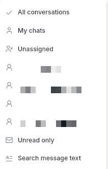
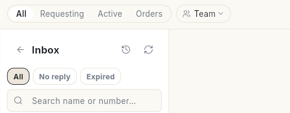
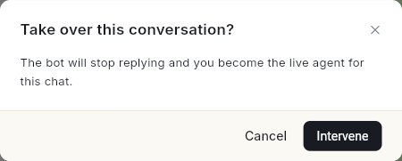
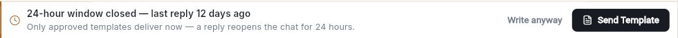
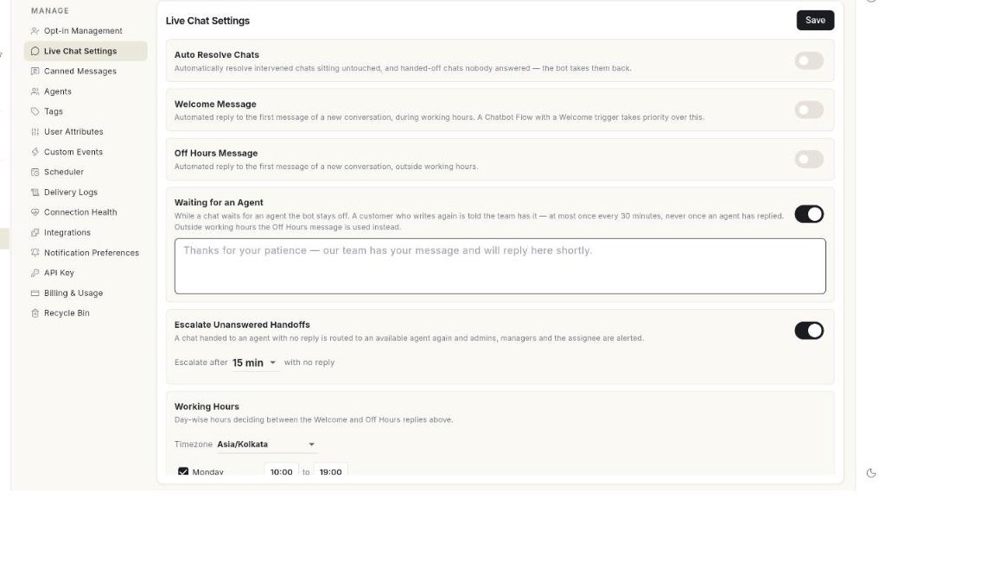

# WhatsApp इनबॉक्स इस्तेमाल करें { #use-the-whatsapp-inbox }

अपने ग्राहकों के WhatsApp मैसेज का जवाब पूरी टीम मिलकर दें। इस पेज के अंत तक आप सीख जाएँगे कि इंतज़ार कर रही चैट कैसे उठानी है। 24 घंटे की विंडो में या टेम्प्लेट से जवाब कैसे देना है। चैट किसी साथी को कैसे सौंपनी है। और काम पूरा होने पर चैट वापस बॉट को कैसे देनी है।

## शुरू करने से पहले { #before-you-start }

- आपका WhatsApp नंबर कनेक्ट होना चाहिए। देखें [अपना WhatsApp नंबर कनेक्ट करें](connect-whatsapp-number.md)।
- **WhatsApp** पैनल में आपको **Inbox** दिखना चाहिए। WhatsApp executive रोल वाले एजेंट को सिर्फ़ **Inbox** दिखता है। कुछ भी न दिखे तो अपने एडमिन से पूछें। देखें [टीम के मेंबर, रोल और अनुमतियाँ मैनेज करें](../settings/roles-and-permissions.md)।
- चैट असाइन करने के लिए आप एडमिन या मैनेजर होने चाहिए। Executive चैट असाइन नहीं कर सकते।

## स्टेप्स { #steps }

### बातचीत ढूँढें { #find-a-conversation }

1. लेफ़्ट रेल में **WhatsApp** खोलें, फिर **Inbox** चुनें।
2. लिस्ट के ऊपर **Team** पर क्लिक करें और **All conversations**, **My chats** या **Unassigned** चुनें। मैनेजर और एडमिन को हर साथी का नाम और रोल भी दिखता है। वे उस साथी का इनबॉक्स खोल सकते हैं।

    

3. लिस्ट के ऊपर के टैब इस्तेमाल करें:

    | टैब | क्या दिखाता है |
    | --- | --- |
    | **All** | सारी बातचीत, सबसे नई ऊपर। इसमें वे ब्रॉडकास्ट भी आते हैं जिनके जवाब का इंतज़ार है, और बंद हो चुकी चैट भी। |
    | **Requesting** | ग्राहक ने जवाब दिया है, पर अभी कोई उसे देख नहीं रहा। इन चैट को किसी इंसान का इंतज़ार है। |
    | **Active** | चैट को बॉट संभाल रहा है, या किसी एजेंट ने उसे अपने हाथ में ले लिया है। हाथ में ली गई चैट पर **Intervened by** और एक नाम दिखता है। |
    | **Orders** | स्टोर से जुड़ी चैट, जैसे ऑर्डर दिया गया, शिप हुआ या कैंसिल हुआ, या कार्ट छोड़ दी गई। यह टैब तभी दिखता है जब स्टोर कनेक्ट हो। |

    

4. लिस्ट छोटी करने के लिए **Inbox** के नीचे **All**, **No reply** या **Expired** चुनें। या **Search name or number…** में टाइप करें। या **Team** मेन्यू में **Unread only** या **Search message text** चुनें।
5. किसी बातचीत पर क्लिक करें। चैट दाईं ओर खुलेगी।

लेआउट बदलने के लिए **List** या **Board** चुनें। पुरानी चैट ढूँढने के लिए **Chat history** खोलें।

### बॉट से चैट अपने हाथ में लें { #take-over-a-chat-from-the-bot }

1. **Requesting** में कोई चैट खोलें। उसमें लिखा दिखेगा **This chat is waiting for a human. Click Intervene to take over and reply.**
2. चैट के ऊपर दाईं ओर **Intervene** पर क्लिक करें। **Take over this conversation?** दिखेगा। इसका मतलब है कि बॉट जवाब देना बंद कर देगा और आप लाइव एजेंट बन जाएँगे। पक्का करने के लिए फिर से **Intervene** पर क्लिक करें, या रुकने के लिए **Cancel** पर।

    

3. बॉट इस चैट में जवाब देना बंद कर देता है। अब आप लाइव एजेंट हैं।

**Active** चैट में जवाब टाइप करने से भी चैट आपके हाथ में आ जाती है। जब तक कोई उसे पूरा न करे, वह आपके पास रहती है।

### 24 घंटे की विंडो में जवाब दें { #reply-inside-the-24-hour-window }

ग्राहक का आख़िरी मैसेज आने के बाद 24 घंटे तक WhatsApp आपको साधारण टेक्स्ट मैसेज भेजने देता है। बचा हुआ समय चैट के हेडर में दिखता है। आख़िरी एक घंटे में वह एम्बर रंग का हो जाता है। ग्राहक का हर नया मैसेज समय को फिर से 24 घंटे कर देता है।

1. नीचे कंपोज़र में अपना जवाब लिखें।
2. कुछ और जोड़ना हो, तो **Add to this message** पर क्लिक करें और **Document**, **Photo or video**, **Template**, **Emoji**, **Bold**, **Italic** या **Schedule this reply** चुनें।
3. Enter दबाएँ या **Send Reply** पर क्लिक करें।

### जानें कि जवाब किस नंबर से जाता है { #know-which-number-you-reply-from }

अगर आपके पास कई WhatsApp नंबर हैं, तो हर जवाब उसी नंबर से जाता है जिस पर ग्राहक ने आख़िरी बार मैसेज किया था। नंबर आप नहीं चुनते। WhatsApp की 24 घंटे की विंडो एक ग्राहक और आपके एक नंबर के बीच होती है। इसलिए किसी दूसरे नंबर से भेजा जवाब WhatsApp मंज़ूर नहीं करेगा।

1. चैट का हेडर देखें। उसमें लिखा होता है कि ग्राहक ने किस नंबर पर मैसेज किया।
2. हर मैसेज के नीचे छोटा अक्षर वाला बैज देखें। वह बताता है कि मैसेज किस नंबर पर आया या किस नंबर से गया। लेबल और फ़ोन नंबर पढ़ने के लिए उस पर माउस ले जाएँ, जैसे `Sales · +91 98100 45210`।
3. कंपोज़र के ऊपर देखें। वहाँ **Replying from** लिखा होता है, फिर बैज, लेबल और नंबर।

    <!-- SCREENSHOT TODO: add the image, then restore this line:  -->

इनबॉक्स के ऊपर आपके सारे नंबर उनके बैज के साथ दिखते हैं। `?` वाला धूसर बैज ऐसे नंबर का है जो Ohanvi में कनेक्ट नहीं है।

ग्राहक ने ऐसे नंबर पर मैसेज किया हो जो कनेक्ट नहीं है, तो कंपोज़र बंद हो जाता है। उसमें लिखा होता है **This customer wrote to a number that isn't connected**। **Connect** पर क्लिक करें, **Label** लिखें और फिर **Connect** पर क्लिक करें। इसके बाद जवाब दें। देखें [कई WhatsApp नंबर चलाएँ](run-multiple-whatsapp-numbers.md)।

### 24 घंटे की विंडो बंद होने के बाद जवाब दें { #reply-after-the-24-hour-window-closes }

विंडो बंद होने पर कंपोज़र में **24-hour window closed** दिखता है। साथ में यह भी दिखता है कि ग्राहक ने आख़िरी बार कितनी देर पहले जवाब दिया था। और यह लाइन भी: **Only approved templates deliver now — a reply reopens the chat for 24 hours.**

1. **Send Template** पर क्लिक करें। टेम्प्लेट की लिस्ट खुलेगी।
2. **Search templates…** में खोजें और कोई Approved टेम्प्लेट चुनें।
3. **Variables** के नीचे हर फ़ील्ड भरें, फिर **Send** पर क्लिक करें। **Template sent.** मैसेज दिखेगा।

**Write anyway** पर क्लिक करने से कंपोज़र खुल जाता है। पर विंडो के बाहर WhatsApp साधारण टेक्स्ट डिलीवर नहीं करता। टेम्प्लेट भेजने से चैट आपके हाथ में नहीं आती। इसलिए टेम्प्लेट से शुरू हुआ फ़्लो फिर भी चल सकता है।

### क्विक रिप्लाई इस्तेमाल करें { #use-quick-replies }

1. कंपोज़र में **/** टाइप करें, फिर शॉर्टकट के कुछ अक्षर। **Canned messages** की लिस्ट खुलेगी।
2. कोई जवाब चुनें। वह कंपोज़र में आ जाएगा। लिस्ट को **All**, **Starred**, **Text**, **Image**, **Video** या **Doc** से छाँट सकते हैं।
3. किसी जवाब को स्टार कर दें, ताकि बाद में वह जल्दी मिल जाए।

क्विक रिप्लाई बनाने के लिए **WhatsApp** → **Manage** → **Canned Messages** खोलें, फिर **New quick reply** पर क्लिक करें। **New Canned Message** खुलेगा। उसमें **Shortcut** और **Message** लिखें, **Type** चुनें (**Text**, **Image**, **Video** या **Document**), फिर **Create** पर क्लिक करें। मैसेज को पर्सनल बनाने के लिए **Insert variable** के नीचे किसी चिप पर क्लिक करें, जैसे `{{name}}` या `{{agent}}`। पिकर में इसे सबसे पहले दिखाना हो, तो **Star this reply** चालू करें।

AI से ड्राफ़्ट लिखवाने के लिए **Help me write** पर क्लिक करें। अपना लिखा ड्राफ़्ट दोबारा लिखवाना हो, तो **Rephrase with AI** पर क्लिक करें।

### चैट किसी साथी को सौंपें { #assign-a-chat-to-a-teammate }

1. चैट के हेडर में ओनर चिप पर क्लिक करें। उस पर **Intervene**, **You** या ओनर का नाम दिखता है।
2. **Search teammate or team** में टाइप करें, फिर किसी व्यक्ति को चुनें।

आप लिस्ट में किसी बातचीत पर राइट-क्लिक करके **Assign to teammate** भी चुन सकते हैं। **Assign conversation** में किसी व्यक्ति को चुनें, या **Unassign** पर क्लिक करें। चैट सिर्फ़ उन एजेंट के पास जाती है जिनके चैट नियम उससे मेल खाते हैं। देखें [WhatsApp एजेंट जोड़ें](add-whatsapp-agents.md)।

### नोट्स और टैग जोड़ें { #add-notes-and-tags }

1. चैट के ऊपर कॉन्टैक्ट के नाम पर क्लिक करें। प्रोफ़ाइल पैनल खुलेगा।
2. **Tags** के नीचे **Add a tag…** में टाइप करें और Enter दबाएँ।
3. **Notes** पर क्लिक करके उसे खोलें, **Add a note…** में टाइप करें, फिर **Add note** पर क्लिक करें। नोट्स सिर्फ़ आपकी टीम देख सकती है।

    

प्रोफ़ाइल में **WA conversation** की हालत भी दिखती है (**Open — free replies deliver** या **Closed — template only**)। इसके अलावा ऑप्ट-इन, ऑर्डर, कैंपेन और **Custom attributes** भी दिखते हैं।

### चैट पूरी करें { #resolve-a-chat }

1. काम पूरा होने पर चैट के हेडर में ओनर चिप पर क्लिक करें।
2. **Done — hand back to the bot** पर क्लिक करें, या **E** दबाएँ। चैट वापस बॉट के पास चली जाएगी।

चैट को पूरा किए बिना वापस कतार में डालना हो, तो **Release this chat** पर क्लिक करें। किसी बातचीत पर राइट-क्लिक करने से ये विकल्प मिलते हैं: **Resolve — back to bot**, **Mark as read**, **Pin to top**, **Flag for follow-up** और **Close chat**।

### ऑटो-रिज़ॉल्व, वेलकम मैसेज और काम के घंटे सेट करें { #set-auto-resolve-welcome-messages-and-working-hours }

1. लेफ़्ट रेल में **WhatsApp** खोलें, फिर **Manage** चुनें।
2. **Live Chat Settings** चुनें।
3. जो सेटिंग चाहिए, उसे सेट करें:

    | सेटिंग | क्या करती है |
    | --- | --- |
    | **Auto Resolve Chats** | हाथ में ली गई ऐसी चैट अपने-आप पूरी कर देती है जिन पर कोई काम नहीं हुआ। साथ ही उन हैंड-ऑफ़ चैट को भी, जिनका किसी ने जवाब नहीं दिया। **Resolve after** में 1 से 72 घंटे चुनें, यानी इतने घंटे कोई हलचल न हो तो चैट पूरी हो जाएगी। डिफ़ॉल्ट 24 घंटे है। |
    | **Welcome Message** | काम के घंटों में नई बातचीत के पहले मैसेज का जवाब देता है। अगर किसी चैटबॉट फ़्लो में Welcome ट्रिगर लगा है, तो वही फ़्लो पहले चलता है। |
    | **Off Hours Message** | काम के घंटों के बाहर नई बातचीत के पहले मैसेज का जवाब देता है। |
    | **Waiting for an Agent** | दोबारा मैसेज करने वाले ग्राहक को बताता है कि उसकी चैट टीम के पास है। यह 30 मिनट में एक बार से ज़्यादा नहीं जाता। एजेंट के जवाब देने के बाद यह कभी नहीं जाता। |
    | **Escalate Unanswered Handoffs** | जिस हैंड-ऑफ़ चैट का जवाब नहीं आया, उसे किसी दूसरे उपलब्ध एजेंट को भेजता है। साथ ही एडमिन, मैनेजर और असाइन किए गए व्यक्ति को अलर्ट भेजता है। **Escalate after** में 5 से 60 मिनट चुनें। डिफ़ॉल्ट 15 मिनट है। |
    | **Working Hours** | **Timezone** चुनें और हर दिन के घंटे सेट करें। किसी दिन छुट्टी हो, तो उसे **Closed** कर दें। हर नंबर के घंटे अलग भी रखे जा सकते हैं। देखें [कई WhatsApp नंबर चलाएँ](run-multiple-whatsapp-numbers.md)। |

4. **Save** पर क्लिक करें। **Live chat settings saved.** मैसेज दिखेगा।

### इंतज़ार कर रहे ग्राहकों को बताएँ कि टीम के पास उनकी चैट है { #tell-waiting-customers-that-the-team-has-their-chat }

बॉट जब चैट किसी इंसान को सौंप देता है, तो चैट पूरी होने तक बॉट चुप रहता है। इस बीच ग्राहक दोबारा मैसेज करे, तो उसे क्या दिखे, यह इसी सेटिंग से तय होता है।

1. लेफ़्ट रेल में **WhatsApp** खोलें, फिर **Manage** चुनें।
2. **Live Chat Settings** चुनें।
3. **Waiting for an Agent** चालू करें। एक टेक्स्ट बॉक्स खुलेगा।

    

4. जवाब का मैसेज लिखें। बॉक्स में एक उदाहरण दिखता है: `Thanks for your patience — our team has your message and will reply here shortly.`
5. **Save** पर क्लिक करें। **Live chat settings saved.** मैसेज दिखेगा।

यह जवाब 30 मिनट में एक बार से ज़्यादा नहीं जाता। एजेंट के जवाब देने के बाद यह कभी नहीं जाता। काम के घंटों के बाहर इसकी जगह **Off Hours Message** जाता है।

### जिन चैट का कोई जवाब नहीं देता, उन्हें आगे भेजें { #escalate-chats-that-nobody-answers }

किसी एजेंट को चैट सौंपी गई और किसी ने जवाब नहीं दिया, तो Ohanvi उसे दूसरे एजेंट के पास भेज सकता है और आपकी टीम को अलर्ट कर सकता है।

1. **Live Chat Settings** में **Escalate Unanswered Handoffs** चालू करें। **Escalate after** लिस्ट खुलेगी।
2. **Escalate after** में 5, 10, 15, 30 या 60 min चुनें। डिफ़ॉल्ट 15 min है।
3. लाइन का आख़िरी हिस्सा पढ़ें, जिसमें **with no reply** लिखा है।
4. **Save** पर क्लिक करें। **Live chat settings saved.** मैसेज दिखेगा।

इसके बाद जिस हैंड-ऑफ़ चैट का जवाब नहीं आता, वह फिर से किसी उपलब्ध एजेंट के पास जाती है। एडमिन, मैनेजर और असाइन किए गए व्यक्ति को अलर्ट मिलता है।

!!! tip "सुझाव"
    यह सुविधा रोकनी हो, तो **Escalate Unanswered Handoffs** बंद करें और **Save** पर क्लिक करें। चैट उसी एजेंट के पास रहेंगी जिन्हें वे असाइन की गई थीं।

## वीडियो वॉकथ्रू { #video-walkthrough }

[VIDEO]

## समस्या और समाधान { #troubleshooting }

| समस्या | कारण | समाधान |
| --- | --- | --- |
| **This person has not messaged you in the last 24 hours, so WhatsApp only allows an approved template here — a normal message will not go through. Send a template instead.** | 24 घंटे की विंडो बंद है। | **Send Template** पर क्लिक करें और Approved टेम्प्लेट भेजें। |
| ऊपर वाला लाल मैसेज दिख रहा है, पर चैट के हेडर में समय बचा दिख रहा है। | ग्राहक ने ऐसे नंबर पर मैसेज किया है जो कनेक्ट नहीं है, इसलिए उस नंबर से जवाब नहीं जा सकता। | उस नंबर को कनेक्ट करें। देखें [जवाब में विंडो बंद लिखा आता है, पर चैट में समय बचा दिखता है](fix-24-hour-window-error.md)। |
| **This customer wrote to a number that isn't connected** | ग्राहक ने जिस नंबर पर मैसेज किया, वह Ohanvi में कनेक्ट नहीं है। | **Connect** पर क्लिक करें और नंबर को कोई नाम दें। |
| **No approved templates found.** | अभी आपके पास कोई Approved टेम्प्लेट नहीं है। | टेम्प्लेट बनाएँ और Meta की मंज़ूरी का इंतज़ार करें। देखें [WhatsApp का ओवरव्यू](index.md)। |
| **Requesting** चैट में टाइप नहीं हो रहा | ऐसी चैट को पहले साफ़ तौर पर अपने हाथ में लेना पड़ता है। | पहले **Intervene** पर क्लिक करें। |
| **No one to assign to yet — add agents under Manage → Team.** | अभी कोई एजेंट जुड़ा नहीं है। | एजेंट जोड़ें। देखें [WhatsApp एजेंट जोड़ें](add-whatsapp-agents.md)। |
| **Live updates paused** | लाइव कनेक्शन टूट गया। | थोड़ा रुकें। कनेक्शन वापस आते ही नए मैसेज दिखने लगेंगे। ज़रूरत हो तो **Refresh** पर क्लिक करें। |
| **This number cannot receive WhatsApp messages.** | नंबर WhatsApp पर नहीं है, गलत लिखा गया है, या उसने आपके बिज़नेस को ब्लॉक कर दिया है। | कॉन्टैक्ट में नंबर जाँचें। |

## संबंधित गाइड { #related }

- [कई WhatsApp नंबर चलाएँ](run-multiple-whatsapp-numbers.md)
- [WhatsApp एजेंट जोड़ें](add-whatsapp-agents.md)
- [WhatsApp AI एजेंट सेट करें](set-up-ai-agent.md)
- [WhatsApp कॉन्टैक्ट मैनेज करें](manage-whatsapp-contacts.md)
- [WhatsApp चैटबॉट फ़्लो बनाएँ](../create-whatsapp-flow.md)
