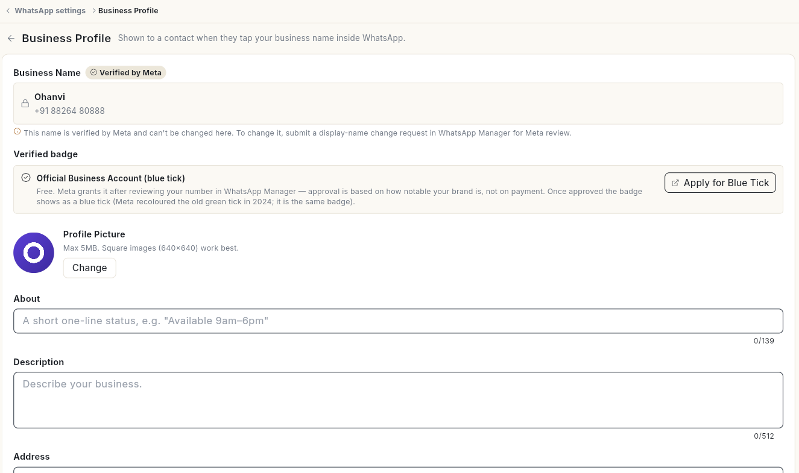
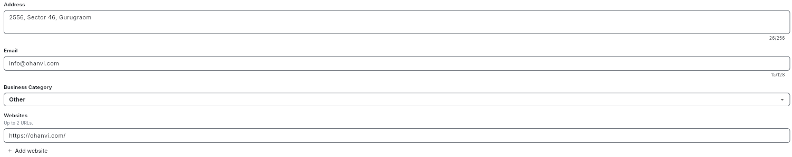
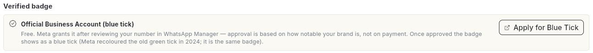
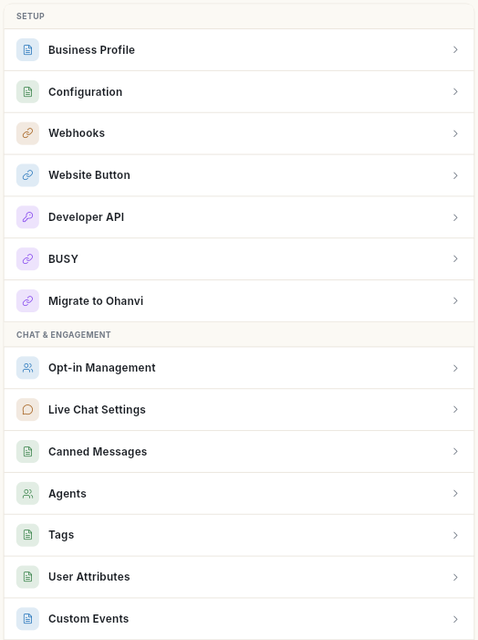
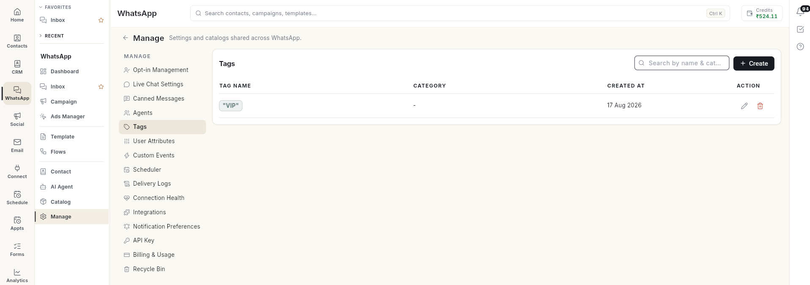

# अपनी WhatsApp बिज़नेस प्रोफ़ाइल सेट करें { #set-up-your-whatsapp-business-profile }

ग्राहक WhatsApp में आपके बिज़नेस के नाम पर टैप करते हैं, तो उन्हें आपकी प्रोफ़ाइल दिखती है। उसे यहाँ भरें। आख़िर में आपकी फ़ोटो, About लाइन, पता, ईमेल और वेबसाइट WhatsApp पर लाइव हो जाएँगी। साथ ही आपको पता चल जाएगा कि बाकी हर WhatsApp सेटिंग कहाँ मिलती है।

## शुरू करने से पहले { #before-you-start }

- आपका WhatsApp नंबर कनेक्ट होना चाहिए। देखें [अपना WhatsApp नंबर कनेक्ट करें](connect-whatsapp-number.md)।
- आपका रोल WhatsApp **Configuration** और **Business Profile** खोल सकता हो। ये एडमिन स्क्रीन हैं। देखें [टीम के मेंबर, रोल और अनुमतियाँ मैनेज करें](../settings/roles-and-permissions.md)।
- आपका लोगो चौकोर इमेज होना चाहिए। उसका साइज़ 5 MB या उससे कम हो, और बैकग्राउंड एक ही ठोस रंग का हो।

## स्टेप्स { #steps }

### बिज़नेस प्रोफ़ाइल खोलें { #open-the-business-profile }

1. नीचे बाएँ कोने में अपने नाम के पहले अक्षर पर क्लिक करें, फिर **Settings** पर क्लिक करें।
2. **WhatsApp** चुनें, फिर **Business Profile**। **Business Profile** स्क्रीन खुलेगी।

    

आप पहले से किसी WhatsApp सेटिंग स्क्रीन पर हों, तो बाईं ओर की **Settings** लिस्ट से भी **Business Profile** चुन सकते हैं।

### प्रोफ़ाइल फ़ोटो बदलें { #change-the-profile-picture }

1. **Profile Picture** के नीचे **Change** पर क्लिक करें।
2. कोई इमेज चुनें। 640×640 की चौकोर इमेज सबसे अच्छी रहती है।
3. **This image has a transparent background** दिखे, तो **Pick another** पर क्लिक करें और ठोस बैकग्राउंड वाली इमेज चुनें। WhatsApp पारदर्शी हिस्सों को काले रंग से भर देता है।
4. **Profile picture updated.** मैसेज दिखेगा।

### प्रोफ़ाइल की जानकारी बदलें { #edit-the-profile-details }

1. जो फ़ील्ड चाहिए, उन्हें भरें:

    | फ़ील्ड | क्या लिखें | लिमिट |
    | --- | --- | --- |
    | **About** | एक लाइन का छोटा स्टेटस, जैसे **Available 9am–6pm**। | 139 अक्षर |
    | **Description** | आपका बिज़नेस क्या करता है। | 512 अक्षर |
    | **Address** | आपके बिज़नेस का पता। | 256 अक्षर |
    | **Email** | वह ईमेल, जिस पर ग्राहक आपसे संपर्क कर सकें। | 128 अक्षर |
    | **Business Category** | वह कैटेगरी जो आपके बिज़नेस से सबसे ज़्यादा मेल खाती हो। | — |
    | **Websites** | हर लिंक के लिए **Add website** पर क्लिक करें। | ज़्यादा से ज़्यादा 2 URL |

    

2. ऊपर दाईं ओर **Save Changes** पर क्लिक करें। **Business profile saved.** मैसेज दिखेगा।

**Business Name** पर **Verified by Meta** लिखा होता है और इसे यहाँ बदला नहीं जा सकता। नाम बदलना हो, तो WhatsApp Manager में डिस्प्ले नेम बदलने की रिक्वेस्ट भेजें। Meta उसे जाँचेगा।

### ब्लू टिक के लिए अप्लाई करें { #apply-for-the-blue-tick }

1. **Verified badge** के नीचे **Official Business Account (blue tick)** वाला नोट पढ़ें।

    

2. **Apply for Blue Tick** पर क्लिक करें। Meta का WhatsApp Manager नए टैब में खुलेगा।
3. रिक्वेस्ट वहीं पूरी करें। बैज फ़्री है। Meta यह देखकर मंज़ूरी देता है कि आपका ब्रांड कितना जाना-माना है।

### बाकी WhatsApp सेटिंग्स ढूँढें { #find-other-whatsapp-settings }

WhatsApp की सेटिंग्स दो जगह बँटी हैं: **Settings** और **Manage** स्क्रीन।

**Settings** → **WhatsApp** में **Setup** के नीचे ये मिलता है:

| पंक्ति | इसमें क्या है |
| --- | --- |
| **Business Profile** | यही पेज। |
| **Configuration** | आपके कनेक्ट किए हुए नंबर। देखें [अपना WhatsApp नंबर कनेक्ट करें](connect-whatsapp-number.md)। |
| **Webhooks** | Meta के लिए Webhook URL और Verify Token, और आने वाले इवेंट। देखें [वेबहुक और इंटीग्रेशन](whatsapp-webhooks-and-integrations.md)। |
| **Website Button** | आपकी वेबसाइट पर लगाने के लिए WhatsApp चैट बटन। |
| **Developer API** | अपने सॉफ़्टवेयर से WhatsApp मैसेज भेजने की Key। देखें [वेबहुक और इंटीग्रेशन](whatsapp-webhooks-and-integrations.md)। |
| **BUSY** | BUSY अकाउंटिंग सॉफ़्टवेयर से इनवॉइस WhatsApp पर भेजता है। देखें [वेबहुक और इंटीग्रेशन](whatsapp-webhooks-and-integrations.md)। |
| **Migrate to Ohanvi** | किसी दूसरे WhatsApp प्रोवाइडर से Ohanvi पर आने के स्टेप। देखें [अपना नंबर Ohanvi पर लाएँ](migrate-to-ohanvi.md)। |

लेफ़्ट रेल में **WhatsApp** खोलें, फिर **Manage** चुनें। बाईं ओर की इसकी लिस्ट में ये मिलता है:

| आइटम | इसमें क्या है |
| --- | --- |
| **Opt-in Management** | ऑप्ट-आउट और ऑप्ट-इन के और शब्द, और कन्फ़र्मेशन के जवाब। देखें [WhatsApp कॉन्टैक्ट मैनेज करें](manage-whatsapp-contacts.md)। |
| **Live Chat Settings** | ऑटो-रिज़ॉल्व, वेलकम, ऑफ़-आवर्स और हैंडऑफ़ मैसेज, और काम के घंटे। देखें [WhatsApp इनबॉक्स इस्तेमाल करें](use-whatsapp-inbox.md)। |
| **Canned Messages** | सेव किए हुए जवाब, जिन्हें आपकी टीम इनबॉक्स में **/** टाइप करके डालती है। |
| **Agents** | आपकी WhatsApp टीम। देखें [WhatsApp एजेंट जोड़ें](add-whatsapp-agents.md)। |
| **Tags** | कॉन्टैक्ट के टैग की लिस्ट। **Create** पर क्लिक करें और **Tag Name** लिखें। |
| **User Attributes** | हर कॉन्टैक्ट पर सेव होने वाले कस्टम फ़ील्ड, जैसे **Text**, **Number**, **Date** या **Yes / No**। |
| **Custom Events** | ऐसे इवेंट जो आपके अपने सिस्टम API से भेजते हैं, ताकि फ़्लो शुरू हो जाएँ। |
| **Scheduler** | बाद में भेजने के लिए शेड्यूल किए गए मैसेज और जॉब। |
| **Delivery Logs** | भेजे गए हर मैसेज का डिलीवरी स्टेटस। |
| **Connection Health** | आपके नंबर का कनेक्शन ठीक चल रहा है या नहीं। |
| **Integrations** | वे सर्विस, जिनसे आपके ऑटोमेशन डेटा पढ़ते हैं और जिनमें डेटा लिखते हैं। |
| **Notification Preferences** | WhatsApp के किन इवेंट पर आपको नोटिफ़िकेशन मिले। |
| **API Key** | **Cloud API Access** खोलता है। यहाँ आप Ohanvi से सेटअप करवा सकते हैं, या अपना नंबर खुद Meta Cloud API से कनेक्ट कर सकते हैं। देखें [अपना WhatsApp नंबर कनेक्ट करें](connect-whatsapp-number.md)। |
| **Billing & Usage** | Meta के कन्वर्सेशन चार्ज। |
| **Recycle Bin** | आपके डिलीट किए हुए आइटम। उन्हें चुनें और **Restore selected** पर क्लिक करें। |

## वीडियो वॉकथ्रू { #video-walkthrough }

[VIDEO]

## समस्या और समाधान { #troubleshooting }

| समस्या | कारण | समाधान |
| --- | --- | --- |
| **That image is …MB. WhatsApp allows up to 5MB — please pick a smaller one.** | फ़ोटो 5 MB से बड़ी है। | इमेज छोटी करें या कंप्रेस करें, फिर **Change** पर दोबारा क्लिक करें। |
| WhatsApp में लोगो काले बैकग्राउंड पर दिखता है | इमेज का बैकग्राउंड पारदर्शी था। | ठोस बैकग्राउंड वाली इमेज अपलोड करें। |
| **Could not load business profile** | Ohanvi, WhatsApp से प्रोफ़ाइल पढ़ नहीं पाया। अक्सर ऐसा तब होता है जब कोई नंबर कनेक्ट न हो या टोकन की वैलिडिटी खत्म हो गई हो। | **Retry** पर क्लिक करें। फिर भी न चले, तो **Configuration** में अपना नंबर जाँचें। |
| **Business Name** बदला नहीं जा सकता | डिस्प्ले नेम को Meta वेरिफ़ाई करता है। | WhatsApp Manager में डिस्प्ले नेम बदलने की रिक्वेस्ट भेजें। |
| **Could not save the business profile.** | WhatsApp ने बदलाव मंज़ूर नहीं किया। | ऊपर बताई गई फ़ील्ड की लिमिट देखें और दोबारा कोशिश करें। |

## संबंधित गाइड { #related }

- [अपना WhatsApp नंबर कनेक्ट करें](connect-whatsapp-number.md)
- [अपना नंबर Ohanvi पर लाएँ](migrate-to-ohanvi.md)
- [सेटिंग्स खोलें और कोई सेटिंग ढूँढें](../settings/open-settings.md)

