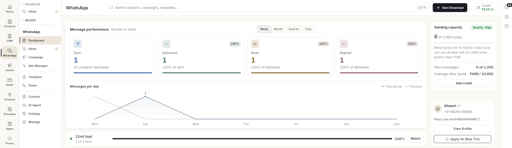
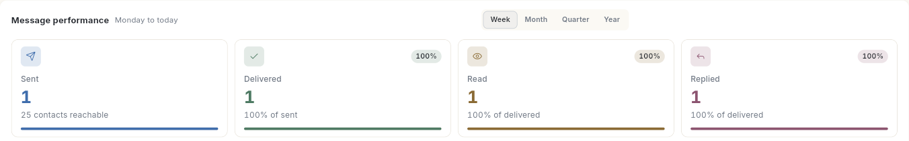
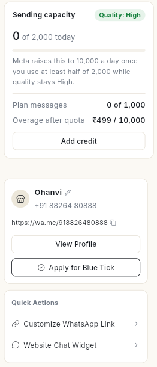
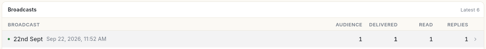
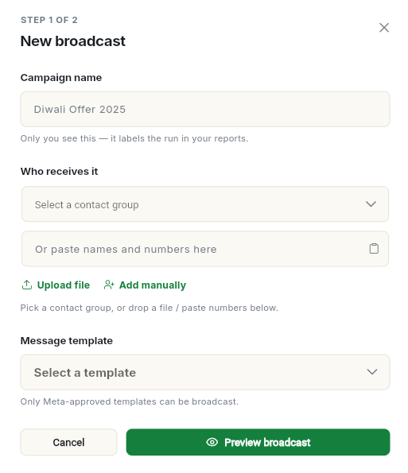

# WhatsApp डैशबोर्ड पढ़ें { #read-the-whatsapp-dashboard }

आपके मैसेज कैसा कर रहे हैं, यह एक नज़र में देखने के लिए WhatsApp **Dashboard** खोलें। इस पेज के आखिर तक आप भेजे, डिलीवर हुए, पढ़े गए और जवाब मिले मैसेज के नंबर पढ़ना सीख जाएँगे। आप रोज़ की भेजने की लिमिट और क्वालिटी रेटिंग भी देख पाएँगे। किसी भी नंबर के पीछे का ब्रॉडकास्ट या चैट भी खोल सकेंगे।

## शुरू करने से पहले { #before-you-start }

- आपका WhatsApp नंबर कनेक्ट होना चाहिए। जब तक वह कनेक्ट नहीं होता, **Dashboard** पर नंबर की जगह कनेक्ट करने के स्टेप दिखते हैं। देखें [अपना WhatsApp नंबर कनेक्ट करें](connect-whatsapp-number.md)।
- **WhatsApp** पैनल में आपको **Dashboard** दिखना चाहिए। न दिखे, तो अपने एडमिन से पूछें। देखें [टीम मेंबर, रोल और अनुमतियाँ मैनेज करें](../settings/roles-and-permissions.md)।

## स्टेप्स { #steps }

### डैशबोर्ड खोलें { #open-the-dashboard }

1. लेफ़्ट रेल में **WhatsApp** खोलें, फिर **Dashboard** चुनें।
2. डैशबोर्ड खुल जाता है। उसमें क्या दिखेगा, यह आपके रोल पर निर्भर करता है:

    | रोल | मुख्य सेक्शन |
    | --- | --- |
    | एडमिन या बिज़नेस ओनर | पूरे बिज़नेस का **Message performance**। |
    | मैनेजर | **Team throughput**, जिसमें **Sent today**, **Running now**, **Waiting for a reply** और **Failed today** हैं। इनबॉक्स में जाने के लिए **Open shared inbox** पर क्लिक करें। |
    | एग्ज़िक्यूटिव | **Your messages**, जिसमें **Inbox**, **Contacts**, **Chat history** और **Your WhatsApp link** के शॉर्टकट हैं। |

    

### अलर्ट पर ध्यान दें { #act-on-alerts }

जब किसी बात पर आपका ध्यान चाहिए, तो डैशबोर्ड के ऊपर एक बार दिखता है। बार के दाईं ओर का बटन दबाएँ:

| बार | बटन | क्या खुलता है |
| --- | --- | --- |
| **2 messages failed.** | **Review failures** | उस अवधि के **Failed messages**। हर मैसेज के साथ कॉन्टैक्ट, फ़ेल होने की वजह (जैसे **Media upload error**) और वह ब्रॉडकास्ट दिखता है जिससे वह आया था। सारे फ़ेल मैसेज उनके **Error code** और **Error message** के साथ देखने के लिए नीचे **Open Delivery Logs** पर क्लिक करें। |

### मैसेज का हाल पढ़ें { #read-message-performance }

1. अवधि चुनें: **Week**, **Month**, **Quarter** या **Year**। **Message performance** के पास लिखा टेक्स्ट बताता है कि कौन-सी तारीख़ें गिनी गई हैं। जैसे **Week** में **Monday to today** और **Month** में **This calendar month**।
2. ये 4 नंबर पढ़ें:

    | नंबर | मतलब |
    | --- | --- |
    | **Sent** | उस अवधि में भेजे गए मैसेज, और कितने कॉन्टैक्ट तक मैसेज पहुँच सकता है। |
    | **Delivered** | जो मैसेज फ़ोन तक पहुँचे। यह भेजे गए मैसेज का कितना हिस्सा है, वह भी दिखता है। |
    | **Read** | जो मैसेज ग्राहक ने खोले। यह डिलीवर हुए मैसेज का कितना हिस्सा है, वह भी दिखता है। |
    | **Replied** | जिन मैसेज का ग्राहक ने जवाब दिया। यह डिलीवर हुए मैसेज का कितना हिस्सा है, वह भी दिखता है। |

    

3. किसी भी नंबर पर क्लिक करें, तो उसके पीछे के मैसेज खुल जाते हैं। जैसे **Sent** पर क्लिक करने से उस अवधि के **Messages sent** खुलते हैं। हर मैसेज के साथ कॉन्टैक्ट, उसका स्टेटस (**Sent**, **Delivered**, **Read**, **Replied**) और वह ब्रॉडकास्ट दिखता है जिससे वह आया था। किसी मैसेज पर क्लिक करके उसे दाईं ओर पढ़ें।
4. नीचे का **Messages per day** चार्ट देखें। **This period** सीधी लाइन है और **Previous** टूटी-टूटी लाइन।

चार्ट के नीचे एक पट्टी में आपका सबसे नया ब्रॉडकास्ट दिखता है, और यह भी कि उसके कितने मैसेज जा चुके हैं, जैसे **1 of 1 sent**। पट्टी पर **Watch** पर क्लिक करें। एक साइड पैनल खुलेगा, जिसमें उसका स्टेटस (जैसे **Completed**), भेजे, डिलीवर हुए, पढ़े गए और फ़ेल हुए मैसेज की गिनती, और मैसेज पाने वालों की लिस्ट है।

### भेजने की लिमिट और क्वालिटी देखें { #check-sending-capacity-and-quality }

चौड़ी स्क्रीन पर दाईं ओर का पैनल आपके अकाउंट की जानकारी दिखाता है:

| आइटम | मतलब |
| --- | --- |
| **Sending capacity** | आज आप कितने लोगों को मैसेज कर सकते हैं। नंबर वेरिफ़ाई होने और मैसेज भेजना शुरू होने के बाद Meta यह लिमिट तय करता है। |
| क्वालिटी | **Quality: High**, **Quality: Medium**, **Quality: Low** या **Quality: Not rated yet**। आपके मैसेज पर ग्राहक कैसा रिस्पॉन्स देते हैं, उसे देखकर Meta यह रेटिंग देता है। |
| **Plan messages** | इस महीने आपके प्लान के कितने मैसेज इस्तेमाल हुए। प्लान से ऊपर भेजे मैसेज का चार्ज भी यहीं दिखता है। इसके नीचे **Add credit** बटन है। |
| बिज़नेस कार्ड | आपके बिज़नेस का नाम, WhatsApp नंबर और `wa.me` लिंक। साथ में **View Profile** और **Apply for Blue Tick**। |
| **Quick Actions** | **Customize WhatsApp Link** और **Website Chat Widget**। |
| **Setup Progress** | यह तब तक दिखता है जब तक **WhatsApp Business API Connected** और **Business Name Verified by Meta** दोनों पूरे नहीं हो जाते। उसके बाद छिप जाता है। |

आप रोज़ की लिमिट का कम से कम आधा इस्तेमाल कर लें और क्वालिटी **High** रहे, तो Meta आपकी लिमिट बढ़ा देता है। क्वालिटी Medium या Low रहने तक Meta लिमिट नहीं बढ़ाता।

### हाल के ब्रॉडकास्ट देखें { #check-recent-broadcasts }

1. **Broadcasts** तक स्क्रॉल करें। यहाँ आपके सबसे नए 6 ब्रॉडकास्ट **Audience**, **Delivered**, **Read** और **Replies** के साथ दिखते हैं।

    

2. **Campaign** में कैंपेन की पूरी लिस्ट खोलने के लिए नीचे **View all campaigns** पर क्लिक करें।
3. नया ब्रॉडकास्ट शुरू करने के लिए ऊपर **Start Broadcast** पर क्लिक करें। **New broadcast** डायलॉग खुलता है। देखें [ब्रॉडकास्ट कैंपेन भेजें](send-broadcast-campaign.md)।

    

## वीडियो वॉकथ्रू { #video-walkthrough }

[VIDEO]

## समस्या का समाधान { #troubleshooting }

| समस्या | कारण | समाधान |
| --- | --- | --- |
| **Dashboard** पर नंबरों की जगह **Connect WhatsApp** दिखता है | अभी कोई नंबर कनेक्ट नहीं है। | [अपना WhatsApp नंबर कनेक्ट करें](connect-whatsapp-number.md) में बताए स्टेप करें। |
| **Some WhatsApp data could not load** | कुछ डेटा लोड नहीं हो पाया। | पेज रीफ़्रेश करें। फिर भी यही दिखे, तो **Configuration** में अपना नंबर जाँचें। |
| **No broadcasts yet** | आपने अब तक कोई ब्रॉडकास्ट नहीं भेजा। | **Start Broadcast** पर क्लिक करें। |
| भेजने की लिमिट जस की तस रहती है | क्वालिटी Medium या Low है, या आपने लिमिट का आधा भी इस्तेमाल नहीं किया। | क्वालिटी सुधारें, और रोज़ लिमिट का कम से कम आधा इस्तेमाल करते रहें। |
| **Cloud storage is full.** | आपका मीडिया स्टोरेज भर गया है। | पुराना मीडिया डिलीट करें या अपना प्लान अपग्रेड करें। **Manage storage** पर क्लिक करें। |

## संबंधित गाइड { #related }

- [WhatsApp इनबॉक्स का इस्तेमाल करें](use-whatsapp-inbox.md)
- [अपना WhatsApp नंबर कनेक्ट करें](connect-whatsapp-number.md)
- [मार्केटिंग एनालिटिक्स पढ़ें](../analytics/read-marketing-analytics.md)
- [क्रेडिट और बिलिंग](../credits-and-billing.md)
