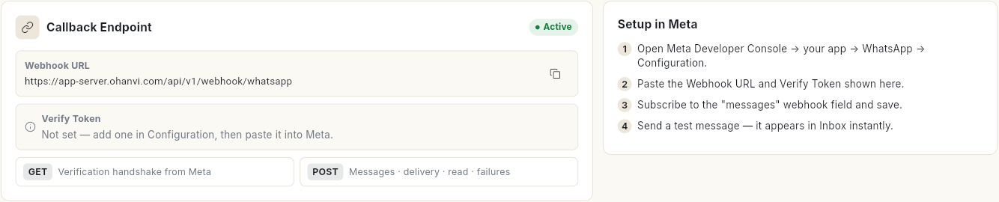
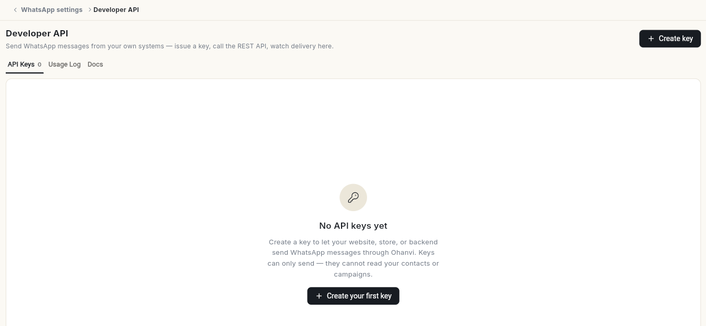
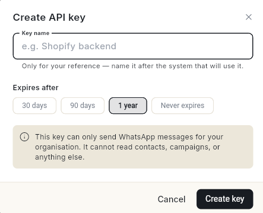
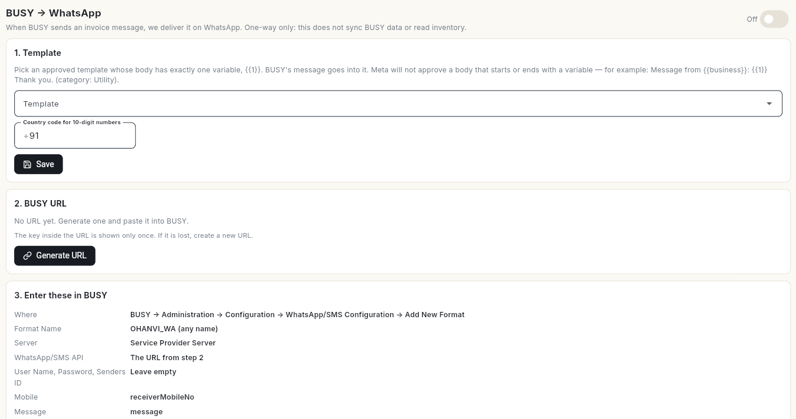

# व्हाट्सऐप वेबहुक और इंटीग्रेशन सेट करें { #set-up-whatsapp-webhooks-and-integrations }

वे 3 व्हाट्सऐप कनेक्शन सेट करें जो Ohanvi को दूसरे सिस्टम से जोड़ते हैं: Meta वेबहुक, Developer API और BUSY। अंत में डिलीवरी और मैसेज इवेंट Ohanvi में आने लगेंगे, आपका अपना सॉफ़्टवेयर व्हाट्सऐप मैसेज भेज सकेगा, और BUSY के इनवॉइस व्हाट्सऐप पर जाएँगे।

## शुरू करने से पहले { #before-you-start }

- आपका व्हाट्सऐप नंबर Ohanvi से कनेक्ट हो। देखें [अपना व्हाट्सऐप नंबर कनेक्ट करें](connect-whatsapp-number.md)।
- आप एडमिन हों, या आपके रोल को इन स्क्रीन का एक्सेस हो। देखें [रोल और अनुमतियाँ](../settings/roles-and-permissions.md)।
- BUSY के लिए: आपके पास ऐसा Approved टेम्प्लेट हो जिसकी बॉडी में ठीक 1 वेरिएबल, `{{1}}`, हो। देखें [व्हाट्सऐप मैसेज टेम्प्लेट बनाएँ](create-message-template.md)।

## ये स्क्रीन कहाँ मिलेंगी { #where-to-find-these-screens }

नीचे-बाएँ अपने नाम के पहले अक्षर पर क्लिक करें, फिर **Settings** पर। **WhatsApp** के नीचे **Webhooks** या **BUSY** चुनें। Developer API **Settings** → आपका नाम → **Developer** → **Developer APIs** में है।

आप कोई भी व्हाट्सऐप सेटअप स्क्रीन खोलकर ऊपर के टैब भी इस्तेमाल कर सकते हैं: **Configuration**, **Webhooks**, **Business Profile**, **Website Button**, **BUSY** और **Migrate to Ohanvi**। BUSY बाएँ रेल में **Connect** के नीचे **BUSY (Accounting)** के नाम से भी दिखता है।

| स्क्रीन | यह किसलिए है |
| --- | --- |
| **Webhooks** | Meta मैसेज और डिलीवरी इवेंट रियल टाइम में Ohanvi को भेजता है। इसके बिना कैंपेन में कभी **Delivered** या **Read** नहीं दिखता, और जवाब **Inbox** तक नहीं पहुँचते। |
| **Developer API** | आपकी वेबसाइट, स्टोर या बैकएंड को API key से Ohanvi के ज़रिए व्हाट्सऐप मैसेज भेजने देता है। |
| **BUSY** | BUSY अकाउंटिंग से इनवॉइस और पेमेंट मैसेज व्हाट्सऐप पर भेजता है। |

## चरण { #steps }

### Meta वेबहुक कनेक्ट करें { #connect-the-meta-webhook }

1. नीचे-बाएँ कोने में अपने नाम के पहले अक्षर पर क्लिक करें, **Settings** पर क्लिक करें, **WhatsApp** चुनें, फिर **Webhooks**। **Callback Endpoint** कार्ड आपका **Webhook URL** और **Verify Token** दिखाता है। उसके बगल का **Setup in Meta** कार्ड वही चरण सूचीबद्ध करता है।

    

2. अगर **Verify Token** में **Not set — add one in Configuration, then paste it into Meta.** दिखे, तो पहले **Configuration** में वेरिफ़ाई टोकन जोड़ें।
3. नए टैब में Meta Developer Console → आपका ऐप → **WhatsApp** → **Configuration** खोलें।
4. Ohanvi में **Webhook URL** के बगल में **Copy** पर क्लिक करें और उसे Meta में पेस्ट करें।
5. **Verify Token** के बगल में **Copy** पर क्लिक करें और उसे Meta में पेस्ट करें। सेव करें।
6. Meta में **messages** वेबहुक फ़ील्ड को सब्सक्राइब करें और सेव करें।
7. अपने नंबर पर एक टेस्ट मैसेज भेजें। वह तुरंत **Inbox** में दिखता है।
8. Ohanvi में वापस आकर **Webhook Events** के बगल के रीफ़्रेश आइकन पर क्लिक करें। इवेंट सूची में दिखता है। पहला इवेंट आने तक वहाँ **No events yet** लिखा रहता है।

### अपने सॉफ़्टवेयर से मैसेज भेजें (Developer API) { #send-messages-from-your-own-software-developer-api }

1. **Settings** में अपने नाम पर क्लिक करें, फिर **Developer** के नीचे **Developer APIs** खोलें। इसमें 3 टैब हैं: **API Keys**, **Usage Log** और **Docs**। अभी कोई key न हो तो **No API keys yet** और **Create your first key** दिखता है।

    

2. **Create key** पर क्लिक करें। **Create API key** विंडो खुलती है।
3. **Key name** लिखें, जैसे `Website checkout`।
4. **Expires after** चुनें: **30 days**, **90 days**, **1 year** या **Never expires**। शुरू में **1 year** चुना होता है।

    

5. **Create key** पर क्लिक करें। **Your API key — copy it now** खुलता है।
6. **Copy key** पर क्लिक करें और key को किसी सुरक्षित जगह रखें। **I have copied the key and stored it somewhere safe.** पर टिक करें और **Done** पर क्लिक करें।

!!! warning "key सिर्फ़ एक बार दिखती है"
    Ohanvi key को हैश करके रखता है, इसलिए उसे दोबारा नहीं दिखाया जा सकता। खो जाए तो उसे रद्द करके नई key बनाएँ।

यह key सिर्फ़ आपके संगठन के व्हाट्सऐप मैसेज भेज सकती है। यह संपर्क, कैंपेन या कुछ और नहीं पढ़ सकती। इससे भेजा गया हर मैसेज **Usage Log** में **Queued**, **Sent** या **Failed** के रूप में दिखता है, और बाकी मैसेज की तरह आपके क्रेडिट से कटता है।

अनुरोधों की जानकारी के लिए **Docs** टैब और [डेवलपर API से व्हाट्सऐप मैसेज भेजें](../settings/developer-apis.md) देखें।

किसी key को चलने से रोकने के लिए उस पर **Revoke** पर क्लिक करें, फिर **Revoke this key?** में **Revoke** पर।

### व्हाट्सऐप पर BUSY इनवॉइस भेजें { #send-busy-invoices-on-whatsapp }

BUSY → व्हाट्सऐप एकतरफ़ा है। जब BUSY इनवॉइस मैसेज भेजता है, तो Ohanvi उसे आपके टेम्प्लेट के ज़रिए व्हाट्सऐप पर पहुँचाता है। यह BUSY का डेटा सिंक नहीं करता और आपकी इन्वेंटरी नहीं पढ़ता।

1. **Settings** → **WhatsApp** में **BUSY** खोलें। ऊपर दाईं ओर के स्विच को **Off** से **On** करें।

    

2. **1. Template** में ऐसा Approved टेम्प्लेट चुनें जिसकी बॉडी में ठीक 1 वेरिएबल, `{{1}}`, हो। BUSY का मैसेज उसी में जाता है। टेम्प्लेट में मीडिया हेडर या डायनेमिक बटन नहीं हो सकते। **Utility** कैटेगरी में `Message from {{business}}: {{1}} Thank you.` जैसी बॉडी चलती है, जिसमें `{{business}}` की जगह आपके बिज़नेस का नाम हो।
3. **Country code for 10-digit numbers** सेट करें, जैसे `91`, और **Save** पर क्लिक करें।
4. **2. BUSY URL** में **Generate URL** पर क्लिक करें। **Your BUSY URL — copy it now** खुलता है।
5. **Copy URL** पर क्लिक करें। **I have pasted this URL into BUSY or stored it safely.** पर टिक करें और **Done** पर क्लिक करें।
6. BUSY में **Administration** → **Configuration** → **WhatsApp/SMS Configuration** → **Add New Format** पर जाएँ।
7. **3. Enter these in BUSY** की वैल्यू ठीक वैसी ही डालें जैसी दिखाई गई हैं:

    | BUSY फ़ील्ड | वैल्यू |
    | --- | --- |
    | **Format Name** | `OHANVI_WA` (कोई भी नाम) |
    | **Server** | **Service Provider Server** |
    | **WhatsApp/SMS API** | चरण 5 का URL |
    | **User Name, Password, Senders ID** | खाली छोड़ें |
    | **Mobile** | Ohanvi जो पैरामीटर नाम दिखाए, डिफ़ॉल्ट रूप से `receiverMobileNo` |
    | **Message** | Ohanvi जो पैरामीटर नाम दिखाए, डिफ़ॉल्ट रूप से `message` |
    | **No. of Other Parameters** | `0` |
    | **Treatment of Mobile Number** | जैसा है वैसा रहने दें |
    | **Upload PDF** | PDF सेट होने तक बंद रखें |

    पेमेंट की पुष्टि के लिए Receipt वाउचर के लिए **Send SMS after saving** भी चालू करें। थोक में पेमेंट रिमाइंडर के लिए **Separate Internet Call for Each Number During Bulk SMS** पर टिक करें। पैरामीटर के नाम में छोटे-बड़े अक्षर का फ़र्क पड़ता है।

8. **4. Test** में **Send a test to** में नंबर लिखें और **Send test** पर क्लिक करें। **Test message queued. Its status appears under Recent activity.** दिखता है।
9. BUSY से एक असली इनवॉइस भेजें। जाँचें कि वह **Recent activity** में दिखता है।

Ohanvi से किया गया टेस्ट सिर्फ़ Ohanvi की तरफ़ की जाँच करता है। BUSY सही सेट है, यह सिर्फ़ BUSY से असली भेजने पर ही साबित होता है।

!!! warning "BUSY URL वाला कोई भी आपके बिज़नेस के नाम से भेज सकता है"
    URL में एक गुप्त key होती है और वह सिर्फ़ एक बार दिखती है। अगर उसके लीक होने की आशंका हो, तो **Revoke URL** पर क्लिक करें। BUSY के मैसेज तुरंत मना हो जाते हैं।

URL बदलने के लिए **Create new URL** पर क्लिक करें, फिर **Create a new BUSY URL?** विंडो में दोबारा **Create new URL** पर। BUSY में नया URL आ जाने पर **Stop old URL now** इस्तेमाल करें। पुराना URL 24 घंटे तक चलता रहता है, इसलिए नया URL उसी समय में BUSY में पेस्ट कर दें।

#### वैकल्पिक: इनवॉइस PDF और स्टॉक { #optional-invoice-pdfs-and-stock }

- **Invoice PDF (optional)**: 1 `{{1}}` वेरिएबल वाला **PDF template (document header)** चुनें। इसे बंद रखें, **Upload PDF** चालू करके BUSY से 1 इनवॉइस भेजें, फिर **Recent activity** में देखें कि BUSY ने फ़ाइल कैसे भेजी। मेल खाता विकल्प चुनें और **Save PDF settings** पर क्लिक करें।
- **Stock from BUSY**: BUSY से लाइव स्टॉक नहीं माँगा जा सकता। BUSY से Stock Status रिपोर्ट Excel या CSV में एक्सपोर्ट करें और **Upload stock report** पर क्लिक करें। इसके बाद व्हाट्सऐप AI एजेंट "X कितना बचा है?" का जवाब आखिरी अपलोड के हिसाब से दे सकता है। देखें [AI एजेंट सेट करें](set-up-ai-agent.md)।

## वीडियो वॉकथ्रू { #video-walkthrough }

[VIDEO]

## समस्या का समाधान { #troubleshooting }

| समस्या | कारण | समाधान |
| --- | --- | --- |
| **Webhooks** पर **No events yet** | Meta में वेबहुक सेट नहीं है, या **messages** के लिए सब्सक्राइब नहीं है। | वेबहुक के चरण दोबारा करें और **messages** फ़ील्ड सब्सक्राइब करें। |
| कैंपेन **Sent** पर अटके रहते हैं और कभी **Delivered** नहीं दिखाते | डिलीवरी इवेंट Ohanvi तक नहीं पहुँच रहे। | जाँचें कि Meta में **Webhook URL** और **Verify Token** Ohanvi वाले से मेल खाते हैं। |
| API key खो गई | key सिर्फ़ एक बार दिखती है। | key रद्द करें और नई बनाएँ। |
| **No approved template qualifies yet. Create one under WhatsApp → Templates.** | किसी Approved टेम्प्लेट में ठीक 1 `{{1}}` वेरिएबल नहीं है। | एक बनाएँ, जैसे `Message from Sharma Traders: {{1}} Thank you.`, और **Approved** होने का इंतज़ार करें। |
| **Connect a WhatsApp number first (WhatsApp → Configuration).** | कोई व्हाट्सऐप नंबर कनेक्ट नहीं है। | अपना नंबर कनेक्ट करें, फिर **BUSY** दोबारा खोलें। |
| **BUSY has not called this URL yet.** | BUSY अभी यह URL इस्तेमाल नहीं कर रहा। | BUSY के WhatsApp/SMS Configuration की वैल्यू जाँचें, फिर BUSY से इनवॉइस भेजें। |

## संबंधित गाइड { #related }

- [डेवलपर API से व्हाट्सऐप मैसेज भेजें](../settings/developer-apis.md)
- [ब्रॉडकास्ट कैंपेन भेजें](send-broadcast-campaign.md)
- [व्हाट्सऐप मैसेज टेम्प्लेट बनाएँ](create-message-template.md)
- [सेटिंग्स](../settings/index.md)
